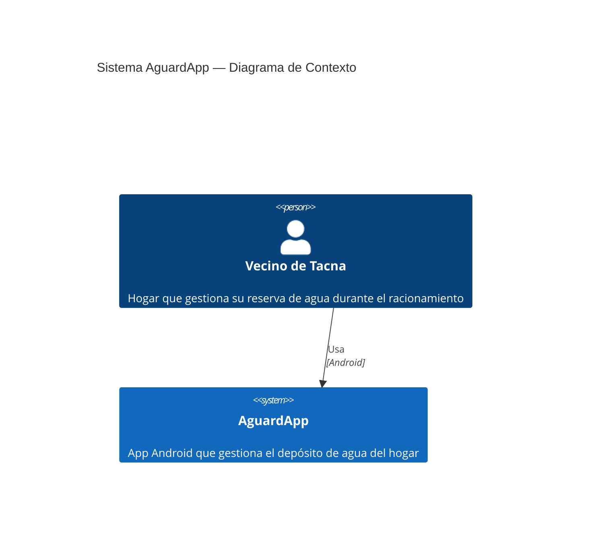
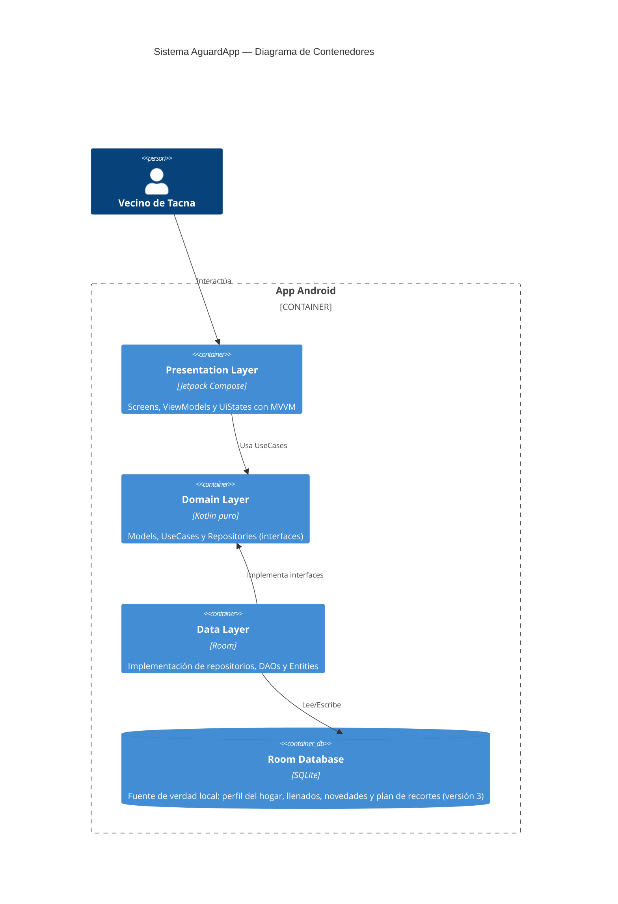
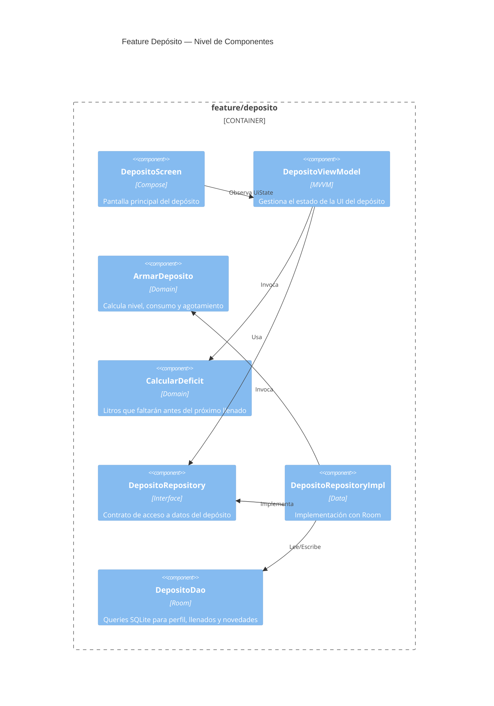
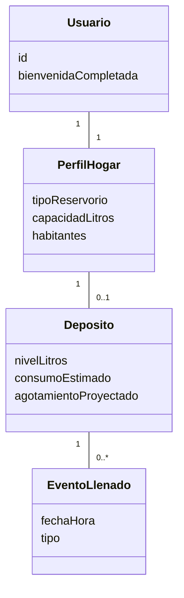

<p align="center">
  
</p>

<h1 align="center">💧 AguardApp</h1>

<p align="center">
  <em>Sistema móvil para la gestión de la reserva domiciliaria de agua y la anticipación de cortes durante el racionamiento hídrico en Tacna</em>
</p>

<p align="center">
  
  
  
  
  
</p>

<p align="center">
  
  
  
  
  
</p>

---

## 👥 Integrantes del Proyecto

| # | Integrante | Código | Rol |
|:-:|---|---|---|
| 🔵 | **Mamani Cori, Cristhian Carlos** | `2023077282` | Jefe de Proyecto · Core y Reserva |
| 🟢 | **Jahuira Pilco, Dayan Elvis** | `2022075749` | Sector y Mapas |
| 🟠 | **Sierra Ruiz, Iker Alberto** | `2023077090` | Recibo e IA · Líder de Pruebas |
| 🟣 | **Llica Mamani, Jimmy Mijair** | `2023076789` | Retos, Reportes y Despliegue |

> **Universidad Privada de Tacna** · Facultad de Ingeniería · Escuela Profesional de Ingeniería de Sistemas  
> **Curso:** Soluciones Móviles I · **Docente:** Mag. Alberto Johnatan Flor Rodríguez

---

## ❗ Problemática

La ciudad de **Tacna** se abastece de agua potable bajo un esquema de **racionamiento por sectores**, con servicio solo durante algunas horas al día. Los hogares enfrentan:

| Problema | Impacto |
|---|---|
| 🔴 **Sin información clara** de cuándo llega el agua a su sector | Desabastecimiento imprevisto |
| 🔴 **Sin control** sobre cuánta reserva queda en el hogar | Desperdicio del recurso |
| 🔴 **Información oficial dispersa** y poco confiable | Mala planificación del consumo |
| 🔴 **Compra de agua de emergencia** a sobreprecio | Gasto innecesario |


---

## ✅ Solución

**AguardApp** es una aplicación Android que permite a los hogares de Tacna:

| Funcionalidad | Descripción |
|---|---|
| 📊 **Gestionar el depósito** | Saber cuántos litros quedan y hasta cuándo alcanza |
| 💧 **Registrar llenados** | Un toque cuando llega el agua (completo o a la mitad) |
| 📉 **Aprender el consumo** | Ajusta la proyección cuando el agua se acaba antes de lo previsto |
| ✂️ **Qué recortar** | Sugerencias de ahorro cuando el agua no alcanza hasta el próximo llenado |
| 🗺️ **Mapa de cisternas** | Puntos de reparto de agua en Tacna sobre Google Maps, con su horario y estado, y la lista de los más cercanos a tu ubicación |
| 📶 **Sensor IoT del tanque** | Lee el nivel real del tanque (ESP32 + sensor ultrasónico, simulado en Wokwi) desde ThingSpeak y lo aplica como nivel actual |
| 🔔 **Avisos** | Alerta dentro de la app si el agua no alcanza, si queda menos del 20 % o si falta registrar un llenado |
| 📡 **100 % local** | Los datos del hogar se guardan solo en el teléfono (SQLite) y no se copian a la nube; el mapa necesita internet para cargar |

---

## 📐 Factibilidad

Según el Informe de Factibilidad **(FD01, Versión 1.0)**, el proyecto es viable en todas las dimensiones:

| Dimensión | Estado | Detalle |
|---|:-:|---|
| 🔧 **Técnica** | ✅ | Equipo competente, tecnologías gratuitas, MVP operativo |
| 💰 **Económica** | ✅ | Inversión: S/ 17,720.00 · VAN positivo · TIR: 22.2% |
| ⚙️ **Operativa** | ✅ | Flujos simples, interfaz accesible |
| ⚖️ **Legal** | ✅ | Cumple Ley N.° 29733 de Protección de Datos Personales |
| 🌱 **Social y Ambiental** | ✅ | Fomenta el ahorro y consumo responsable del agua |

---

## 🎯 Visión y Misión

> ### 🔭 Visión
> Ser un referente en el desarrollo de soluciones móviles con **impacto social** en la región de Tacna, aplicando buenas prácticas de ingeniería de software para resolver problemas reales de la comunidad.

> ### 🚀 Misión
> Desarrollar aplicaciones móviles **accesibles y de calidad** que mejoren la vida de los ciudadanos; para este proyecto, ayudando a los hogares de Tacna a gestionar su reserva de agua durante el racionamiento.

---

## 🛠️ Stack Tecnológico

| Categoría | Tecnologías |
|---|---|
| **Lenguaje** |  |
| **UI** |   |
| **Base de datos** | -003B57?style=flat-square&logo=sqlite&logoColor=white) |
| **Mapas** |  |
| **Red** |   |
| **DI** |  |
| **Fechas** |  |
| **Arquitectura** |    |

---

## 📂 Estructura del Proyecto

```
AguardApp/
├── 📄 build.gradle.kts                    Configuración raíz de Gradle
├── 📄 settings.gradle.kts                 Módulos y repositorios
├── 📄 Readme.md                           ← Estás aquí
│
├── 📁 app/                                Módulo principal Android
│   ├── 📄 build.gradle.kts                Dependencias y plugins
│   ├── 📁 schemas/                        Esquemas exportados de Room
│   └── 📁 src/main/
│       ├── 📄 AndroidManifest.xml
│       ├── 📁 res/                        Recursos (iconos, strings, etc.)
│       └── 📁 java/com/example/aguardapp/
│           ├── 📄 AguardApplication.kt    Inicia la base de datos y Koin
│           ├── 📄 MainActivity.kt         Muestra la app
│           ├── 📄 App.kt                  Tema + navegación
│           │
│           ├── 📁 core/                   🔧 Infraestructura transversal
│           │   ├── 📁 data/               Usuario local (UUID) y DAO
│           │   ├── 📁 db/                 AguardAppDatabase (Room)
│           │   ├── 📁 di/                 Koin: base de datos, repositorios y ViewModels
│           │   ├── 📁 navigation/         Rutas, NavHost, barra inferior y pantalla inicial
│           │   ├── 📁 ui/theme/           Colores, tipografías y tema
│           │   └── 📁 util/               Reloj y UUID
│           │
│           └── 📁 feature/
│               ├── 📁 bienvenida/         Pantalla de entrada (solo el primer uso)
│               ├── 📁 deposito/           Depósito de agua del hogar (MVVM + DDD)
│               ├── 📁 mapa/               Mapa de puntos de cisterna (Google Maps)
│               └── 📁 sensor/             Nivel del tanque desde el sensor IoT (Retrofit + ThingSpeak)
│
├── 📄 claves.properties                 Claves compartidas (Maps y ThingSpeak)
├── 📁 iot/wokwi/                          Simulación del sensor: ESP32 + HC-SR04 (diagram.json, sketch.ino)
│
└── 📁 informes/                           📋 Documentación académica
    ├── 📄 FD01-Factibilidad.md
    ├── 📄 FD02-Vision.md
    ├── 📄 FD03-SRS.md
    ├── 📄 FD04-SAD.md
    └── 📄 FD05-Informe-Final.md
```

### Capas internas de cada Feature

Las features `deposito` y `mapa` siguen el patrón **MVVM + DDD** con estas capas (`bienvenida` solo tiene `presentation/`; `mapa` no tiene Room y su único caso de uso es `BuscarCisternasCercanas`):

| Capa | Contenido | Depende de |
|---|---|---|
| 📐 `domain/` | `model/`, `repository/` (interfaces), `usecase/` — Kotlin puro | Nada |
| 💾 `data/` | Implementaciones de repositorios, `local/` (Room), `mapper/` | `domain/` |
| 🖼️ `presentation/` | Por pantalla: `*Screen.kt` y `*ViewModel.kt` (con su `UiState`); `componentes/` con las piezas comunes | `domain/` |

---

## 🏗️ Diagrama C4 — Nivel de Contexto



## 🏗️ Diagrama C4 — Nivel de Contenedores



## 🏗️ Diagrama C4 — Nivel de Componentes (Feature Depósito)



---

## 📊 Diagrama de Clases Principal



---

## 🔧 Requisitos Previos

| Requisito | Versión |
|---|---|
| Android Studio | Ladybug o superior |
| JDK | 17+ |
| Android SDK | API 24 (mínimo) — API 36 (target) |
| Dispositivo/Emulador | Android 7.0+ (API 24) |

## 🚀 Cómo Ejecutar

```bash
# 1. Clonar el repositorio
git clone https://github.com/tu-usuario/AguardApp.git

# 2. Abrir en Android Studio

# 3. Claves: se leen de claves.properties (compartido en el repo privado).
#    Si alguien pone una clave propia en su local.properties, se usa esa.
#    MAPS_API_KEY, THINGSPEAK_CHANNEL_ID, THINGSPEAK_READ_KEY

# 4. Sincronizar Gradle y ejecutar
./gradlew :app:assembleDebug

# O simplemente presionar ▶️ Run en Android Studio
```

---

## 📋 Requerimientos Funcionales Principales

| ID | Requerimiento | Prioridad |
|---|---|:-:|
| RF-02 | Configurar el hogar | 🔴 Alta |
| RF-04 | Consultar el depósito (nivel y hasta cuándo alcanza) | 🔴 Alta |
| RF-05 | Calcular el déficit hasta el próximo llenado | 🔴 Alta |
| RF-08 | Operar sin conexión | 🔴 Alta |

> 📄 Ver documentación completa en [`informes/FD03-SRS.md`](./informes/FD03-SRS.md)

---

## 📚 Documentación

| Documento | Descripción |
|---|---|
| [`FD01-Factibilidad.md`](./informes/FD01-Factibilidad.md) | Estudio de factibilidad técnica, económica y operativa |
| [`FD02-Vision.md`](./informes/FD02-Vision.md) | Documento de visión del proyecto |
| [`FD03-SRS.md`](./informes/FD03-SRS.md) | Especificación de Requerimientos de Software |
| [`FD04-SAD.md`](./informes/FD04-SAD.md) | Documento de Arquitectura de Software |
| [`FD05-Informe-Final.md`](./informes/FD05-Informe-Final.md) | Informe final del proyecto |

---

## 📝 Changelog

### 2026-11-11
- [Agregado] Feature `mapa`, cisternas cercanas en pantalla: al abrir el mapa con permiso de ubicación, se lee la ubicación una sola vez (`UbicacionRepository`, con `LocationManagerCompat`, sin guardar la coordenada) y bajo el mapa aparece la lista "Cisternas cercanas" con la distancia ("a 1.2 km"), el horario y el estado. Sin permiso, sin ubicación o sin puntos a menos de 10 km, se listan todos los puntos con un aviso. Al tocar una fila, el mapa se centra en ese punto y abre su ficha. Leyenda de colores (Activo, En ruta, Terminado) sobre el mapa. `UbicacionRepository` se registra en `moduloApp` (Koin).
- [Agregado] Feature `mapa`, dominio de cisternas cercanas: `Coordenada.distanciaKmHasta` (distancia real con la fórmula de Haversine), el modelo `CisternaCercana` y el caso de uso `BuscarCisternasCercanas` (descarta los puntos a más de 10 km y ordena del más cercano al más lejano, incluidos los que ya terminaron). Con 14 pruebas unitarias en `app/src/test/.../feature/mapa/` (distancia, búsqueda y formato de la distancia).
- [Agregado] `iot/wokwi/`: código del ESP32 con sensor ultrasónico que publica el nivel del tanque en ThingSpeak.
- [Agregado] `claves.properties`: claves compartidas del equipo; `local.properties` tiene prioridad si define una clave.
- [Agregado] Feature `sensor`: tarjeta "Sensor del tanque" en Mi depósito que consulta cada 20 s el canal de ThingSpeak (Retrofit, inyectado con Koin en `moduloRed`). Una lectura más reciente que el último nivel registrado se aplica sola; una edición manual posterior se respeta hasta la siguiente lectura. El botón "Usar esta medición como nivel actual" la vuelve a aplicar.
- [Corregido] Consumo absurdo (p. ej. 144000 L/h): un "me quedé sin agua" registrado menos de 1 h después del llenado ya no se usa para calcular el consumo.
- [Cambiado] Inyección de dependencias completa: los ViewModels se registran en Koin (`moduloViewModels` en `AppModule.kt`) y cada pantalla los obtiene con `koinViewModel()`. Se eliminaron los `desdeInyeccion()` y se cambió `koin-core` por `koin-androidx-compose`.
- [Agregado] Feature `mapa`: pantalla "Puntos de cisterna" con Google Maps (`maps-compose`), marcadores por estado y "mi ubicación" si se concede el permiso.
- [Agregado] Barra inferior con dos pestañas: Mi depósito y Mapa (`core/navigation/BarraInferior.kt`).
- [Agregado] Permisos `INTERNET` y de ubicación; API key leída de `local.properties` (`MAPS_API_KEY`).
- [Cambiado] El proyecto compila con Java 17 (lo exige `maps-compose`).

### 2026-10-14
- [Cambiado] El consentimiento de la bienvenida empieza sin marcar: "Empezar" se habilita solo al aceptarlo, y el texto ahora explica que los datos se borran desinstalando la app.
- [Cambiado] Respaldo automático de Android desactivado (`allowBackup="false"` y reglas que excluyen todos los datos): la base local no se copia a la nube ni a otro teléfono.
- [Eliminado] Constante sin uso `AGUA_WATER` de `ParametrosConsumo` y comentario huérfano de la ruta `que_recortar/{deficit}` en `Rutas.kt`.
- [Corregido] Comentario de `AguardAppDatabase` sobre migraciones: la versión 3 usa `AutoMigration`.
- [Corregido] Informes FD03, FD04 y FD05 alineados con el código (versión 2.2): conflictos de merge resueltos, base de datos versión 3 y plan de recortes en los diagramas.

---

## 📜 Licencia

Proyecto académico desarrollado en la **Universidad Privada de Tacna** — 2026.

---

<p align="center">
  <sub>Hecho con 💧 para los hogares de Tacna</sub>
</p>
