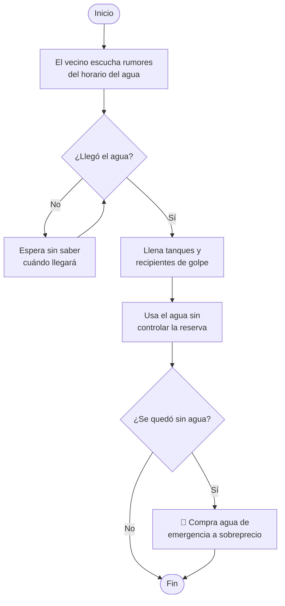
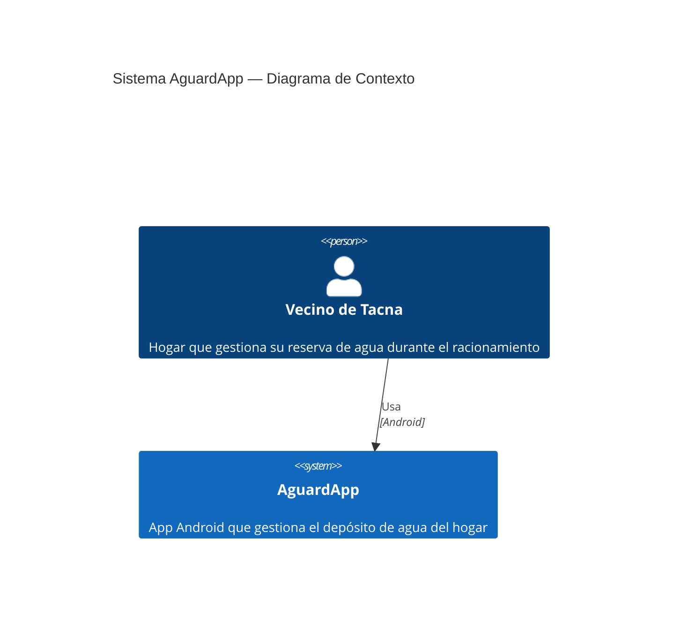
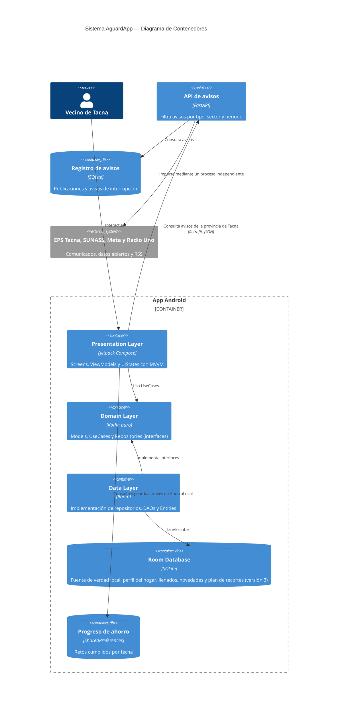
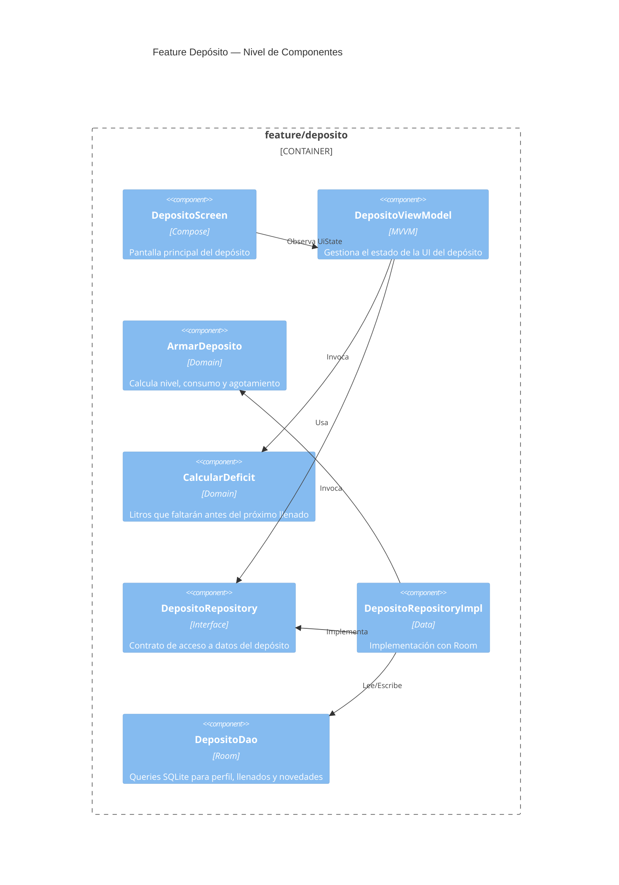
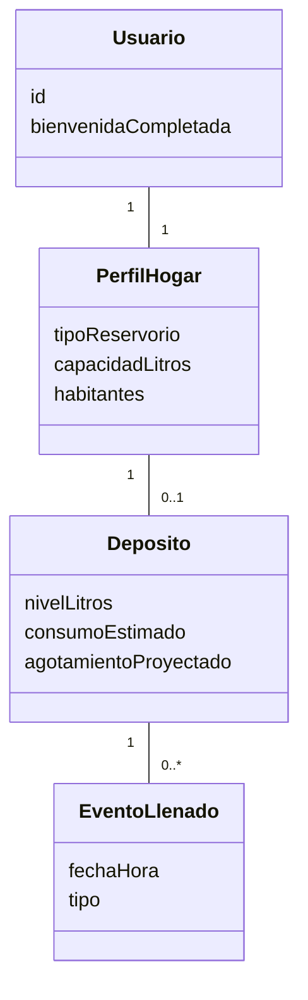
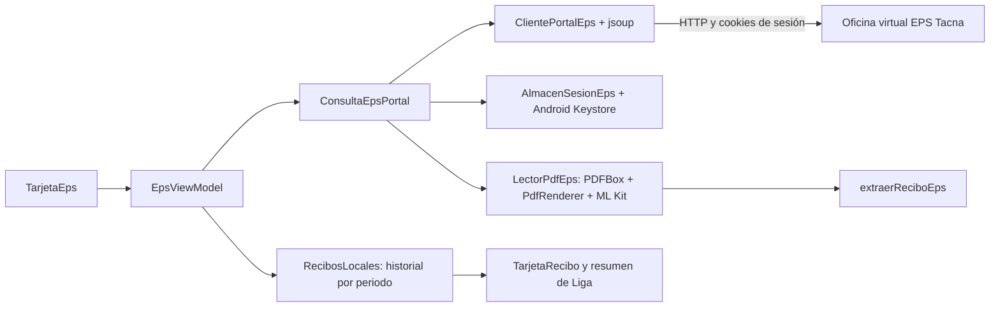

<p align="center">
  
</p>

<h1 align="center">💧 AguardApp</h1>

<p align="center">
  <em>Sistema móvil para la gestión de la reserva domiciliaria de agua y la anticipación de cortes durante el racionamiento hídrico en Tacna</em>
</p>

<p align="center">
  
  
  
  
  
</p>

<p align="center">
  
  
  
  
  
</p>

---

## 👥 Integrantes del Proyecto

| # | Integrante | Código | Rol |
|:-:|---|---|---|
| 🔵 | **Mamani Cori, Cristhian Carlos** | `2023077282` | Jefe de Proyecto · Core y Reserva |
| 🟢 | **Jahuira Pilco, Dayan Elvis** | `2022075749` | Sector y Mapas |
| 🟠 | **Sierra Ruiz, Iker Alberto** | `2023077090` | Recibo e IA · Líder de Pruebas |
| 🟣 | **Llica Mamani, Jimmy Mijair** | `2023076789` | Retos, Reportes y Despliegue |

> **Universidad Privada de Tacna** · Facultad de Ingeniería · Escuela Profesional de Ingeniería de Sistemas  
> **Curso:** Soluciones Móviles I · **Docente:** Mag. Alberto Johnatan Flor Rodríguez

---

## ❗ Problemática

La ciudad de **Tacna** se abastece de agua potable bajo un esquema de **racionamiento por sectores**, con servicio solo durante algunas horas al día. Los hogares enfrentan:

| Problema | Impacto |
|---|---|
| 🔴 **Sin información clara** de cuándo llega el agua a su sector | Desabastecimiento imprevisto |
| 🔴 **Sin control** sobre cuánta reserva queda en el hogar | Desperdicio del recurso |
| 🔴 **Información oficial dispersa** y poco confiable | Mala planificación del consumo |
| 🔴 **Compra de agua de emergencia** a sobreprecio | Gasto innecesario |



---

## ✅ Solución

**AguardApp** es una aplicación Android que permite a los hogares de Tacna:

| Funcionalidad | Descripción |
|---|---|
| 📊 **Gestionar el depósito** | Saber cuántos litros quedan y hasta cuándo alcanza |
| 💧 **Registrar llenados** | Un toque cuando llega el agua (completo o a la mitad) |
| 📉 **Aprender el consumo** | Ajusta la proyección cuando el agua se acaba antes de lo previsto |
| ✂️ **Qué recortar** | Sugerencias de ahorro cuando el agua no alcanza hasta el próximo llenado |
| 🏅 **Ahorro** | Marca los retos de hoy y consulta tu racha, calendario e insignias. El progreso se guarda en el teléfono. |
| 🗺️ **Mapa de cisternas** | Puntos de reparto de agua en Tacna sobre Google Maps, con su horario y estado, la lista de los más cercanos a tu ubicación el aviso "Antes de que se acabe", que te dice a qué cisterna ir antes de quedarte sin agua, y los límites reales de los distritos |
| 📶 **Sensor IoT del tanque** | Lee el nivel real del tanque (ESP32 + sensor ultrasónico, simulado en Wokwi) desde ThingSpeak y lo aplica como nivel actual |
| 🔔 **Avisos** | Alerta dentro de la app si el agua no alcanza, si queda menos del 20 % o si falta registrar un llenado |
| **Notificaciones de agua y saneamiento** | La campana de Inicio muestra avisos de la provincia de Tacna con filtros por sector EPS, tipo y periodo. Incluye búsqueda por calle o asociación, guía de sectores y enlace a la publicación original. |
| 🧾 **Consulta integrada EPS (en validación)** | Vincula la cuenta, conserva la sesión cifrada y consulta el PDF del recibo mediante HTTP en la oficina virtual; extrae consumo, periodo y total con ML Kit dentro del teléfono. Validado con cuenta y recibo reales en el Samsung conectado. |
| 📡 **Datos del hogar locales** | El depósito se guarda en el teléfono; mapa, sensor, ranking opcional y consulta EPS requieren internet. La clave EPS se envía únicamente a su portal HTTP (sin cifrado en tránsito) y no se guarda |

---

## 📐 Factibilidad

Según el Informe de Factibilidad **(FD01, Versión 1.0)**, el proyecto es viable en todas las dimensiones:

| Dimensión | Estado | Detalle |
|---|:-:|---|
| 🔧 **Técnica** | ✅ | Equipo competente, tecnologías gratuitas, MVP operativo |
| 💰 **Económica** | ✅ | Inversión: S/ 17,720.00 · VAN positivo · TIR: 22.2% |
| ⚙️ **Operativa** | ✅ | Flujos simples, interfaz accesible |
| ⚖️ **Legal** | ✅ | Cumple Ley N.° 29733 de Protección de Datos Personales |
| 🌱 **Social y Ambiental** | ✅ | Fomenta el ahorro y consumo responsable del agua |

---

## 🎯 Visión y Misión

> ### 🔭 Visión
> Ser un referente en el desarrollo de soluciones móviles con **impacto social** en la región de Tacna, aplicando buenas prácticas de ingeniería de software para resolver problemas reales de la comunidad.

> ### 🚀 Misión
> Desarrollar aplicaciones móviles **accesibles y de calidad** que mejoren la vida de los ciudadanos; para este proyecto, ayudando a los hogares de Tacna a gestionar su reserva de agua durante el racionamiento.

---

## 🛠️ Stack Tecnológico

| Categoría | Tecnologías |
|---|---|
| **Lenguaje** |  |
| **UI** |   · Jetpack Glance 1.1.1 (widget) |
| **Base de datos** | -003B57?style=flat-square&logo=sqlite&logoColor=white) |
| **Mapas** |  |
| **Red / HTML** | jsoup 1.24.1 ·   |
| **DI** |  |
| **API de cortes** | Python 3.11+, FastAPI, SQLite y lxml. Tesseract es opcional para avisos en imagen. |
| **Fechas** |  |
| **Arquitectura** |    |

---

## 📂 Estructura del Proyecto

```
AguardApp/
├── 📄 build.gradle.kts                    Configuración raíz de Gradle
├── 📄 settings.gradle.kts                 Módulos y repositorios
├── 📄 Readme.md                           ← Estás aquí
│
├── 📁 app/                                Módulo principal Android
│   ├── 📄 build.gradle.kts                Dependencias y plugins
│   ├── 📁 schemas/                        Esquemas exportados de Room
│   └── 📁 src/main/
│       ├── 📄 AndroidManifest.xml
│       ├── 📁 res/                        Recursos (iconos, strings, etc.)
│       └── 📁 java/com/example/aguardapp/
│           ├── 📄 AguardApplication.kt    Inicia la base de datos y Koin
│           ├── 📄 MainActivity.kt         Muestra la app
│           ├── 📄 App.kt                  Tema + navegación
│           │
│           ├── 📁 core/                   🔧 Infraestructura transversal
│           │   ├── 📁 data/               Usuario local (UUID) y DAO
│           │   ├── 📁 db/                 AguardAppDatabase (Room)
│           │   ├── 📁 di/                 Koin: base de datos, repositorios y ViewModels
│           │   ├── 📁 navigation/         Rutas, NavHost y cuadrícula de Inicio
│           │   ├── 📁 ui/theme/           Colores, tipografías y tema
│           │   └── 📁 util/               Reloj y UUID
│           │
│           └── 📁 feature/
│               ├── 📁 bienvenida/         Pantalla de entrada (solo el primer uso)
│               ├── 📁 deposito/           Depósito de agua del hogar (MVVM + DDD)
│               ├── 📁 cortes/             Notificaciones de interrupciones consultadas por Retrofit
│               ├── 📁 liga/               Liga del Agua: medición del consumo y puntaje del hogar
│               ├── 📁 mapa/               Mapa de puntos de cisterna, distritos y reportes de vecinos (Google Maps)
│               ├── 📁 sensor/             Nivel del tanque y detector de fugas desde el sensor IoT (HTTP directo a ThingSpeak)
│               ├── 📁 ahorro/             Retos, racha, calendario e insignias (SharedPreferences)
│               ├── 📁 eps/                Consulta del portal, sesión cifrada y OCR del PDF
│               └── 📁 widget/             Widget 2x1 de pantalla de inicio con el nivel del tanque (Glance)
│
├── 📁 backend/                            API de cortes, importadores y pruebas
├── 📁 iot/wokwi/                          Simulación del sensor: ESP32 + HC-SR04 (diagram.json, sketch.ino)
│
└── 📁 informes/                           📋 Documentación académica
    ├── 📄 FD01-Factibilidad.md
    ├── 📄 FD02-Vision.md
    ├── 📄 FD03-SRS.md
    ├── 📄 FD04-SAD.md
    └── 📄 FD05-Informe-Final.md
```

### Capas internas de cada Feature

Las features `deposito` y `mapa` siguen el patrón **MVVM + DDD** con estas capas (`bienvenida` solo tiene `presentation/`; `mapa` no tiene Room y su único caso de uso es `BuscarCisternasCercanas`):

| Capa | Contenido | Depende de |
|---|---|---|
| 📐 `domain/` | `model/`, `repository/` (interfaces), `usecase/` — Kotlin puro | Nada |
| 💾 `data/` | Implementaciones de repositorios, `local/` (Room), `mapper/` | `domain/` |
| 🖼️ `presentation/` | Por pantalla: `*Screen.kt` y `*ViewModel.kt` (con su `UiState`); `componentes/` con las piezas comunes | `domain/` |

---

## 🏗️ Diagrama C4 — Nivel de Contexto



## 🏗️ Diagrama C4 — Nivel de Contenedores



## 🏗️ Diagrama C4 — Nivel de Componentes (Feature Depósito)



---

## 📊 Diagrama de Clases Principal



---

## 🔧 Requisitos Previos

| Requisito | Versión |
|---|---|
| Android Studio | Ladybug o superior |
| JDK | 17+ |
| Android SDK | API 24 (mínimo) — API 36 (target) |
| Dispositivo/Emulador | Android 7.0+ (API 24) |

## 🚀 Cómo Ejecutar

```bash
# 1. Clonar el repositorio
git clone https://github.com/tu-usuario/AguardApp.git

# 2. Abrir en Android Studio

# 3. Claves: ya están en el código, no hay que configurar nada.
#    ThingSpeak (canal y clave de lectura) -> feature/sensor/data/remote/ThingSpeakApi.kt
#    Supabase (URL y clave anon)           -> feature/liga/data/remote/SupabaseApi.kt
#    Google Maps                           -> AndroidManifest.xml

# 4. Sincronizar Gradle y ejecutar
./gradlew :app:assembleDebug

# O simplemente presionar ▶️ Run en Android Studio
```

---

## 📋 Requerimientos Funcionales Principales

| ID | Requerimiento | Prioridad |
|---|---|:-:|
| RF-02 | Configurar el hogar | 🔴 Alta |
| RF-04 | Consultar el depósito (nivel y hasta cuándo alcanza) | 🔴 Alta |
| RF-05 | Calcular el déficit hasta el próximo llenado | 🔴 Alta |
| RF-08 | Operar sin conexión | 🔴 Alta |
| RF-12 | Registrar y consultar el progreso de ahorro | Media |
| RF-14 | Consultar avisos de agua y saneamiento de la provincia de Tacna | Media |

> 📄 Ver documentación completa en [`informes/FD03-SRS.md`](./informes/FD03-SRS.md)

---

## 📚 Documentación

| Documento | Descripción |
|---|---|
| [`FD01-Factibilidad.md`](./informes/FD01-Factibilidad.md) | Estudio de factibilidad técnica, económica y operativa |
| [`FD02-Vision.md`](./informes/FD02-Vision.md) | Documento de visión del proyecto |
| [`FD03-SRS.md`](./informes/FD03-SRS.md) | Especificación de Requerimientos de Software |
| [`FD04-SAD.md`](./informes/FD04-SAD.md) | Documento de Arquitectura de Software |
| [`FD05-Informe-Final.md`](./informes/FD05-Informe-Final.md) | Informe final del proyecto |

---

## 🧾 Consulta integrada de EPS Tacna — en validación

En **Inicio → Recibos EPS**, la tarjeta **Tu recibo desde EPS Tacna** ofrece:

1. **Vincular cuenta EPS**: ingresar el usuario y la clave impresos en el recibo. El conector lee el formulario y sus campos ocultos; envía las credenciales mediante HTTP únicamente al host exacto de la oficina virtual. La cuenta queda vinculada únicamente si la respuesta contiene evidencia de acceso y una cookie de sesión.
2. **Actualizar último recibo**: reutiliza la sesión, sigue enlaces directos del portal al PDF y extrae primero el texto digital con PDFBox Android y, si no basta, procesa hasta cuatro páginas con `PdfRenderer` y ML Kit, asociando etiquetas y cifras por posición. Guarda automáticamente mes facturado, consumo explícito en m³ y **total a pagar** (puede incluir deuda, no equivale al cargo del mes). No estima consumo a partir del importe o de las lecturas.
3. **Desvincular cuenta**: elimina la sesión de este teléfono y conserva el historial de recibos. No revoca la sesión en el servidor de EPS.

En **Recibos EPS → Evolución del consumo**, desliza el gráfico para recorrer todo el historial y alterna entre consumo (m³) y cargo del mes (S/). Toca un periodo para ver su detalle. Los meses sin recibo y los cargos ausentes se muestran como «Sin datos». El resumen compara el último consumo registrado con el promedio de los meses anteriores que tienen recibo. Desde la tarjeta del último recibo se puede definir, editar o quitar una meta mensual en m³ tomando como referencia el promedio histórico. La meta se guarda en el teléfono, aparece como línea discontinua y se compara con el consumo de cada recibo. La tarjeta principal reúne el total a pagar y el progreso de la meta. **Descargar PDF** obtiene el último documento original de EPS y abre el selector de Android para elegir nombre y ubicación. **Ver PDF** abre ese mismo documento dentro de la app, con navegación por página y zoom. Si la sesión caduca, la acción se reanuda al vincular la cuenta. El historial presenta filas desplegables con el consumo, el total y el detalle disponible por periodo. El gráfico abarca todo el historial y muestra el valor de consumo o el cargo del mes sobre cada barra. Se puede elegir una foto de la galería o tomarla con la cámara del sistema. Ambas opciones usan la revisión del recibo y la captura temporal se elimina tras procesarla o cancelarla.

La contraseña no se persiste ni se añade a logs. Las cookies y el usuario se cifran con AES/GCM y una clave de Android Keystore, en `noBackupFilesDir/eps-sesion.enc`. El PDF se procesa en caché privada y se elimina al terminar o fallar. No se envía el documento a una IA externa. Un error conserva el recibo guardado; una sesión vencida abre el formulario para vincular de nuevo. Los datos EPS se reflejan en la tarjeta de recibo existente y en la referencia de consumo de la Liga. El origen EPS cuenta como verificado si el recibo sigue vigente, sin afirmar que exista una firma digital validada.

**Estado real de la integración:** se inspeccionó el HTML público del acceso oficial, que utiliza `usu` y `pas` con POST a `../controlador/login.php`. Se verificaron el acceso autenticado y la descarga de un PDF real desde el Samsung conectado; la validación de campos se describe al final de esta sección. No hay una API oficial documentada identificada. El enlace de Gob.pe usa HTTP y la prueba HTTPS falló al validar el certificado. Por solicitud del usuario se permite HTTP solo para `oficinavirtual.epstacna.com.pe`, sin subdominios y en el puerto estándar. Usuario, clave, cookies y documento viajan sin cifrado y podrían ser interceptados; la pantalla lo informa antes de vincular. HTTPS sigue validando certificados si el portal redirige allí.

El descubrimiento usa enlaces HTML y el flujo AJAX observado del botón «Recibo virtual PDF»: interpreta las rutas literales y métodos de `CargarRecibo(...)` y `MostrarRecibo()`, solicita el visor y sigue su iframe, siempre en el mismo host. Envía `Referer` y `X-Requested-With` en las solicitudes AJAX. No ejecuta JavaScript arbitrario, no resuelve CAPTCHA y no inventa rutas de descarga. Si hay varios documentos, exige una etiqueta explícita de último recibo o periodos identificables para elegir el más reciente. Formularios adicionales, variantes de JavaScript distintas del flujo observado o una disposición de PDF no reconocible requieren adaptar el conector. La extracción rechaza campos ausentes o ambiguos, y periodos futuros.

**Dependencias nuevas:** `org.jsoup:jsoup:1.24.1` para formularios, enlaces y transporte HTTP/HTTPS, y `com.tom-roush:pdfbox-android:2.0.27.0` para texto digital del PDF. PDFBox extrae el texto digital; `PdfRenderer`, Android Keystore y ML Kit reutilizan la plataforma y dependencias existentes. No requiere claves API nuevas, servidor propio ni cambios de Supabase. El permiso `INTERNET` ya existe.

**Paquete:** `feature/eps/{domain,data,presentation}`, registrado en `ModuloRecibos.kt`. No cambia el esquema de Room. El historial se guarda en las preferencias existentes y conserva el recibo de instalaciones previas.



**Validación ejecutada antes del ajuste HTTP (18/11/2026):** `:app:testDebugUnitTest` y `:app:assembleDebug` completaron correctamente: 77 pruebas, incluidas 18 de EPS, sin fallos. APK generado en `app/build/outputs/apk/debug/app-debug.apk`. No se realizó prueba en dispositivo ni consulta con cuenta real.

**Validación reproducible:** ejecutar `sh ./gradlew :app:testDebugUnitTest :app:assembleDebug` con JDK 17 o superior compatible con Gradle y el SDK Android configurado. Las pruebas de `feature/eps` usan respuestas HTML/PDF sintéticas; no consultan datos de usuarios. Se completó la prueba con una cuenta y un recibo reales en el Samsung conectado: acceso HTTP, cookies, menú AJAX, descarga, extracción y guardado. Otros diseños de recibo o cambios del portal requieren nueva validación.

---

## 📝 Changelog

### 2026-11-22
- [Agregado] Importación de publicaciones recientes de EPSTacna mediante RSS generado por FetchRSS o RSS.app, con OCR de las imágenes incluidas.
- [Corregido] El importador también acepta los enlaces `.rss` vigentes de FetchRSS.
- [Corregido] Los filtros reconocen menciones en singular como «Sector IV» y «Subsector 05» en el texto de los avisos.
- [Agregado] Lectura automática de fotos y álbumes de Facebook por OCR con acceso autorizado a Meta Graph. La campana permite ampliar el texto del aviso.
- [Cambiado] Notificaciones con sectores EPS, filtros por fecha y tipo y búsqueda por calles o asociaciones. El importador admite Facebook de EPS Tacna mediante Meta Graph, noticias de SUNASS y el RSS de Radio Uno. [Guía del módulo](backend/README.md)
- [Corregido] La API valida los filtros de distrito con el catálogo de Tacna. Se agregó la [guía de despliegue en un VPS](backend/DESPLIEGUE.md).
- [Corregido] La bandeja ofrece los 28 distritos de Tacna aun sin conexión. El script `backend/iniciar.ps1` inicia la API local y conecta su puerto para Android por USB.
- [Agregado] Campana de notificaciones en Inicio y API de cortes de agua con importación de SUNASS y EPS Tacna. Ver [cómo probar la API](backend/README.md).
- [Agregado] Visor del PDF del último recibo en la tarjeta principal de Recibos EPS.

### 2026-11-21
- [Agregado] Descarga del PDF original del último recibo desde la tarjeta principal.
- [Cambiado] Gráfico del historial completo con valores sobre las barras, selector segmentado y captura de recibos desde la cámara.
- [Cambiado] Recibos EPS integra el último recibo y la meta en una tarjeta y muestra el historial en filas desplegables.
- [Agregado] Meta mensual de consumo con referencia visual y evaluación por periodo en Recibos EPS.
- [Agregado] Gráfico mensual interactivo de consumo y cargo, con detalle por periodo y comparación del último consumo con el promedio anterior.
- Si EPS rechaza la sesión al actualizar, Recibos EPS abre el formulario con el usuario anterior. Al volver a vincular, reintenta actualizar el recibo una vez. La clave se introduce de nuevo y el recibo anterior sigue disponible durante el proceso.
- Aguarda recuerda localmente el usuario después de vincular la cuenta con éxito y lo rellena al abrir el formulario, incluso tras cerrar la app. Desvincular explícitamente borra el usuario recordado. La clave se vuelve a ingresar.
- Recibos EPS conserva un historial local por mes facturado, tanto al actualizar desde el portal como al añadir una foto. El recibo de la versión anterior aparece como primer registro. Una nueva lectura del mismo mes actualiza su entrada. Si ya existe un recibo oficial, una foto solo puede completar los días faltantes. Liga sigue leyendo el periodo más reciente. La pantalla compara los dos periodos guardados más recientes, con el consumo y el total a pagar separados. Solo compara litros por día cuando ambos recibos tienen días facturados. La foto permite confirmar el importe y los días como campos opcionales. EPS obtiene los días de un valor explícito o de fechas identificadas como periodo de consumo.
- Recibos EPS ofrece **Actualizar último recibo** (PDF) e **Importar historial completo** (todos los periodos entregados por Historial de facturación, incluido el más reciente). La importación reutiliza la sesión, conserva consumo, cargo del mes, deuda y total a pagar como campos distintos y actualiza el historial local sin duplicados. La tabla no muestra días facturados, por lo que se conservan los que ya se hayan obtenido de un recibo. Si la sesión vence se reanuda la acción elegida tras volver a vincular.

### 2026-11-20
- [Cambiado] Liga del Agua, pantalla en tarjetas: en lugar de mostrar todo de golpe, la Liga abre con un resumen de la semana y cinco tarjetas cuadradas como las de Inicio (Mi tanque, Mi consumo, Mi puntaje, Ranking y Duelos), cada una con su ícono (`ic_liga_*.xml`) y un dato en vivo. Al tocar una tarjeta se abre esa sección y el botón atrás regresa al menú; no cambia la navegación de la app (`MenuLiga.kt`, `LigaScreen.kt`).
- [Cambiado] Liga del Agua, ranking con colores: cada distrito usa su color del mapa, medallas oro, plata y bronce para los tres primeros, barra de puntaje, tarjeta "Tu distrito" con su puesto y, para los que aún no compiten, una barra de hogares hacia el mínimo de 5. Los duelos son tarjetas "distrito contra distrito" con la barra dividida por puntos y quién va ganando (`SeccionRanking.kt`, `TarjetaDuelos.kt`, `ColoresLiga.kt`).
- [Agregado] Mapa, reportes de vecinos: el botón "Reportar" permite avisar "Sin agua en mi cuadra", "Ya llegó el agua a mi cuadra", "Llegó la cisterna" o "La cisterna ya se fue". Solo se envía el tipo de reporte, el distrito (o la cisterna elegida, de la que se deduce su distrito) y el código anónimo del hogar; nunca la ubicación, el nombre ni fotos del vecino. Un reporte se muestra cuando al menos 2 hogares distintos coinciden (en la tarjeta del distrito, bajo la cisterna y como "En tu distrito" si el teléfono tiene ubicación), dura 6 horas en pantalla y el servidor lo olvida a los 2 días. Se rechaza el mismo reporte repetido en 3 horas y más de 10 por hora. Código: `ReportesRepositoryImpl.kt`, `ReportesApi.kt`, `DialogoReporte.kt`, `AvisoDeVecinos.kt` y `ModuloReportes.kt`.
- [Agregado] `supabase/reportes_agua.sql`: tabla `reporte_agua` (sin acceso directo, con RLS) y las funciones `enviar_reporte` y `reportes_recientes`. Se ejecuta una vez en el SQL Editor después de `liga_del_agua.sql`; ya está aplicado en el proyecto AguaTacna. Reemplaza `borrar_mis_datos` para que "Salir y borrar mis datos" también borre los reportes del hogar.
- [Agregado] Mapa, colores por distrito: cada distrito tiene su propio color (Tacna turquesa, Alto de la Alianza violeta, Ciudad Nueva amarillo, Pocollay verde y Coronel Gregorio Albarracín Lanchipa rosa; `ColoresDeDistrito.kt`). El relleno se intensifica cuando el distrito ya compite en la Liga según su puntaje real y se mantiene tenue mientras no. En pantalla completa aparece la leyenda de distritos y la tarjeta del distrito muestra su color.
- [Agregado] Liga del Agua, gráfico semanal: la tarjeta "Tus litros por semana" muestra en barras los litros por persona al día de las últimas 6 semanas (la actual resaltada) y una línea con el consumo habitual. Se calcula en el teléfono con las mismas marcas de nivel (`historialSemanal` en `HistorialLitros.kt`, `GraficoSemanal.kt`); las semanas sin medición quedan con "–".
- [Cambiado] Liga del Agua, ranking: cuando un distrito aún no compite, en lugar de "Sin datos" se lee cuántos hogares le faltan ("Faltan 4 hogares") y "Aún sin hogares" si no tiene ninguno. El mínimo de 5 hogares es la constante `HOGARES_MINIMOS` (`RankingLiga.kt`), la misma cifra de `supabase/liga_del_agua.sql`.
- [Cambiado] El botón del ranking dice "Salir y borrar mis datos" para que el texto no se pegue a los bordes en pantallas angostas.
- [Cambiado] La tarjeta "Mi depósito" de Inicio usa las mismas dos olas del fondo del widget (`AguaOla` `#80AAD3` con transparencia) en lugar de los círculos decorativos.
- [Cambiado] Los fondos que usaban `#000F22` (tarjeta de Mi depósito en Inicio y widget) pasan a `#1B3554`; el texto principal (`Tinta`) se mantiene en `#000F22`. Los elementos que iban sobre fondos `#1B3554` (botón de ajustes de Mi depósito, logo, tarjeta y casilla de la bienvenida, círculo de Inicio, pastilla y círculo del widget) usan `AguaSuave` `#3F6593` para seguir viéndose.
- [Cambiado] Las barras superiores (`BarraSuperior`: Mapa, Represas, Liga del Agua, Recibos EPS, Avisos, Configurar, Registrar llenado, Sin agua y Qué recortar) y el encabezado "Aguarda" de Inicio son `#1B3554` hasta la barra de estado, con título blanco, subtítulo `#C0E6FD` e íconos de estado claros.
- [Cambiado] El agua de los tres tanques (widget, Mi depósito y Registrar llenado completo/parcial) pasa a un cian apagado (`#51AFBC`) para que no resalte tanto sobre la paleta azul.
- [Cambiado] Paleta azul del tema (`Color.kt`): `AguaProfunda`/`AguaMedia` `#1B3554`, `Tinta` `#000F22`, `AguaSuave` `#3F6593`, `TintaSuave` `#3F6593`, `Agua`/`TintaTenue` `#5B86B6` y `AguaClara` `#C0E6FD`; el widget usa fondo `#1B3554` con ondas `#80AAD3`.
- [Cambiado] La aplicación se llama "Aguarda" (nombre en el teléfono y en la bienvenida).
- [Cambiado] Ícono de la aplicación en azul marino (`#1B3554`, el mismo del logo de Inicio).
- [Cambiado] Widget del tanque con fondo azul marino de la paleta actual; el interior de los tanques mantiene el fondo turquesa oscuro original (`#06323A`).
- [Corregido] Widget: el texto ya no se corta en teléfonos con la letra del sistema agrandada (los tamaños compensan `fontScale`).
- [Cambiado] Inicio: las 5 tarjetas de "Explorar Aguarda" son cuadradas y del mismo tamaño (`aspectRatio(1f)`), incluida la que queda sola en la última fila.
- [Agregado] Widget 2x1 "Nivel del tanque" (`feature/widget`, Jetpack Glance): muestra el porcentaje, los litros sobre la capacidad y un ícono de wifi que indica si el tanque envió una lectura en los últimos 10 minutos. Consulta ThingSpeak una vez por hora (`updatePeriodMillis`) para ahorrar batería y datos; al tocarlo abre la app. Usa colores turquesa propios. Recursos: `widget_nivel_tanque_info.xml`, `widget_fondo`, `widget_circulo`, `widget_pastilla`, `ic_wifi` e `ic_wifi_off`.
- [Cambiado] El dibujo del tanque de Mi depósito se separó en `dibujarIndicadorNivel()` (con ola y colores opcionales) para que el widget lo reutilice sin animación.
- [Cambiado] La conexión con ThingSpeak es directa, como la de Maps: `ThingSpeakApi` hace un GET a la URL del canal (con la clave de lectura incluida) tanto para la última lectura como para el historial del detector de fugas, y arma las `LecturaSensor` con `org.json`. Ya no usa Retrofit ni DTOs; Retrofit sigue para la ANA y Supabase.
- [Cambiado] La URL y la clave de Supabase están en `SupabaseApi.kt`. La clave de Google Maps sigue en el `AndroidManifest.xml`.
- [Eliminado] `claves.properties`, la lectura de claves en `app/build.gradle.kts` (`Properties`, `manifestPlaceholders`, `buildConfigField`) y `buildConfig = true`.
- [Eliminado] Las comprobaciones "sin configurar" que ya no pueden ocurrir: `SensorRepository.estaConfigurado`, `RankingRepository.conectado` y la tarjeta "El ranking todavía no está conectado".
- [Eliminado] Código sin uso: íconos `ic_info`, `ic_reloj` e `ic_flecha_abajo`, `ExampleUnitTest.kt`, las dependencias `ui-tooling` / `ui-tooling-preview` (no hay `@Preview`) y un import sin uso.
- [Eliminado] Los comentarios `//` y `/* */` (incluidos los KDoc `/** */`) de todo el código propio: Kotlin de `app/src`, `app/build.gradle.kts` y `iot/wokwi/sketch.ino`. Los archivos de la plantilla del proyecto quedan como estaban.
- [Corregido] `SeccionRanking` usa `LocalLifecycleOwner` de `androidx.lifecycle.compose` (el de `compose.ui.platform` está obsoleto).
- Inicio reemplaza la barra inferior y muestra el nivel del depósito, un acceso a llenado y tarjetas independientes para Mapa, Represas, Ahorro, Liga del Agua y Recibos EPS.
- Se aplica la paleta azul al tema. Recibos EPS agrupa la consulta en línea y la lectura por foto. Liga usa el recibo guardado como referencia de consumo sin gestionar la cuenta EPS. Se reutilizan las claves locales para conservar los recibos anteriores.

### 2026-11-18
- [Validado] Flujo EPS completo en el Samsung conectado con cuenta y recibo reales: sesión persistida, descarga del PDF, extracción de periodo/consumo/total y guardado. Se retiró el diagnóstico temporal. La lectura de casillas pequeñas usa un recorte ampliado; las cifras se asocian por posición, sin inferir consumo a partir de lecturas o importes.
- [Corregido] Consulta EPS: navegación del menú dinámico CargarRecibo/MostrarRecibo, cabeceras AJAX/Referer y visor con iframe. Lectura del texto digital con PDFBox Android y respaldo OCR de mayor resolución con alineación de etiquetas y cifras por posición; soporte de «Volumen Fac m³», valores separados y asteriscos del importe.
- [Cambiado] Por solicitud del usuario, acceso EPS mediante HTTP limitado a `oficinavirtual.epstacna.com.pe` (sin subdominios). Advertencia visible de credenciales y sesión sin cifrado en tránsito. Se mantiene el cifrado local, el bloqueo de destinos externos y la validación TLS de HTTPS.
- [Agregado] Conector EPS en validación: vinculación mediante el formulario del portal, sesión AES/GCM en Android Keystore, consulta del PDF por HTTPS y extracción local de consumo, periodo y total a pagar. Incluye desvinculación, errores de sesión/certificado/formato y pruebas con respuestas sintéticas. La primera implementación requería validación real; se completó para un recibo tras adaptar el menú AJAX y el OCR. El acceso HTTP al portal fue solicitado por el usuario.
- [Agregado] Liga del Agua, recibo verificado y duelos: la app lee los m³ de la foto del recibo dentro del teléfono con ML Kit (`com.google.mlkit:text-recognition`); la foto no se guarda ni se envía. El hogar queda "Verificado" solo si el número salió de la foto, el usuario no lo cambió y el recibo tiene hasta 2 meses; su dato pesa el doble en la mediana. Duelos semanales entre distritos que ya compiten, con rivales que rotan cada semana.
- [Agregado] Liga del Agua, ranking real: consentimiento explícito, envío semanal anónimo (código anónimo, distrito, litros por persona y puntaje) y ranking de distritos con la mediana de sus hogares; un distrito necesita al menos 5 hogares para competir. El mapa pinta cada distrito según su puntaje real. Salir de la Liga borra los datos enviados. El servidor es Supabase: ejecutar `supabase/liga_del_agua.sql` y poner `SUPABASE_URL` y `SUPABASE_ANON_KEY` en `claves.properties`; sin esas claves el ranking queda desconectado y el resto de la app funciona igual.
- [Agregado] Liga del Agua, medición real (`feature/liga`): pantalla abierta desde el mapa donde el usuario marca cuánta agua hay en su tanque. El consumo sale de lo que bajó el nivel entre dos marcas, descartando los tramos con llenados; hacen falta al menos 24 horas medidas. Puntaje semanal del hogar: mejora frente a su propio consumo habitual (50), retos de Ahorro (30) y constancia (20). Las marcas se guardan solo en el teléfono (`liga.db`).
- [Agregado] Mapa por distritos: límites reales de Tacna, Alto de la Alianza, Ciudad Nueva, Pocollay y Coronel Gregorio Albarracín Lanchipa en `app/src/main/assets/distritos_tacna.geojson` (OpenStreetMap, licencia ODbL, con el ubigeo del INEI). Con el mapa en pantalla completa, al tocar un distrito se muestra su tarjeta. Los distritos salen en gris porque la Liga del Agua aún no tiene datos de hogares: la app no muestra puntajes inventados. El distrito del usuario se calcula en el teléfono y la ubicación no se envía a ningún servidor.

### 2026-11-12
- [Agregado] Pestaña Ahorro con retos de la semana, racha, calendario e insignias. Los retos se registran por día y funcionan sin internet.
- [Agregado] Mapa en pantalla completa: al tocar el mapa se ocultan el título y la lista; "Volver a la lista" o el botón atrás lo devuelven a su tamaño. El permiso de ubicación y el botón pasan a `ControlesMapa.kt`.
- [Agregado] Mapa, aviso "Antes de que se acabe": cruza la hora en que se acaba el agua del tanque (`Deposito.agotamientoProyectado()`) con el próximo llenado y con las cisternas. Si el agua no alcanza, una tarjeta coral dice cuándo se acaba y a qué cisterna ir ("Ve a Viñani (a 3.8 km): reparte hasta la 1:00 p.m."); si alcanza, una tarjeta celeste sugiere la más conveniente por si se necesita más. La cisterna sugerida se marca "Te conviene" en la lista. Nuevo caso de uso `ElegirCisternaConveniente` (la más cercana que no terminó y no pasó su hora de fin) y 13 pruebas unitarias nuevas (27 en total en `feature/mapa`). `MapaViewModel` ahora recibe `DepositoRepository` y el reloj (Koin).
- [Cambiado] Mapa: el aviso queda fijo sobre la lista y la lista se desplaza en un panel más bajo, para que el mapa conserve su espacio.

### 2026-11-11
- [Agregado] Feature `mapa`, cisternas cercanas en pantalla: al abrir el mapa con permiso de ubicación, se lee la ubicación una sola vez (`UbicacionRepository`, con `LocationManagerCompat`, sin guardar la coordenada) y bajo el mapa aparece la lista "Cisternas cercanas" con la distancia ("a 1.2 km"), el horario y el estado. Sin permiso, sin ubicación o sin puntos a menos de 10 km, se listan todos los puntos con un aviso. Al tocar una fila, el mapa se centra en ese punto y abre su ficha. Leyenda de colores (Activo, En ruta, Terminado) sobre el mapa. `UbicacionRepository` se registra en `moduloApp` (Koin).
- [Agregado] Feature `mapa`, dominio de cisternas cercanas: `Coordenada.distanciaKmHasta` (distancia real con la fórmula de Haversine), el modelo `CisternaCercana` y el caso de uso `BuscarCisternasCercanas` (descarta los puntos a más de 10 km y ordena del más cercano al más lejano, incluidos los que ya terminaron). Con 14 pruebas unitarias en `app/src/test/.../feature/mapa/` (distancia, búsqueda y formato de la distancia).
- [Agregado] `iot/wokwi/`: código del ESP32 con sensor ultrasónico que publica el nivel del tanque en ThingSpeak.
- [Agregado] `claves.properties`: claves compartidas del equipo; `local.properties` tiene prioridad si define una clave.
- [Agregado] Feature `sensor`: tarjeta "Sensor del tanque" en Mi depósito que consulta cada 20 s el canal de ThingSpeak (Retrofit, inyectado con Koin en `moduloRed`). Una lectura más reciente que el último nivel registrado se aplica sola; una edición manual posterior se respeta hasta la siguiente lectura. El botón "Usar esta medición como nivel actual" la vuelve a aplicar.
- [Corregido] Consumo absurdo (p. ej. 144000 L/h): un "me quedé sin agua" registrado menos de 1 h después del llenado ya no se usa para calcular el consumo.
- [Cambiado] Inyección de dependencias completa: los ViewModels se registran en Koin (`moduloViewModels` en `AppModule.kt`) y cada pantalla los obtiene con `koinViewModel()`. Se eliminaron los `desdeInyeccion()` y se cambió `koin-core` por `koin-androidx-compose`.
- [Agregado] Feature `mapa`: pantalla "Puntos de cisterna" con Google Maps (`maps-compose`), marcadores por estado y "mi ubicación" si se concede el permiso.
- [Agregado] Barra inferior con dos pestañas: Mi depósito y Mapa (`core/navigation/BarraInferior.kt`).
- [Agregado] Permisos `INTERNET` y de ubicación; API key leída de `local.properties` (`MAPS_API_KEY`).
- [Cambiado] El proyecto compila con Java 17 (lo exige `maps-compose`).

### 2026-10-14
- [Cambiado] El consentimiento de la bienvenida empieza sin marcar: "Empezar" se habilita solo al aceptarlo, y el texto ahora explica que los datos se borran desinstalando la app.
- [Cambiado] Respaldo automático de Android desactivado (`allowBackup="false"` y reglas que excluyen todos los datos): la base local no se copia a la nube ni a otro teléfono.
- [Eliminado] Constante sin uso `AGUA_WATER` de `ParametrosConsumo` y comentario huérfano de la ruta `que_recortar/{deficit}` en `Rutas.kt`.
- [Corregido] Comentario de `AguardAppDatabase` sobre migraciones: la versión 3 usa `AutoMigration`.
- [Corregido] Informes FD03, FD04 y FD05 alineados con el código (versión 2.2): conflictos de merge resueltos, base de datos versión 3 y plan de recortes en los diagramas.

---

## 📜 Licencia

Proyecto académico desarrollado en la **Universidad Privada de Tacna** — 2026.

---

<p align="center">
  <sub>Hecho con 💧 para los hogares de Tacna</sub>
</p>

**Validación del ajuste HTTP (18/11/2026):** `:app:testDebugUnitTest` y `:app:assembleDebug` completaron correctamente: 78 pruebas, incluidas 19 de EPS, sin fallos. Se comprobó que la política Android bloquea HTTP por defecto y lo permite solo para el host exacto de la oficina virtual. La consulta autenticada del recibo real continúa pendiente.

**Validación final del conector EPS (18/11/2026):** 89 pruebas unitarias aprobadas (30 de EPS), APK Debug compilado y actualización completa verificada en el Samsung con una cuenta y un recibo reales, incluyendo el guardado desde EpsViewModel. La verificación cubre ese formato de recibo; no garantiza disponibilidad del portal ni otros diseños. Se retiraron la actividad temporal y los puntos de diagnóstico. No se incorporaron datos personales, cookies, contraseñas ni documentos reales al repositorio.
