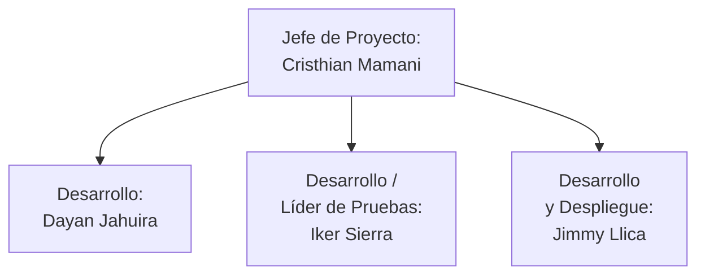
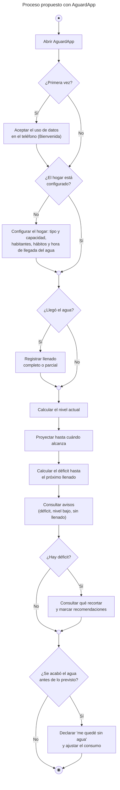
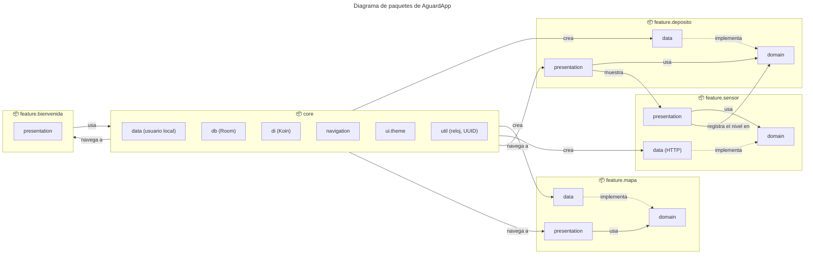
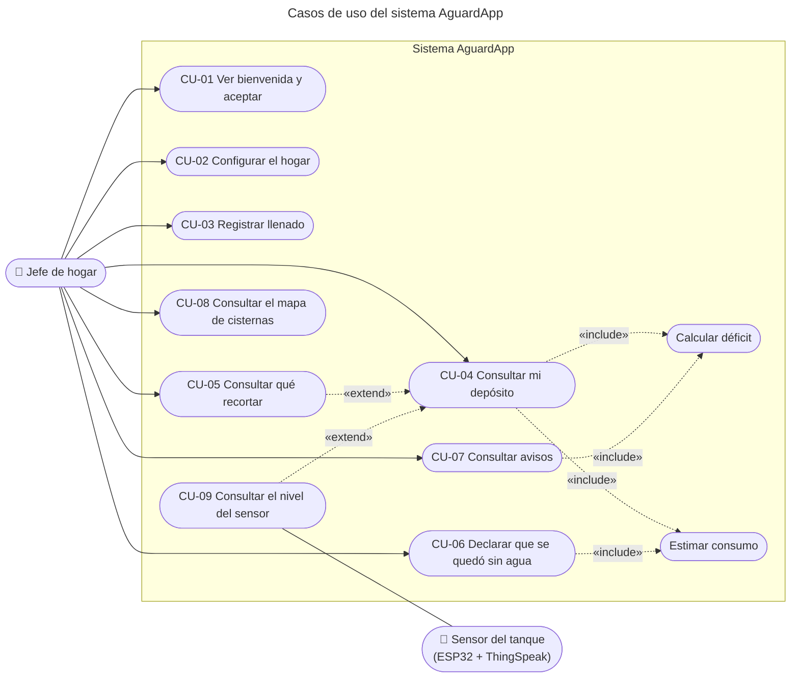
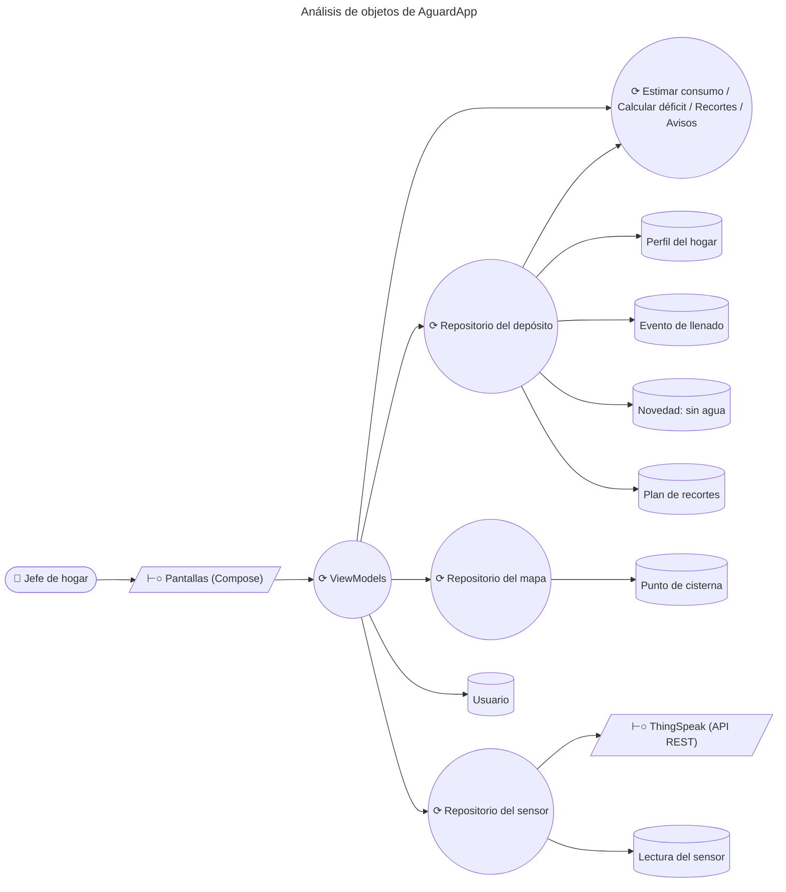
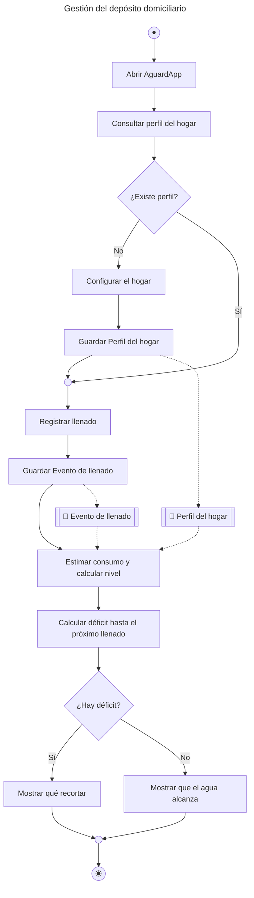
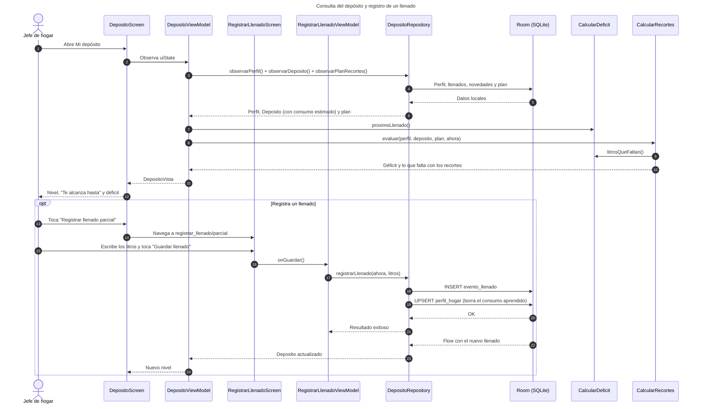
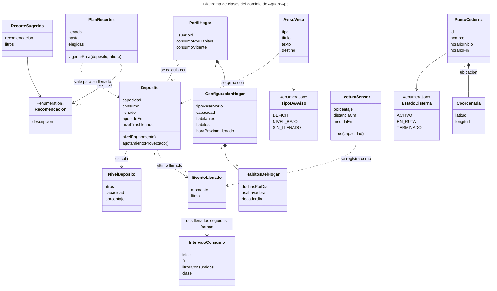

# AguardApp — Documento de Especificación de Requerimientos de Software (SRS)

> **Universidad Privada de Tacna** · Facultad de Ingeniería · Escuela Profesional de Ingeniería de Sistemas
> **Curso:** Soluciones Móviles I · **Docente:** Mag. Alberto Johnatan Flor Rodríguez
> **Sistema:** AguardApp: sistema móvil para la gestión de la reserva domiciliaria de agua y la anticipación de cortes durante el racionamiento hídrico en Tacna
> **Versión:** 2.3 · Tacna – Perú, 2026

**Integrantes**

| Integrante | Código |
|---|---|
| Jahuira Pilco, Dayan Elvis | 2022075749 |
| Llica Mamani, Jimmy Mijair | 2023076789 |
| Mamani Cori, Cristhian Carlos | 2023077282 |
| Sierra Ruiz, Iker Alberto | 2023077090 |

## Control de versiones

| Versión | Hecha por | Revisada por | Aprobada por | Fecha | Motivo |
|---|---|---|---|---|---|
| 1.0 | DJ - JL - CM - IS | AFR | AFR | 30/09/2026 | Versión Original |
| 2.0 | DJ - JL - CM - IS | — | — | 02/10/2026 | Actualización al sistema AguardApp: aplicación Android nativa centrada en el módulo Depósito, con base de datos local |
| 2.1 | DJ - JL - CM - IS | — | — | 02/10/2026 | Se agrega la pantalla Avisos (RF-09, RN-11, CU-07) |
| 2.2 | DJ - JL - CM - IS | — | — | 14/10/2026 | Se alinea con el código: validaciones reales de RF-02 y RF-07, consumo aprendido en RN-03 y RN-04, avisos con recortes en RN-11, privacidad (respaldo desactivado y consentimiento explícito) y plan de recortes en los modelos |
| 2.3 | DJ - JL - CM - IS | — | — | 11/11/2026 | Se agregan el mapa de cisternas (RF-10, CU-08) y el sensor del tanque (RF-11, CU-09, RN-12); se descarta el "me quedé sin agua" registrado menos de 1 h después del llenado (RN-05) y se actualizan los permisos (RNF-03) |

## Índice

1. [Generalidades de la Empresa](#1-generalidades-de-la-empresa)
2. [Visionamiento de la Empresa](#2-visionamiento-de-la-empresa)
3. [Análisis de Procesos](#3-análisis-de-procesos)
4. [Especificación de Requerimientos de Software](#4-especificación-de-requerimientos-de-software)
5. [Fase de Desarrollo](#5-fase-de-desarrollo)
6. [Conclusiones](#6-conclusiones)
7. [Recomendaciones](#7-recomendaciones)
8. [Bibliografía](#8-bibliografía)
9. [Webgrafía](#9-webgrafía)

---

## 1. Generalidades de la Empresa

### 1.1. Nombre de la Empresa

AguardApp: sistema móvil para la gestión de la reserva domiciliaria de agua y la anticipación de cortes durante el racionamiento hídrico en Tacna.

### 1.2. Visión

Ser un referente en el desarrollo de soluciones móviles con impacto social en la región de Tacna, aplicando buenas prácticas de ingeniería de software para resolver problemas reales de la comunidad.

### 1.3. Misión

Desarrollar aplicaciones móviles accesibles y de calidad que mejoren la vida de los ciudadanos; para este proyecto, ayudando a los hogares de Tacna a saber cuánta agua les queda en su depósito y hasta cuándo les alcanza durante el racionamiento.

### 1.4. Organigrama



## 2. Visionamiento de la Empresa

### 2.1. Descripción del Problema

La ciudad de Tacna se abastece de agua potable bajo un esquema de racionamiento, con servicio solo durante algunas horas al día. Los hogares almacenan agua en tanques elevados, cisternas o bidones, pero no saben cuánta agua les queda ni hasta qué hora les alcanzará. Por eso se quedan sin agua de forma imprevista, compran agua de emergencia a sobreprecio y no ajustan su consumo a tiempo.

### 2.2. Objetivos de Negocios

- Reducir la incertidumbre de los hogares sobre cuánta agua les queda en su depósito.
- Disminuir los gastos por compra de agua de emergencia anticipando cuándo se acabará el agua.
- Fomentar el ahorro con recomendaciones concretas cuando el agua no alcanza hasta el próximo llenado.

### 2.3. Objetivos de Diseño

- Construir una aplicación Android nativa con Kotlin y Jetpack Compose.
- Garantizar que la gestión del depósito funcione 100 % sin conexión, con una base de datos local (Room / SQLite) como única fuente de verdad; las funciones de mapa, sensor, ranking opcional y consulta EPS usan internet.
- Aplicar el patrón MVVM en la presentación y una organización por dominio (DDD), con el dominio independiente de Android.
- Proteger la privacidad: todos los datos del hogar quedan en el teléfono; la aplicación solo pide internet (mapa, sensor, ranking y EPS) y, de forma opcional, la ubicación para el mapa.

### 2.4. Alcance del proyecto

El sistema comprende la configuración del hogar (tipo y capacidad del depósito, habitantes, hábitos de consumo y hora habitual de llegada del agua), el registro de llenados completos o parciales, el cálculo del nivel actual del depósito, la proyección de la hora de agotamiento, el cálculo del déficit de litros hasta el próximo llenado, las recomendaciones de recorte de consumo, la declaración de "me quedé sin agua", con la que la aplicación aprende el consumo real del hogar, y una pantalla de avisos que alerta dentro de la aplicación sobre el déficit, el nivel bajo o la falta de un llenado registrado. Además, incluye un mapa con los puntos de reparto de agua en cisterna de Tacna y la lectura del nivel real del tanque desde un sensor IoT (ESP32 con sensor ultrasónico) que publica sus mediciones en ThingSpeak.

La aplicación es nativa para Android y se desarrolla con Kotlin, Jetpack Compose, Room, Koin, Navigation Compose, Google Maps Compose y Retrofit. Todos los datos del hogar se guardan en una base de datos SQLite local y no se necesita una cuenta para gestionar el depósito; la consulta EPS requiere vincular su cuenta externa; mapa, sensor, ranking opcional y consulta EPS requieren conexión a internet.

Quedan fuera del alcance de esta versión: la consulta del sector y del cronograma oficial, la confirmación colaborativa de horarios, los reportes ciudadanos, la clasificación por sector, el asistente hídrico, la sincronización en la nube, el inicio de sesión con Google, las notificaciones push (los avisos solo se muestran dentro de la aplicación) y la versión para iOS.

### 2.5. Viabilidad del Sistema

Según el Informe de Factibilidad (FD01, Versión 1.0), el proyecto es viable en las dimensiones técnica, económica (inversión estimada de S/ 17,720.00 con VAN positivo y TIR del 22.2 %), operativa, legal (Ley N.° 29733), social y ambiental. La reducción del alcance a una aplicación local refuerza la viabilidad técnica y legal: no hay costos de servidor propio ni datos personales fuera del dispositivo. El mapa y el sensor usan servicios externos (Google Maps y ThingSpeak) dentro de su cuota gratuita.

### 2.6. Información obtenida del Levantamiento de Información

*(Sección sin contenido en el documento original.)*

## 3. Análisis de Procesos

A partir de la observación del comportamiento de los hogares durante el racionamiento, se modelaron el proceso actual (manual) y el proceso propuesto (con AguardApp).

### a) Diagrama del Proceso Actual – Diagrama de actividades

Actualmente, el vecino llena su depósito cuando llega el agua y la usa sin saber cuánto le queda, lo que lo lleva a quedarse sin agua y comprarla de emergencia.


### b) Diagrama del Proceso Propuesto – Diagrama de actividades Inicial

Con AguardApp, el vecino configura su hogar una vez, registra cada llenado con un toque y consulta en todo momento cuánta agua le queda, hasta cuándo le alcanza y cuántos litros le faltarán antes del próximo llenado.



## 4. Especificación de Requerimientos de Software

### a) Cuadro de Requerimientos funcionales Inicial

| ID | Requerimiento | Descripción | Prioridad |
|---|---|---|---|
| RF-01 | Mostrar bienvenida | Presentar la aplicación la primera vez y pedir el consentimiento para guardar los datos del hogar en el teléfono. | Alta |
| RF-02 | Configurar el hogar | Registrar el tipo de depósito, su capacidad, los habitantes, los hábitos de consumo y la hora habitual de llegada del agua. | Alta |
| RF-03 | Registrar llenado | Registrar un llenado completo (la capacidad del depósito) o parcial (los litros indicados por el usuario). | Alta |
| RF-04 | Consultar el depósito | Mostrar el nivel actual, el porcentaje, el último llenado, hasta cuándo alcanza el agua y el consumo estimado. | Alta |
| RF-05 | Calcular el déficit | Calcular los litros que faltarán antes del próximo llenado. | Alta |
| RF-06 | Recomendar recortes | Mostrar recomendaciones de ahorro según los hábitos del hogar y recalcular en vivo los litros ganados y los que faltan. | Media |
| RF-07 | Declarar que se quedó sin agua | Registrar que el agua se acabó ahora o a una hora anterior y ajustar el consumo estimado del hogar. | Media |
| RF-08 | Operar sin conexión | Gestionar el depósito sin internet, guardando toda la información en el teléfono. | Alta |
| RF-09 | Consultar avisos | Mostrar dentro de la aplicación las alertas del depósito y llevar al usuario a la pantalla que las resuelve. | Media |
| RF-10 | Consultar el mapa de cisternas | Mostrar en un mapa los puntos de reparto de agua en cisterna de Tacna, con su horario y estado. | Media |
| RF-11 | Consultar el nivel del sensor | Leer el nivel real del tanque medido por un sensor IoT y usarlo como nivel actual del depósito. | Media |
| RF-12 | Registrar y consultar el progreso de ahorro | Marcar y desmarcar los retos del día, consultar la racha y el calendario, y ver las insignias. El historial se guarda en el teléfono. | Media |
| RF-13 | Ver el nivel del tanque en un widget | Widget 2x1 para la pantalla de inicio. Muestra el porcentaje del tanque, los litros sobre la capacidad configurada y un ícono de wifi encendido si el sensor envió una lectura en los últimos 10 minutos (tachado si no). Se actualiza una vez por hora consultando ThingSpeak; sin conexión muestra la última lectura guardada. Al tocarlo se abre la aplicación. | Baja |

### b) Cuadro de Requerimientos No funcionales

| ID | Requerimiento | Descripción |
|---|---|---|
| RNF-01 | Disponibilidad | La gestión del depósito opera al 100 % sin conexión, con la base de datos local (Room / SQLite) como única fuente de verdad. Sin internet, el mapa y el sensor muestran el motivo y el resto de la aplicación sigue funcionando. |
| RNF-02 | Rendimiento | Las pantallas deben responder en un máximo de 2 segundos en condiciones normales; los cálculos se hacen en el dispositivo sin esperar a la red. |
| RNF-03 | Privacidad y seguridad | El depósito permanece local y el respaldo automático de Android está desactivado. La consulta EPS envía credenciales al portal HTTP (sin cifrado en tránsito) sin guardarlas y el ranking opcional envía datos anónimos con consentimiento. La aplicación solo declara los permisos de internet (para el mapa y el sensor, que únicamente descargan datos) y de ubicación, que se pide al abrir el mapa y puede negarse. Las claves de Google Maps, ThingSpeak (solo lectura) y Supabase (clave anon) están en el código del repositorio privado; ninguna permite modificar datos fuera de las funciones públicas previstas. El usuario se identifica con un UUID local. |
| RNF-04 | Usabilidad y accesibilidad | Interfaz con textos legibles, una sola fuente tipográfica, colores sólidos, botones a lo ancho de la pantalla y mensajes de error claros debajo de cada campo. |
| RNF-05 | Compatibilidad | Android 7.0 (API 24) o superior; probado contra la API 36. |
| RNF-06 | Mantenibilidad | Arquitectura MVVM + DDD: dominio en Kotlin puro, independiente de Android; cada pantalla con un Screen y un ViewModel; sin capas innecesarias. |
| RNF-07 | Exactitud del cálculo | La estimación del consumo debe usar el historial real del hogar cuando haya datos suficientes y limitar los cambios bruscos ante un error del usuario. |

### c) Cuadro de Requerimientos funcionales Final

Tras el análisis se mantuvieron los requerimientos iniciales, se precisaron sus validaciones y se detallaron los requerimientos de avisos (RF-09), del mapa de cisternas (RF-10) y del sensor del tanque (RF-11):

| ID | Requerimiento | Descripción | Prioridad |
|---|---|---|---|
| RF-01 | Mostrar bienvenida | Se muestra solo la primera vez. La casilla de consentimiento empieza sin marcar y el botón "Empezar" queda deshabilitado hasta que el usuario la marque. | Alta |
| RF-02 | Configurar el hogar | Capacidad entre 200 y 5000 L; habitantes entre 1 y 12; hábitos (duchas por día, lavadora, riego) y hora del próximo llenado obligatoria, escrita con 4 números en formato de 24 h (el ":" se agrega solo). Capacidad (en pasos de 50 L), habitantes y duchas por día (0 a 6) se ajustan con controles que no permiten salir del rango. Si al tocar Guardar falta la hora o no es válida, no se guarda y se muestra el error debajo del campo ("Falta la hora del próximo llenado", "Escribe la hora completa" o "La hora no existe: usa de 00:00 a 23:59"). El consumo estimado se recalcula en vivo al cambiar habitantes o hábitos. Se usa al inicio y para editar desde Mi depósito. | Alta |
| RF-03 | Registrar llenado | Completo: se registran los litros de la capacidad. Parcial: los litros deben ser mayores que 0 y no superar la capacidad. No se pueden registrar llenados en el futuro. | Alta |
| RF-04 | Consultar el depósito | Nivel actual en litros y porcentaje, último llenado, "Te alcanza hasta", próximo llenado, consumo en L/h y promedio en L/persona/día. Se actualiza solo cada minuto. | Alta |
| RF-05 | Calcular el déficit | Déficit = consumo por hora × horas hasta el próximo llenado − nivel actual (nunca negativo). | Alta |
| RF-06 | Recomendar recortes | Solo se sugieren las acciones que corresponden a los hábitos del hogar, con litros calculados para ese hogar; se muestra "Ahorras X L" y "Aún te faltan Y L" o "¡Con esto te alcanza hasta el próximo llenado!". Lo marcado se guarda como plan de recortes hasta el próximo llenado (o hasta registrar un llenado nuevo), se vuelve a mostrar al entrar y se refleja en Mi depósito ("Con tus recortes") y en Avisos. | Media |
| RF-07 | Declarar que se quedó sin agua | Opciones "Se acabó ahora" o "Se acabó antes, a las HH:mm" (4 números en formato de 24 h; el ":" se agrega solo). Una hora posterior a la actual se toma como del día anterior. La hora debe estar completa, existir (00:00 a 23:59) y quedar después del último llenado; cada caso tiene su propio mensaje, y si la hora escrita aún no llega hoy y tampoco sirve como de ayer, se avisa "Esa hora todavía no llega". Antes de registrar se muestra lo proyectado frente a lo ocurrido, y la comparación se actualiza con la hora escrita. El botón Registrar no permite registros duplicados. | Media |
| RF-08 | Operar sin conexión | Todas las funciones del depósito trabajan con la base local. El mapa y el sensor necesitan internet; sin conexión, el resto de la aplicación funciona igual. | Alta |
| RF-09 | Consultar avisos | Se abre desde "Ver avisos" en Mi depósito. Los avisos se generan según RN-11, cada tipo con su color; al tocar uno se navega a Qué recortar, a Registrar llenado completo o de vuelta a Mi depósito. Sin avisos se indica que el depósito alcanza hasta el próximo llenado. | Media |
| RF-10 | Consultar el mapa de cisternas | Se abre desde la tarjeta «Mapa» de Inicio. Muestra sobre Google Maps los puntos de reparto de Tacna con un marcador por punto, coloreado según su estado (azul: activo, naranja: en ruta, rojo: terminado); al tocarlo se ve el nombre, el horario y el estado. Al abrir el mapa se pide el permiso de ubicación: si se concede, se muestra la ubicación del usuario y el botón para centrarla; si se niega, el mapa funciona igual. Mientras no haya puntos oficiales, se usan puntos de prueba. | Media |
| RF-11 | Consultar el nivel del sensor | La tarjeta "Sensor del tanque" aparece en Mi depósito solo si está configurado el canal de ThingSpeak. Mientras la pantalla está visible, consulta el último dato cada 20 s y muestra el porcentaje, los litros (porcentaje × capacidad) y la antigüedad de la lectura ("hace 30 s"). Una lectura más reciente que el último nivel registrado se aplica sola como nivel actual del depósito (RN-12); el botón "Usar esta medición como nivel actual" la vuelve a aplicar. Si no hay conexión o el canal no tiene datos, la tarjeta muestra el motivo ("Sin conexión con el sensor" o "El sensor aún no envió datos"). | Media |
| RF-12 | Registrar y consultar el progreso de ahorro | La pestaña Ahorro permite marcar y desmarcar los retos del día. Un día cuenta para la racha y el calendario si tiene al menos un reto marcado. Las insignias se calculan con el historial local. | Media |

### d) Reglas de Negocio

| ID | Regla de negocio |
|---|---|
| RN-01 | El agua llega todos los días a la hora configurada: el próximo llenado es hoy a esa hora si aún no pasó, o mañana si ya pasó. |
| RN-02 | El nivel del depósito baja de forma lineal desde el último llenado según el consumo por hora; nunca es menor que cero ni mayor que la capacidad. |
| RN-03 | El consumo se estima en este orden: (1) el consumo aprendido en la última declaración de "me quedé sin agua", mientras no se registre un llenado nuevo ni se edite el hogar; (2) con el historial del hogar si hay datos suficientes; (3) con los hábitos declarados y (4) si no hay nada, suponiendo que el depósito dura 48 horas. |
| RN-04 | El historial alcanza para estimar con al menos un intervalo "observado" (terminó con "me quedé sin agua") o con dos intervalos entre llenados. Se usan los 5 más recientes; si entre ellos hay intervalos observados, se usan solo esos, porque son datos exactos. El consumo es la mediana de los litros por hora de los intervalos elegidos. |
| RN-05 | Dos llenados separados por menos de 6 horas se consideran un relleno y no cuentan para el consumo; un "me quedé sin agua" registrado menos de 1 hora después del llenado tampoco cuenta, porque se considera un error al registrar; un intervalo de más del doble de la mediana se descarta como un llenado olvidado. |
| RN-06 | El consumo por hábitos se calcula con 60 L por persona al día más 30 L por ducha, 100 L si usa lavadora y 150 L si riega el jardín, repartidos en 12 horas de uso al día. |
| RN-07 | Al declarar que se quedó sin agua, el nuevo consumo no puede variar más de un 30 % respecto del anterior en una sola declaración. |
| RN-08 | Al registrar un llenado se descarta el consumo aprendido y se vuelve a estimar con todo el historial. |
| RN-09 | Las recomendaciones de recorte y su ahorro diario son: no lavar ropa hoy (100 L, si usa lavadora), no regar el jardín (150 L, si riega), duchas de 5 minutos (la mitad de 30 L por ducha × duchas por día × habitantes), lavar los platos en un recipiente (8 L por persona) y echar al inodoro agua ya usada (10 L por persona). El ahorro se multiplica por la parte del día de uso (12 h) que falta hasta el próximo llenado, con un máximo de un día; así es coherente con el cálculo del déficit. |
| RN-10 | El usuario se identifica con un UUID local que se crea una sola vez y no cambia. |
| RN-11 | Los avisos se generan así: si el hogar no tiene llenados, solo "¿Llegó el agua a tu casa?"; si queda déficit después de descontar los recortes elegidos (RF-05 y RF-06), "Tu reserva se agota antes de que vuelva el agua" (con "aun con tus recortes" si hay un plan); y si el nivel actual es menor al 20 % de la capacidad, "Te queda poca agua". Los avisos se calculan al vuelo y no se guardan. |
| RN-12 | Una lectura del sensor se aplica como nivel actual solo si es más reciente que el último nivel registrado; sus litros son el porcentaje medido por la capacidad del depósito y se registran como un llenado con la hora de la medición. Si el usuario registró un llenado después de esa lectura, se respeta hasta que llegue una lectura nueva. Una lectura de tanque vacío (menos de 1 L) no se registra. |

## 5. Fase de Desarrollo

### 5.1. Perfiles de Usuario

| Perfil | Descripción | Permisos principales |
|---|---|---|
| Jefe de hogar | Persona que administra el agua de la casa | Configurar el hogar, registrar llenados, consultar el depósito y el déficit, ver qué recortar, declarar que se quedó sin agua, consultar los avisos, el mapa de cisternas y el nivel del sensor |

> La gestión local tiene un único perfil por teléfono, sin roles. La consulta integrada de recibos requiere vincular opcionalmente una cuenta externa de EPS Tacna.

### 5.2. Modelo Conceptual

#### a) Diagrama de Paquetes



#### b) Diagrama de Casos de Uso



#### c) Escenarios de Caso de Uso (narrativa)

| CU-01 | Ver bienvenida y aceptar |
|---|---|
| **Actor** | Jefe de hogar |
| **Precondición** | Es la primera vez que se abre la aplicación. |
| **Flujo principal** | 1) La aplicación muestra qué hace y la casilla de consentimiento, sin marcar. 2) El usuario marca la casilla (recién entonces se habilita "Empezar") y toca "Empezar". 3) El sistema guarda que la bienvenida fue completada. 4) Navega a Configurar hogar (o a Inicio si el hogar ya estaba configurado). |
| **Postcondición** | La bienvenida no vuelve a mostrarse. |

| CU-02 | Configurar el hogar |
|---|---|
| **Actor** | Jefe de hogar |
| **Precondición** | El usuario pasó la bienvenida. |
| **Flujo principal** | 1) El usuario elige el tipo de depósito (tanque elevado, cisterna o bidones). 2) Ajusta la capacidad, los habitantes y los hábitos. 3) Escribe la hora a la que suele llegar el agua (4 números, formato 24 h). 4) El sistema muestra en vivo el consumo estimado. 5) El usuario toca "Guardar". 6) El sistema valida la hora, guarda el perfil y calcula el consumo por hábitos. |
| **Flujo alternativo** | Si al tocar "Guardar" falta la hora o no es válida, no se guarda y se muestra el error debajo del campo. Capacidad, habitantes y duchas no pueden salir de su rango porque sus controles lo impiden. |
| **Postcondición** | El perfil del hogar queda guardado; al editar, se descarta el consumo aprendido. |

| CU-03 | Registrar llenado |
|---|---|
| **Actor** | Jefe de hogar |
| **Precondición** | El hogar está configurado. |
| **Flujo principal** | 1) Desde Mi depósito, el usuario elige "llenado completo" o "llenado parcial" (también puede llegar al llenado completo desde el aviso "¿Llegó el agua a tu casa?"). 2) Si es completo, confirma. 3) Si es parcial, escribe los litros. 4) El sistema valida y guarda el llenado con la fecha y hora actuales. 5) Vuelve a Mi depósito, que se actualiza solo. |
| **Flujo alternativo** | Si los litros son 0 o superan la capacidad, se muestra el error y no se guarda. |
| **Postcondición** | El depósito parte del nuevo llenado. |

| CU-04 | Consultar mi depósito |
|---|---|
| **Actor** | Jefe de hogar |
| **Precondición** | El hogar está configurado. |
| **Flujo principal** | 1) El sistema obtiene el perfil y el último llenado. 2) Estima el consumo (RN-03). 3) Calcula el nivel actual, la hora de agotamiento, el próximo llenado y el déficit. 4) Muestra la información y la actualiza cada minuto. |
| **Flujo alternativo** | Si no hay llenados, se invita a registrar el primero. |
| **Postcondición** | El usuario sabe cuánta agua le queda y hasta cuándo. |

| CU-05 | Consultar qué recortar |
|---|---|
| **Actor** | Jefe de hogar |
| **Precondición** | El depósito tiene déficit. |
| **Flujo principal** | 1) El usuario toca "¿Qué puedo recortar?". 2) El sistema muestra las recomendaciones que corresponden a sus hábitos. 3) El usuario marca acciones. 4) El sistema recalcula en vivo los litros ahorrados y los que faltan, y guarda el plan hasta el próximo llenado. 5) Mi depósito y Avisos muestran el déficit que queda con los recortes. |
| **Postcondición** | El usuario conoce un plan para que el agua alcance. |

| CU-06 | Declarar que se quedó sin agua |
|---|---|
| **Actor** | Jefe de hogar |
| **Precondición** | Existe al menos un llenado. |
| **Flujo principal** | 1) El sistema muestra lo proyectado frente a lo ocurrido. 2) El usuario elige "Se acabó ahora" o escribe la hora (HH:mm); la comparación se actualiza con esa hora. 3) El sistema valida la hora (si es posterior a la actual, se toma como de ayer). 4) Registra el agotamiento y ajusta el consumo (RN-07). 5) Vuelve a Mi depósito. |
| **Flujo alternativo** | Si la hora está incompleta, no existe o no queda después del último llenado (aun tomándola como de ayer), se muestra el error debajo del campo y no se registra. |
| **Postcondición** | El depósito queda en cero desde ese momento y el consumo aprendido se usa en las siguientes proyecciones. |

| CU-07 | Consultar avisos |
|---|---|
| **Actor** | Jefe de hogar |
| **Precondición** | El hogar está configurado. |
| **Flujo principal** | 1) Desde Mi depósito, el usuario toca "Ver avisos". 2) El sistema obtiene el perfil y el depósito y calcula el próximo llenado, el déficit y el nivel actual. 3) Muestra los avisos que correspondan (RN-11). 4) El usuario toca un aviso. 5) El sistema navega a la pantalla que lo resuelve: Qué recortar (déficit), Registrar llenado completo (sin llenado) o Mi depósito (nivel bajo). |
| **Flujo alternativo** | Si no hay avisos, se muestra "No tienes avisos" y que el depósito alcanza hasta el próximo llenado. |
| **Postcondición** | El usuario conoce las alertas de su depósito y la acción para atenderlas. |

| CU-08 | Consultar el mapa de cisternas |
|---|---|
| **Actor** | Jefe de hogar |
| **Precondición** | El hogar está configurado y el teléfono tiene conexión a internet. |
| **Flujo principal** | 1) El usuario toca la tarjeta «Mapa» de Inicio. 2) El sistema pide el permiso de ubicación si aún no lo tiene. 3) Obtiene los puntos de cisterna y centra el mapa en Tacna. 4) Muestra un marcador por punto, con el color de su estado. 5) El usuario toca un marcador y ve el nombre, el horario y el estado del punto. |
| **Flujo alternativo** | Si el usuario niega el permiso de ubicación, el mapa se muestra igual, sin su ubicación. Sin conexión, el mapa no carga sus calles. |
| **Postcondición** | El usuario sabe dónde y en qué horario reparten agua las cisternas. |

| CU-09 | Consultar el nivel del sensor |
|---|---|
| **Actor** | Jefe de hogar (actor secundario: sensor del tanque) |
| **Precondición** | El hogar está configurado, el canal de ThingSpeak está configurado en la aplicación y el sensor publica sus mediciones. |
| **Flujo principal** | 1) El usuario abre Mi depósito. 2) El sistema consulta el último dato del sensor y lo repite cada 20 s mientras la pantalla está visible. 3) Muestra el porcentaje, los litros y la antigüedad de la lectura. 4) Si la lectura es más reciente que el último nivel registrado, la registra como nivel actual (RN-12). 5) Mi depósito recalcula el nivel, el agotamiento y el déficit. |
| **Flujo alternativo** | El usuario toca "Usar esta medición como nivel actual" para volver a aplicar la lectura. Si no hay conexión o el canal no tiene datos, la tarjeta muestra el motivo y el depósito sigue con el último nivel registrado. |
| **Postcondición** | El nivel del depósito coincide con el medido en el tanque. |

### 5.3. Modelo Lógico

#### a) Análisis de Objetos

Diagrama de robustez: frontera (*boundary*), controladores (*control*) y entidades (*entity*).



#### b) Diagrama de Actividades con objetos



#### c) Diagrama de Secuencia



#### d) Diagrama de Clases



> `AvisoVista` y `TipoDeAviso` pertenecen a la capa de presentación (`AvisosViewModel`): los avisos se derivan del `Deposito` y no se guardan en la base de datos. Los litros de cada `RecorteSugerido` los calcula el caso de uso `CalcularRecortes` según los hábitos y habitantes del hogar (RN-09); `PlanRecortes` sí se guarda (tabla `plan_recortes`) y solo vale para el llenado en que se creó y hasta el próximo llenado. `LecturaSensor` (paquete `feature.sensor`) no tiene tabla propia: cuando es nueva, se guarda como un `EventoLlenado` con los litros medidos (RN-12). `PuntoCisterna`, `Coordenada` y `EstadoCisterna` pertenecen al paquete `feature.mapa` y tampoco se guardan en la base de datos.

## 6. Conclusiones

- La especificación definió las funcionalidades de AguardApp mediante 11 requerimientos funcionales, 7 no funcionales y 12 reglas de negocio, centrados en la gestión del depósito domiciliario de agua.
- El módulo Depósito ofrece una solución completa y simple que funciona sin conexión ni cuentas de usuario; el mapa de cisternas y el sensor del tanque la amplían y son las únicas funciones que usan internet.
- El sensor IoT reemplaza la estimación por una medición real del tanque cuando está disponible, sin cambiar el modelo de datos: cada lectura nueva se registra como un llenado.
- El modelado de procesos evidencia la mejora frente al proceso manual: el hogar sabe cuánta agua le queda, hasta cuándo le alcanza y cuántos litros le faltarán antes del próximo llenado.
- Los diagramas de paquetes, casos de uso, actividades, secuencia y clases reflejan la arquitectura MVVM + DDD implementada en el código.

## 7. Recomendaciones

- Validar las reglas de estimación del consumo (RN-03 a RN-07) con hogares piloto y ajustar sus parámetros.
- Agregar pruebas unitarias para la capa de dominio, que es Kotlin puro y no depende de Android.
- Mantener la trazabilidad entre requerimientos, casos de uso y pruebas en las próximas versiones.
- Evaluar en versiones futuras los módulos que quedaron fuera del alcance (sector, notificaciones push a partir de los avisos actuales, sincronización) sin perder el funcionamiento sin conexión.
- Reemplazar los puntos de cisterna de prueba por los oficiales de EPS Tacna cuando estén disponibles.
- Validar el sensor del tanque con un ESP32 y un sensor ultrasónico reales instalados en un tanque, además de la simulación.

## 8. Bibliografía

- Congreso de la República del Perú. (2011). *Ley N.° 29733 – Ley de Protección de Datos Personales*. Lima, Perú.
- Sommerville, I. (2016). *Ingeniería de Software* (10.ª ed.). Pearson Educación.
- Pressman, R. S. (2014). *Ingeniería del Software: Un Enfoque Práctico* (8.ª ed.). McGraw-Hill.
- IEEE. (1998). *IEEE Std 830-1998 – Recommended Practice for Software Requirements Specifications*.
- Evans, E. (2003). *Domain-Driven Design: Tackling Complexity in the Heart of Software*. Addison-Wesley.

## 9. Webgrafía

- Documentación de Jetpack Compose: <https://developer.android.com/compose>
- Documentación de Room: <https://developer.android.com/training/data-storage/room>
- Guía de arquitectura de apps Android: <https://developer.android.com/topic/architecture>
- Documentación de Koin: <https://insert-koin.io/docs>
- Documentación de Maps Compose: <https://developers.google.com/maps/documentation/android-sdk/maps-compose>
- Documentación de Retrofit: <https://square.github.io/retrofit/>
- Documentación de ThingSpeak: <https://www.mathworks.com/help/thingspeak/>
- Documentación de Mermaid: <https://mermaid.js.org/>


## Actualización de alcance — 18/11/2026: recibo integrado EPS (en validación)

- **RF-EPS-01:** vincular la cuenta del usuario con el formulario real de EPS Tacna mediante HTTP, limitado al host de la oficina virtual. La contraseña no se guarda; se conserva solo la sesión cifrada en el teléfono y la cuenta se vincula tras confirmar el acceso.
- **RF-EPS-02:** consultar el recibo con «Actualizar recibo», sin abrir la web ni descargar manualmente. El conector interpreta el flujo AJAX de recibo observado en el portal, sigue el iframe del visor al PDF y obtiene mes facturado, consumo explícito en m³ y total a pagar mediante texto digital y OCR local con alineación por posición. El total puede incluir deuda y no debe presentarse como cargo exclusivo del mes.
- **RF-EPS-03:** desvincular eliminando la sesión local, conservando el último recibo. La operación no revoca sesiones del servidor EPS.
- **RN-EPS-01 (actualizada por solicitud del usuario):** permitir HTTP únicamente al host exacto `oficinavirtual.epstacna.com.pe`, puerto estándar y sin subdominios. Informar antes de vincular que usuario, clave y sesión viajan sin cifrado y pueden ser interceptados. Bloquear otros destinos y no reenviar POST por redirecciones 307/308. Mantener validación TLS para HTTPS.
- **RN-EPS-02:** guardar automáticamente solo si consumo, periodo e importe son inequívocos. Ante error, conservar el recibo anterior. No aceptar periodos futuros o anteriores al guardado, ni deducir consumo de importes/lecturas.
- **RN-EPS-03:** el recibo obtenido de EPS puede figurar como verificado por origen y vigencia (hasta dos meses); no significa validación de firma digital. La lectura de fotos previa se conserva.
- **RNF-EPS-01:** procesamiento fuera del hilo principal, PDF de menos de 8 MB y entre una y cuatro páginas; caché privada temporal y sesión cifrada con Android Keystore, excluida de copias.

**Estado:** acceso, descarga, extracción de campos y guardado validados con una sesión y un recibo reales en el Samsung conectado; además, hay pruebas unitarias sintéticas. El enlace oficial usa HTTP y no se logró validar HTTPS; el usuario autorizó el acceso HTTP limitado a la oficina virtual. La aplicación muestra el riesgo antes de enviar los datos. No se afirma que exista una API oficial disponible. Se soporta el flujo AJAX observado de CargarRecibo/MostrarRecibo; CAPTCHA, formularios adicionales y variantes desconocidas siguen fuera del conector.

```mermaid
sequenceDiagram
    actor U as Usuario
    participant V as TarjetaEps / EpsViewModel
    participant C as ConsultaEpsPortal
    participant E as Portal EPS (HTTP)
    participant P as PdfRenderer / ML Kit / extractor
    participant L as RecibosLocales
    U->>V: Vincular usuario y clave
    V->>C: vincular
    C->>E: Leer formulario y POST HTTP
    E-->>C: Sesión y evidencia de acceso
    C->>C: Guardar sesión cifrada, sin contraseña
    U->>V: Actualizar recibo
    V->>C: actualizar
    C->>E: Consultar enlaces con sesión
    E-->>C: PDF
    C->>P: Extraer texto y campos
    alt Campos inequívocos y periodo válido
        P-->>V: Consumo, mes y total
        V->>L: Guardar último recibo
    else Error o datos incompletos
        C-->>V: Error visible; conservar recibo anterior
    end
```

**Validación final del conector EPS (18/11/2026):** 89 pruebas unitarias aprobadas (30 de EPS), APK Debug compilado y actualización completa verificada en el Samsung con una cuenta y un recibo reales, incluyendo el guardado desde EpsViewModel. La verificación cubre ese formato de recibo; no garantiza disponibilidad del portal ni otros diseños. Se retiraron la actividad temporal y los puntos de diagnóstico. No se incorporaron datos personales, cookies, contraseñas ni documentos reales al repositorio.


## Inicio y Recibos EPS — 20/11/2026

Inicio reúne Mi depósito, Mapa, Represas, Ahorro, Liga del Agua y Recibos EPS. El nivel del depósito viene del mismo estado que usa Mi depósito y el acceso a llenado permite elegir completo o parcial. Cada pantalla tiene un acceso de regreso. La interfaz adopta la paleta azul.

Recibos EPS tiene ruta propia y agrupa vinculación, actualización y lectura por foto. `RecibosLocales` conserva las claves del último recibo y Liga del Agua consume ese dato para su resumen, sin presentar la vinculación de EPS dentro de Liga.
