# AguardApp — Documento de Especificación de Requerimientos de Software (SRS)

> **Universidad Privada de Tacna** · Facultad de Ingeniería · Escuela Profesional de Ingeniería de Sistemas
> **Curso:** Soluciones Móviles I · **Docente:** Mag. Alberto Johnatan Flor Rodríguez
> **Sistema:** AguardApp: sistema móvil para la gestión de la reserva domiciliaria de agua y la anticipación de cortes durante el racionamiento hídrico en Tacna
> **Versión:** 2.3 · Tacna – Perú, 2026

**Integrantes**

| Integrante | Código |
|---|---|
| Jahuira Pilco, Dayan Elvis | 2022075749 |
| Llica Mamani, Jimmy Mijair | 2023076789 |
| Mamani Cori, Cristhian Carlos | 2023077282 |
| Sierra Ruiz, Iker Alberto | 2023077090 |

## Control de versiones

| Versión | Hecha por | Revisada por | Aprobada por | Fecha | Motivo |
|---|---|---|---|---|---|
| 1.0 | DJ - JL - CM - IS | AFR | AFR | 30/09/2026 | Versión Original |
| 2.0 | DJ - JL - CM - IS | — | — | 02/10/2026 | Actualización al sistema AguardApp: aplicación Android nativa centrada en el módulo Depósito, con base de datos local |
| 2.1 | DJ - JL - CM - IS | — | — | 02/10/2026 | Se agrega la pantalla Avisos (RF-09, RN-11, CU-07) |
| 2.2 | DJ - JL - CM - IS | — | — | 14/10/2026 | Se alinea con el código: validaciones reales de RF-02 y RF-07, consumo aprendido en RN-03 y RN-04, avisos con recortes en RN-11, privacidad (respaldo desactivado y consentimiento explícito) y plan de recortes en los modelos |
| 2.3 | DJ - JL - CM - IS | — | — | 11/11/2026 | Unidad II: se agrega la pestaña Represas (RF-10 a RF-13, RNF-08, RN-12 a RN-16, CU-08 y CU-09), que consume los servicios REST de la ANA y de OpenStreetMap y usa la ubicación del teléfono; se corrigen la disponibilidad y la privacidad (RNF-01 y RNF-03), porque la aplicación ahora usa internet y ubicación |

## Índice

1. [Generalidades de la Empresa](#1-generalidades-de-la-empresa)
2. [Visionamiento de la Empresa](#2-visionamiento-de-la-empresa)
3. [Análisis de Procesos](#3-análisis-de-procesos)
4. [Especificación de Requerimientos de Software](#4-especificación-de-requerimientos-de-software)
5. [Fase de Desarrollo](#5-fase-de-desarrollo)
6. [Conclusiones](#6-conclusiones)
7. [Recomendaciones](#7-recomendaciones)
8. [Bibliografía](#8-bibliografía)
9. [Webgrafía](#9-webgrafía)

---

## 1. Generalidades de la Empresa

### 1.1. Nombre de la Empresa

AguardApp: sistema móvil para la gestión de la reserva domiciliaria de agua y la anticipación de cortes durante el racionamiento hídrico en Tacna.

### 1.2. Visión

Ser un referente en el desarrollo de soluciones móviles con impacto social en la región de Tacna, aplicando buenas prácticas de ingeniería de software para resolver problemas reales de la comunidad.

### 1.3. Misión

Desarrollar aplicaciones móviles accesibles y de calidad que mejoren la vida de los ciudadanos; para este proyecto, ayudando a los hogares de Tacna a saber cuánta agua les queda en su depósito y hasta cuándo les alcanza durante el racionamiento.

### 1.4. Organigrama

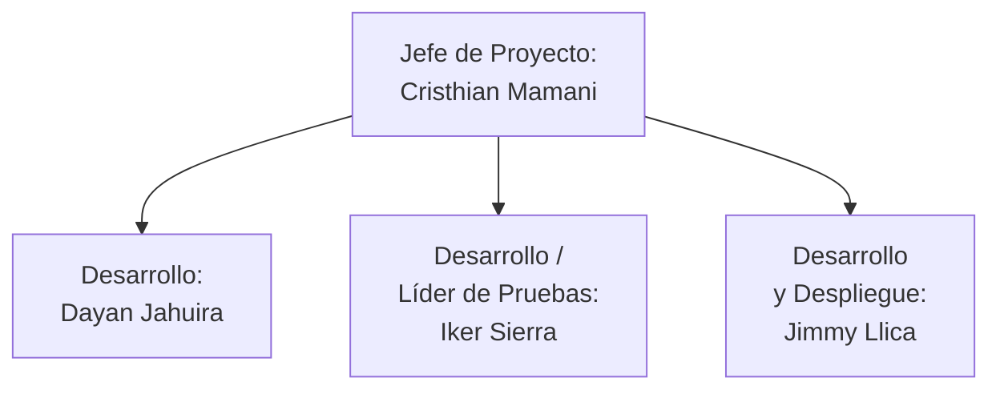

## 2. Visionamiento de la Empresa

### 2.1. Descripción del Problema

La ciudad de Tacna se abastece de agua potable bajo un esquema de racionamiento, con servicio solo durante algunas horas al día. Los hogares almacenan agua en tanques elevados, cisternas o bidones, pero no saben cuánta agua les queda ni hasta qué hora les alcanzará. Por eso se quedan sin agua de forma imprevista, compran agua de emergencia a sobreprecio y no ajustan su consumo a tiempo.

### 2.2. Objetivos de Negocios

- Reducir la incertidumbre de los hogares sobre cuánta agua les queda en su depósito.
- Disminuir los gastos por compra de agua de emergencia anticipando cuándo se acabará el agua.
- Fomentar el ahorro con recomendaciones concretas cuando el agua no alcanza hasta el próximo llenado.

### 2.3. Objetivos de Diseño

- Construir una aplicación Android nativa con Kotlin y Jetpack Compose.
- Garantizar el funcionamiento sin conexión, con una base de datos local (Room / SQLite) como única fuente de verdad: internet solo se usa para descargar datos públicos, que se guardan en el teléfono.
- Aplicar el patrón MVVM en la presentación y una organización por dominio (DDD), con el dominio independiente de Android.
- Consumir servicios web REST de fuentes oficiales y abiertas (Retrofit) para explicar al hogar de dónde viene su agua.
- Proteger la privacidad: los datos del hogar quedan en el teléfono, y el permiso de ubicación solo se pide al usar una función que lo necesita; el distrito también puede elegirse de una lista.

### 2.4. Alcance del proyecto

El sistema comprende la configuración del hogar (tipo y capacidad del depósito, habitantes, hábitos de consumo y hora habitual de llegada del agua), el registro de llenados completos o parciales, el cálculo del nivel actual del depósito, la proyección de la hora de agotamiento, el cálculo del déficit de litros hasta el próximo llenado, las recomendaciones de recorte de consumo, la declaración de "me quedé sin agua", con la que la aplicación aprende el consumo real del hogar, y una pantalla de avisos que alerta dentro de la aplicación sobre el déficit, el nivel bajo o la falta de un llenado registrado.

En la Unidad II se agregó la pestaña **Represas**: muestra de qué represa o pozo viene el agua del distrito del hogar ("Tu recorrido") y las represas de Tacna con datos oficiales de la Autoridad Nacional del Agua (ANA), en un mapa y en una lista. La aplicación también incluye un mapa de puntos de reparto de cisternas y la lectura de un sensor de nivel del tanque.

La aplicación es nativa para Android y se desarrolla con Kotlin, Jetpack Compose, Room, Koin, Navigation Compose y Retrofit. Los datos del hogar se guardan en una base de datos SQLite local y no se necesitan cuentas de usuario. Internet se usa solo para descargar datos públicos: el inventario de represas de la ANA, el distrito que corresponde a una ubicación (OpenStreetMap), los mapas de Google y las lecturas del sensor. Lo descargado de la ANA se guarda en el teléfono, de modo que la pestaña Represas también se puede consultar sin conexión.

Quedan fuera del alcance de esta versión: la consulta del sector y del cronograma oficial, la confirmación colaborativa de horarios, la digitalización de recibos, los retos y reportes ciudadanos, el asistente hídrico, la sincronización en la nube, el inicio de sesión con Google, las notificaciones push (los avisos solo se muestran dentro de la aplicación), el nivel actual de agua de las represas (la ANA no lo publica para Tacna) y la versión para iOS.

### 2.5. Viabilidad del Sistema

Según el Informe de Factibilidad (FD01, Versión 1.0), el proyecto es viable en las dimensiones técnica, económica (inversión estimada de S/ 17,720.00 con VAN positivo y TIR del 22.2 %), operativa, legal (Ley N.° 29733), social y ambiental. La reducción del alcance a una aplicación local refuerza la viabilidad técnica y legal: no hay costos de servidor y los datos del hogar no salen del dispositivo. Los servicios que usa la pestaña Represas (ANA y OpenStreetMap) son públicos y gratuitos, y solo reciben las coordenadas del teléfono cuando se detecta el distrito (RNF-03).

### 2.6. Información obtenida del Levantamiento de Información

*(Sección sin contenido en el documento original.)*

## 3. Análisis de Procesos

A partir de la observación del comportamiento de los hogares durante el racionamiento, se modelaron el proceso actual (manual) y el proceso propuesto (con AguardApp).

### a) Diagrama del Proceso Actual – Diagrama de actividades

Actualmente, el vecino llena su depósito cuando llega el agua y la usa sin saber cuánto le queda, lo que lo lleva a quedarse sin agua y comprarla de emergencia.

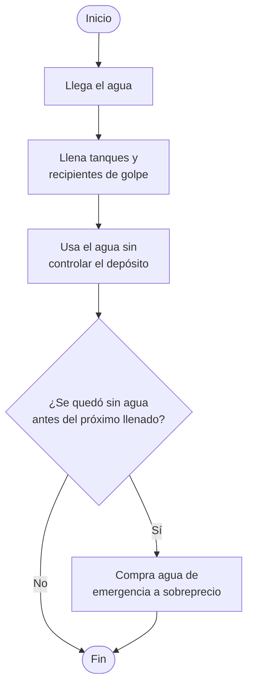

### b) Diagrama del Proceso Propuesto – Diagrama de actividades Inicial

Con AguardApp, el vecino configura su hogar una vez, registra cada llenado con un toque y consulta en todo momento cuánta agua le queda, hasta cuándo le alcanza y cuántos litros le faltarán antes del próximo llenado.

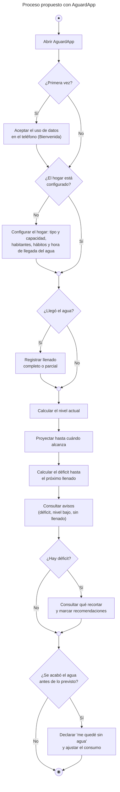

## 4. Especificación de Requerimientos de Software

### a) Cuadro de Requerimientos funcionales Inicial

| ID | Requerimiento | Descripción | Prioridad |
|---|---|---|---|
| RF-01 | Mostrar bienvenida | Presentar la aplicación la primera vez y pedir el consentimiento para guardar los datos del hogar en el teléfono. | Alta |
| RF-02 | Configurar el hogar | Registrar el tipo de depósito, su capacidad, los habitantes, los hábitos de consumo y la hora habitual de llegada del agua. | Alta |
| RF-03 | Registrar llenado | Registrar un llenado completo (la capacidad del depósito) o parcial (los litros indicados por el usuario). | Alta |
| RF-04 | Consultar el depósito | Mostrar el nivel actual, el porcentaje, el último llenado, hasta cuándo alcanza el agua y el consumo estimado. | Alta |
| RF-05 | Calcular el déficit | Calcular los litros que faltarán antes del próximo llenado. | Alta |
| RF-06 | Recomendar recortes | Mostrar recomendaciones de ahorro según los hábitos del hogar y recalcular en vivo los litros ganados y los que faltan. | Media |
| RF-07 | Declarar que se quedó sin agua | Registrar que el agua se acabó ahora o a una hora anterior y ajustar el consumo estimado del hogar. | Media |
| RF-08 | Operar sin conexión | Funcionar sin internet con la información guardada en el teléfono. | Alta |
| RF-09 | Consultar avisos | Mostrar dentro de la aplicación las alertas del depósito y llevar al usuario a la pantalla que las resuelve. | Media |
| RF-10 | Consultar el recorrido del agua | Mostrar de qué represa o pozo viene el agua del distrito del hogar y por dónde pasa hasta llegar al tanque. | Media |
| RF-11 | Indicar el distrito del hogar | Detectar el distrito con la ubicación del teléfono o dejar que el usuario lo elija de una lista. | Media |
| RF-12 | Consultar las represas de Tacna | Mostrar las represas de Tacna con datos oficiales de la ANA en un mapa y en una lista, con filtros por uso. | Media |
| RF-13 | Ver el detalle de una represa | Mostrar los datos de una represa y compararla con el tanque del hogar. | Baja |

### b) Cuadro de Requerimientos No funcionales

| ID | Requerimiento | Descripción |
|---|---|---|
| RNF-01 | Disponibilidad | Las funciones del depósito operan al 100 % sin conexión, con la base de datos local (Room / SQLite) como única fuente de verdad. La pestaña Represas muestra la copia guardada en el teléfono: solo necesita internet la primera vez y para renovarla (RN-13). |
| RNF-02 | Rendimiento | Las pantallas deben responder en un máximo de 2 segundos en condiciones normales; los cálculos se hacen en el dispositivo y las pantallas muestran primero lo guardado, sin esperar a la red. Cada consulta a un servicio externo espera como máximo 20 segundos. |
| RNF-03 | Privacidad y seguridad | Los datos del hogar no salen del teléfono: el respaldo automático de Android está desactivado, tanto a la nube como al pasar a otro teléfono. La aplicación declara los permisos de internet y de ubicación; la ubicación se pide en tiempo de ejecución al abrir el Mapa o al tocar "Usar mi ubicación" en Represas, y el distrito solo se detecta cuando el usuario toca ese botón, aunque el permiso ya se haya concedido en el Mapa. Para detectar el distrito, las coordenadas se envían una vez al buscador de direcciones de OpenStreetMap (Nominatim) y solo se guarda el nombre del distrito. No se piden cámara ni notificaciones. El usuario se identifica con un UUID local. |
| RNF-04 | Usabilidad y accesibilidad | Interfaz con textos legibles, una sola fuente tipográfica, colores sólidos, botones a lo ancho de la pantalla y mensajes de error claros debajo de cada campo. |
| RNF-05 | Compatibilidad | Android 7.0 (API 24) o superior; probado contra la API 36. |
| RNF-06 | Mantenibilidad | Arquitectura MVVM + DDD: dominio en Kotlin puro, independiente de Android; cada pantalla con un Screen y un ViewModel; sin capas innecesarias. |
| RNF-07 | Exactitud del cálculo | La estimación del consumo debe usar el historial real del hogar cuando haya datos suficientes y limitar los cambios bruscos ante un error del usuario. |
| RNF-08 | Uso responsable de servicios externos | Cada consulta se identifica con un User-Agent propio, como exige Nominatim. El inventario de la ANA se descarga como máximo una vez por semana (RN-13) y Nominatim se consulta solo al detectar el distrito, nunca de forma periódica. Los errores de red se muestran con un mensaje claro y la opción de reintentar. |

### c) Cuadro de Requerimientos funcionales Final

Tras el análisis se mantuvieron los requerimientos iniciales, se precisaron sus validaciones y se detalló el requerimiento de avisos (RF-09). En la Unidad II se agregaron los requerimientos de la pestaña Represas (RF-10 a RF-13):

| ID | Requerimiento | Descripción | Prioridad |
|---|---|---|---|
| RF-01 | Mostrar bienvenida | Se muestra solo la primera vez. La casilla de consentimiento empieza sin marcar y el botón "Empezar" queda deshabilitado hasta que el usuario la marque. | Alta |
| RF-02 | Configurar el hogar | Capacidad entre 200 y 5000 L; habitantes entre 1 y 12; hábitos (duchas por día, lavadora, riego) y hora del próximo llenado obligatoria, escrita con 4 números en formato de 24 h (el ":" se agrega solo). Capacidad (en pasos de 50 L), habitantes y duchas por día (0 a 6) se ajustan con controles que no permiten salir del rango. Si al tocar Guardar falta la hora o no es válida, no se guarda y se muestra el error debajo del campo ("Falta la hora del próximo llenado", "Escribe la hora completa" o "La hora no existe: usa de 00:00 a 23:59"). El consumo estimado se recalcula en vivo al cambiar habitantes o hábitos. Se usa al inicio y para editar desde Mi depósito. | Alta |
| RF-03 | Registrar llenado | Completo: se registran los litros de la capacidad. Parcial: los litros deben ser mayores que 0 y no superar la capacidad. No se pueden registrar llenados en el futuro. | Alta |
| RF-04 | Consultar el depósito | Nivel actual en litros y porcentaje, último llenado, "Te alcanza hasta", próximo llenado, consumo en L/h y promedio en L/persona/día. Se actualiza solo cada minuto. | Alta |
| RF-05 | Calcular el déficit | Déficit = consumo por hora × horas hasta el próximo llenado − nivel actual (nunca negativo). | Alta |
| RF-06 | Recomendar recortes | Solo se sugieren las acciones que corresponden a los hábitos del hogar, con litros calculados para ese hogar; se muestra "Ahorras X L" y "Aún te faltan Y L" o "¡Con esto te alcanza hasta el próximo llenado!". Lo marcado se guarda como plan de recortes hasta el próximo llenado (o hasta registrar un llenado nuevo), se vuelve a mostrar al entrar y se refleja en Mi depósito ("Con tus recortes") y en Avisos. | Media |
| RF-07 | Declarar que se quedó sin agua | Opciones "Se acabó ahora" o "Se acabó antes, a las HH:mm" (4 números en formato de 24 h; el ":" se agrega solo). Una hora posterior a la actual se toma como del día anterior. La hora debe estar completa, existir (00:00 a 23:59) y quedar después del último llenado; cada caso tiene su propio mensaje, y si la hora escrita aún no llega hoy y tampoco sirve como de ayer, se avisa "Esa hora todavía no llega". Antes de registrar se muestra lo proyectado frente a lo ocurrido, y la comparación se actualiza con la hora escrita. El botón Registrar no permite registros duplicados. | Media |
| RF-08 | Operar sin conexión | Todas las funciones del depósito trabajan con la base local. Represas usa la copia local del inventario de la ANA y, si no puede renovarla, avisa el error, muestra los datos guardados con su fecha y ofrece "Reintentar". | Alta |
| RF-09 | Consultar avisos | Se abre desde "Ver avisos" en Mi depósito. Los avisos se generan según RN-11, cada tipo con su color; al tocar uno se navega a Qué recortar, a Registrar llenado completo o de vuelta a Mi depósito. Sin avisos se indica que el depósito alcanza hasta el próximo llenado. | Media |
| RF-10 | Consultar el recorrido del agua | Se ve en la pestaña Represas, en "Tu recorrido": los tramos del distrito (RN-12) unidos por una línea, desde la fuente hasta "Tu tanque" (con la capacidad configurada). Los tramos por confirmar se muestran en color ocre. Las represas de un tramo aparecen como etiquetas con su volumen útil y al tocarlas se abre su detalle (RF-13). Debajo, un aviso explica qué significa el recorrido para el hogar; por ejemplo, que cuando bajan las represas la planta Calana produce menos. Sin distrito, en su lugar se pide indicarlo (RF-11). | Media |
| RF-11 | Indicar el distrito del hogar | "Usar mi ubicación" pide el permiso de ubicación; con él, se lee la ubicación actual (por red o GPS, con un máximo de 15 segundos) y se busca el distrito (RN-15). "Elegir de la lista" muestra los 8 distritos de la ciudad. El distrito se guarda en el teléfono, se muestra con su origen ("detectado por GPS" o "elegido por ti") y se cambia con "Cambiar". Si se niega el permiso, no se puede leer la ubicación o esta queda fuera de los distritos conocidos, se muestra un mensaje y se invita a elegir de la lista. Aunque el permiso ya esté concedido (por ejemplo, desde el Mapa), el distrito solo se detecta al tocar "Usar mi ubicación": las coordenadas nunca salen del teléfono sin una acción explícita del usuario. | Media |
| RF-12 | Consultar las represas de Tacna | En "Todas las represas de Tacna": filtros Todas, Agua potable, Riego y Minería (RN-14); un mapa con un marcador por represa, del color de su uso principal y con un anillo oscuro si abastece al distrito del hogar (el mapa no se arrastra, para no interferir con el desplazamiento de la pantalla; se acerca con los botones + y −); una leyenda; y una lista ordenada por volumen útil que muestra 4 represas y "Ver las N represas". Los datos que la ANA no tiene se muestran como "Sin dato". Al pie se indican la fuente y la fecha de descarga. Sin datos guardados ni conexión, se muestra el error con "Reintentar". | Media |
| RF-13 | Ver el detalle de una represa | Se abre al tocar una represa en el recorrido, en el mapa o en la lista. Muestra el uso según la ANA, si abastece al distrito del hogar, el volumen útil, la altitud, la altura de la presa, el año de inicio de operación, el río o quebrada, el distrito y el operador, con "Sin dato" donde falte, y la comparación con el tanque del hogar (RN-16). Si el hogar se abastece de pozos, se aclara que no recibe agua de esa represa. | Baja |

### d) Reglas de Negocio

| ID | Regla de negocio |
|---|---|
| RN-01 | El agua llega todos los días a la hora configurada: el próximo llenado es hoy a esa hora si aún no pasó, o mañana si ya pasó. |
| RN-02 | El nivel del depósito baja de forma lineal desde el último llenado según el consumo por hora; nunca es menor que cero ni mayor que la capacidad. |
| RN-03 | El consumo se estima en este orden: (1) el consumo aprendido en la última declaración de "me quedé sin agua", mientras no se registre un llenado nuevo ni se edite el hogar; (2) con el historial del hogar si hay datos suficientes; (3) con los hábitos declarados y (4) si no hay nada, suponiendo que el depósito dura 48 horas. |
| RN-04 | El historial alcanza para estimar con al menos un intervalo "observado" (terminó con "me quedé sin agua") o con dos intervalos entre llenados. Se usan los 5 más recientes; si entre ellos hay intervalos observados, se usan solo esos, porque son datos exactos. El consumo es la mediana de los litros por hora de los intervalos elegidos. |
| RN-05 | Dos llenados separados por menos de 6 horas se consideran un relleno y no cuentan para el consumo; un intervalo de más del doble de la mediana se descarta como un llenado olvidado. |
| RN-06 | El consumo por hábitos se calcula con 60 L por persona al día más 30 L por ducha, 100 L si usa lavadora y 150 L si riega el jardín, repartidos en 12 horas de uso al día. |
| RN-07 | Al declarar que se quedó sin agua, el nuevo consumo no puede variar más de un 30 % respecto del anterior en una sola declaración. |
| RN-08 | Al registrar un llenado se descarta el consumo aprendido y se vuelve a estimar con todo el historial. |
| RN-09 | Las recomendaciones de recorte y su ahorro diario son: no lavar ropa hoy (100 L, si usa lavadora), no regar el jardín (150 L, si riega), duchas de 5 minutos (la mitad de 30 L por ducha × duchas por día × habitantes), lavar los platos en un recipiente (8 L por persona) y echar al inodoro agua ya usada (10 L por persona). El ahorro se multiplica por la parte del día de uso (12 h) que falta hasta el próximo llenado, con un máximo de un día; así es coherente con el cálculo del déficit. |
| RN-10 | El usuario se identifica con un UUID local que se crea una sola vez y no cambia. |
| RN-11 | Los avisos se generan así: si el hogar no tiene llenados, solo "¿Llegó el agua a tu casa?"; si queda déficit después de descontar los recortes elegidos (RF-05 y RF-06), "Tu reserva se agota antes de que vuelva el agua" (con "aun con tus recortes" si hay un plan); y si el nivel actual es menor al 20 % de la capacidad, "Te queda poca agua". Los avisos se calculan al vuelo y no se guardan. |
| RN-12 | El recorrido del agua de cada distrito sale de una tabla armada por el equipo con noticias y estudios públicos, porque la ANA no publica qué represa abastece a cada zona: Ciudad Nueva y Alto de la Alianza reciben agua de las represas del Uchusuma (Paucarani, Casiri y Condorpico) por la captación Cerro Blanco, la planta Calana y el reservorio R1; Gregorio Albarracín, de los pozos de Viñani; Tacna (Cercado) y Pocollay, de las represas del Uchusuma por la planta Calana o Alto Lima (por confirmar); y de Calana, Pachía y La Yarada-Los Palos aún no hay datos. El recorrido se presenta como aproximado y debe confirmarse con EPS Tacna. |
| RN-13 | El inventario de represas se descarga de la ANA (solo las del departamento de Tacna) y se guarda en el teléfono. Se renueva si tiene más de 7 días o si el usuario toca "Reintentar"; si la descarga falla, se conservan los datos anteriores. Una represa sin nombre o sin ubicación válida se descarta. |
| RN-14 | El uso de cada represa se deduce del texto de la ANA: "suministro de agua" es agua potable, "riego" o "regadío" es riego, y "minería" es minería. El color del marcador sigue el uso principal (primero agua potable, luego minería y luego riego); cada filtro muestra las represas que tienen ese uso entre los suyos. Los campos que la ANA marca como "No disponible" se tratan como dato faltante. |
| RN-15 | El distrito se obtiene del campo de ciudad de la dirección que devuelve OpenStreetMap, sin importar tildes ni mayúsculas: "Coronel Gregorio Albarracín Lanchipa" es Gregorio Albarracín. "Tacna" debe coincidir completo, porque también es el nombre de la región. Solo se guarda el distrito, no las coordenadas. |
| RN-16 | La comparación con el tanque divide el volumen útil de la represa (1 hm³ = 1 000 000 000 L) entre la capacidad del tanque del hogar, y se expresa en miles o millones de tanques; por ejemplo, Paucarani (8.5 hm³) equivale a 7.7 millones de tanques de 1 100 L. |

## 5. Fase de Desarrollo

### 5.1. Perfiles de Usuario

| Perfil | Descripción | Permisos principales |
|---|---|---|
| Jefe de hogar | Persona que administra el agua de la casa | Configurar el hogar, registrar llenados, consultar el depósito y el déficit, ver qué recortar, declarar que se quedó sin agua, consultar los avisos y consultar de dónde viene su agua y las represas de Tacna |

> La aplicación tiene un único perfil: no hay cuentas ni roles, y cada teléfono guarda los datos de un hogar.

### 5.2. Modelo Conceptual

#### a) Diagrama de Paquetes

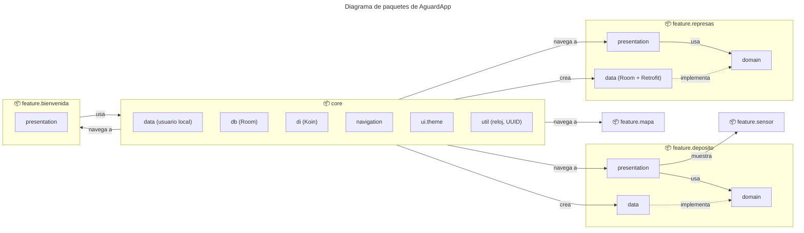

> `feature.represas` se agregó en la Unidad II. `feature.mapa` (puntos de cisterna) y `feature.sensor` (nivel del tanque desde ThingSpeak) se muestran como un solo bloque porque este documento no los especifica en detalle.

#### b) Diagrama de Casos de Uso

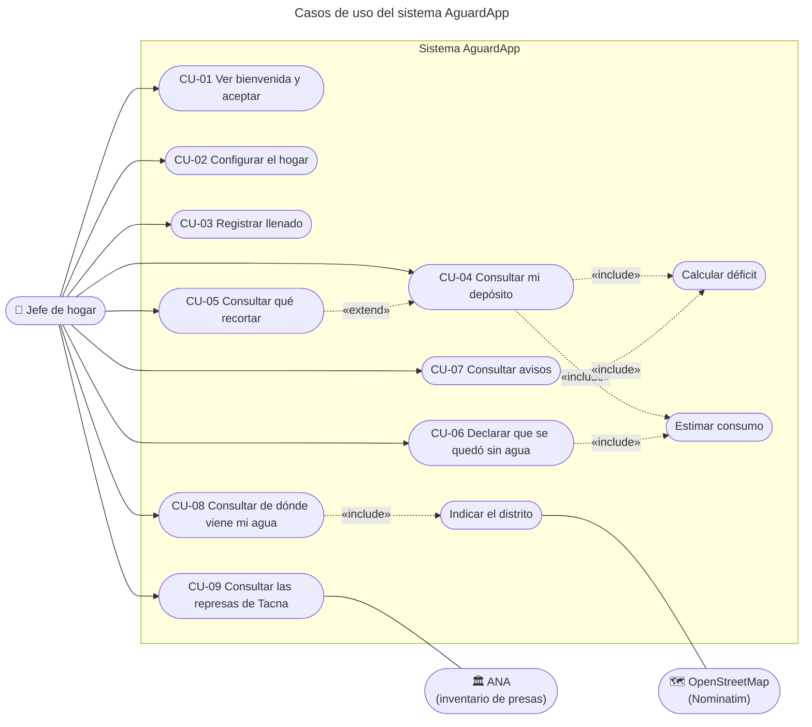

> ANA y OpenStreetMap son actores secundarios: sistemas externos que la aplicación consulta por medio de servicios REST.

#### c) Escenarios de Caso de Uso (narrativa)

| CU-01 | Ver bienvenida y aceptar |
|---|---|
| **Actor** | Jefe de hogar |
| **Precondición** | Es la primera vez que se abre la aplicación. |
| **Flujo principal** | 1) La aplicación muestra qué hace y la casilla de consentimiento, sin marcar. 2) El usuario marca la casilla (recién entonces se habilita "Empezar") y toca "Empezar". 3) El sistema guarda que la bienvenida fue completada. 4) Navega a Configurar hogar (o a Mi depósito si el hogar ya estaba configurado). |
| **Postcondición** | La bienvenida no vuelve a mostrarse. |

| CU-02 | Configurar el hogar |
|---|---|
| **Actor** | Jefe de hogar |
| **Precondición** | El usuario pasó la bienvenida. |
| **Flujo principal** | 1) El usuario elige el tipo de depósito (tanque elevado, cisterna o bidones). 2) Ajusta la capacidad, los habitantes y los hábitos. 3) Escribe la hora a la que suele llegar el agua (4 números, formato 24 h). 4) El sistema muestra en vivo el consumo estimado. 5) El usuario toca "Guardar". 6) El sistema valida la hora, guarda el perfil y calcula el consumo por hábitos. |
| **Flujo alternativo** | Si al tocar "Guardar" falta la hora o no es válida, no se guarda y se muestra el error debajo del campo. Capacidad, habitantes y duchas no pueden salir de su rango porque sus controles lo impiden. |
| **Postcondición** | El perfil del hogar queda guardado; al editar, se descarta el consumo aprendido. |

| CU-03 | Registrar llenado |
|---|---|
| **Actor** | Jefe de hogar |
| **Precondición** | El hogar está configurado. |
| **Flujo principal** | 1) Desde Mi depósito, el usuario elige "llenado completo" o "llenado parcial" (también puede llegar al llenado completo desde el aviso "¿Llegó el agua a tu casa?"). 2) Si es completo, confirma. 3) Si es parcial, escribe los litros. 4) El sistema valida y guarda el llenado con la fecha y hora actuales. 5) Vuelve a Mi depósito, que se actualiza solo. |
| **Flujo alternativo** | Si los litros son 0 o superan la capacidad, se muestra el error y no se guarda. |
| **Postcondición** | El depósito parte del nuevo llenado. |

| CU-04 | Consultar mi depósito |
|---|---|
| **Actor** | Jefe de hogar |
| **Precondición** | El hogar está configurado. |
| **Flujo principal** | 1) El sistema obtiene el perfil y el último llenado. 2) Estima el consumo (RN-03). 3) Calcula el nivel actual, la hora de agotamiento, el próximo llenado y el déficit. 4) Muestra la información y la actualiza cada minuto. |
| **Flujo alternativo** | Si no hay llenados, se invita a registrar el primero. |
| **Postcondición** | El usuario sabe cuánta agua le queda y hasta cuándo. |

| CU-05 | Consultar qué recortar |
|---|---|
| **Actor** | Jefe de hogar |
| **Precondición** | El depósito tiene déficit. |
| **Flujo principal** | 1) El usuario toca "¿Qué puedo recortar?". 2) El sistema muestra las recomendaciones que corresponden a sus hábitos. 3) El usuario marca acciones. 4) El sistema recalcula en vivo los litros ahorrados y los que faltan, y guarda el plan hasta el próximo llenado. 5) Mi depósito y Avisos muestran el déficit que queda con los recortes. |
| **Postcondición** | El usuario conoce un plan para que el agua alcance. |

| CU-06 | Declarar que se quedó sin agua |
|---|---|
| **Actor** | Jefe de hogar |
| **Precondición** | Existe al menos un llenado. |
| **Flujo principal** | 1) El sistema muestra lo proyectado frente a lo ocurrido. 2) El usuario elige "Se acabó ahora" o escribe la hora (HH:mm); la comparación se actualiza con esa hora. 3) El sistema valida la hora (si es posterior a la actual, se toma como de ayer). 4) Registra el agotamiento y ajusta el consumo (RN-07). 5) Vuelve a Mi depósito. |
| **Flujo alternativo** | Si la hora está incompleta, no existe o no queda después del último llenado (aun tomándola como de ayer), se muestra el error debajo del campo y no se registra. |
| **Postcondición** | El depósito queda en cero desde ese momento y el consumo aprendido se usa en las siguientes proyecciones. |

| CU-07 | Consultar avisos |
|---|---|
| **Actor** | Jefe de hogar |
| **Precondición** | El hogar está configurado. |
| **Flujo principal** | 1) Desde Mi depósito, el usuario toca "Ver avisos". 2) El sistema obtiene el perfil y el depósito y calcula el próximo llenado, el déficit y el nivel actual. 3) Muestra los avisos que correspondan (RN-11). 4) El usuario toca un aviso. 5) El sistema navega a la pantalla que lo resuelve: Qué recortar (déficit), Registrar llenado completo (sin llenado) o Mi depósito (nivel bajo). |
| **Flujo alternativo** | Si no hay avisos, se muestra "No tienes avisos" y que el depósito alcanza hasta el próximo llenado. |
| **Postcondición** | El usuario conoce las alertas de su depósito y la acción para atenderlas. |

| CU-08 | Consultar de dónde viene mi agua |
|---|---|
| **Actor** | Jefe de hogar (actor secundario: OpenStreetMap) |
| **Precondición** | El usuario pasó la bienvenida. |
| **Flujo principal** | 1) El usuario toca la pestaña Represas. 2) Si no hay un distrito guardado, el sistema pide indicarlo. 3) El usuario toca "Usar mi ubicación" y concede el permiso. 4) El sistema lee la ubicación, consulta el distrito en OpenStreetMap y lo guarda (RN-15). 5) Muestra "Tu recorrido" del distrito (RN-12) y su aviso. 6) El usuario toca una represa del recorrido y el sistema abre su detalle (CU-09). |
| **Flujo alternativo** | 3a) El usuario toca "Elegir de la lista" y elige su distrito. 3b) Si niega el permiso, no se puede leer la ubicación o esta queda fuera de los distritos conocidos, se muestra un mensaje y se invita a elegir de la lista. 3c) Si el permiso ya estaba concedido, no se vuelve a pedir, pero la detección empieza igual solo al tocar el botón. 5a) Si el recorrido no está confirmado, los tramos pendientes se marcan "Por confirmar con EPS Tacna". En cualquier momento, "Cambiar" permite elegir otro distrito. |
| **Postcondición** | El distrito queda guardado y el usuario sabe de dónde viene su agua. |

| CU-09 | Consultar las represas de Tacna |
|---|---|
| **Actor** | Jefe de hogar (actor secundario: ANA) |
| **Precondición** | Hay conexión la primera vez, o datos guardados de una descarga anterior. |
| **Flujo principal** | 1) Al abrir la pestaña Represas, el sistema muestra las represas guardadas y, si no hay o tienen más de 7 días, las descarga de la ANA y las guarda (RN-13). 2) Muestra el mapa, la leyenda y la lista ordenada por volumen útil. 3) El usuario elige un filtro de uso (RN-14). 4) Toca una represa en el mapa o en la lista. 5) El sistema muestra su detalle y la comparación con el tanque del hogar (RN-16). |
| **Flujo alternativo** | 1a) Si la descarga falla y hay datos guardados, se avisa el error, se muestran los datos guardados con su fecha y se ofrece "Reintentar". 1b) Si falla y no hay datos guardados, se muestra el error con "Reintentar". |
| **Postcondición** | El usuario conoce las represas de Tacna, su uso, su tamaño y cuáles abastecen a su distrito. |

### 5.3. Modelo Lógico

#### a) Análisis de Objetos

Diagrama de robustez: frontera (*boundary*), controladores (*control*) y entidades (*entity*).

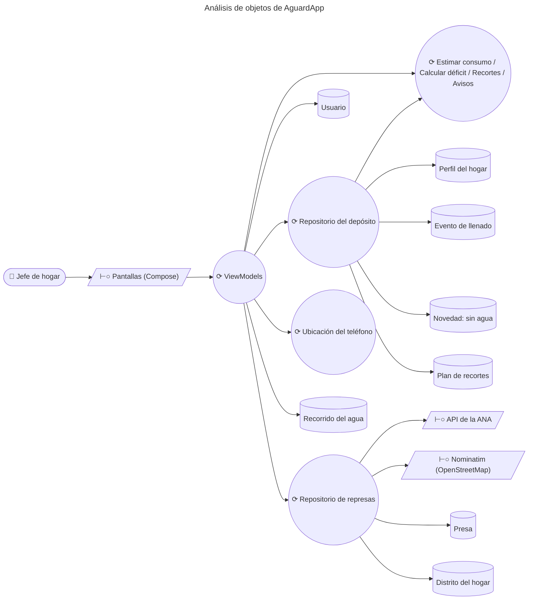

#### b) Diagrama de Actividades con objetos

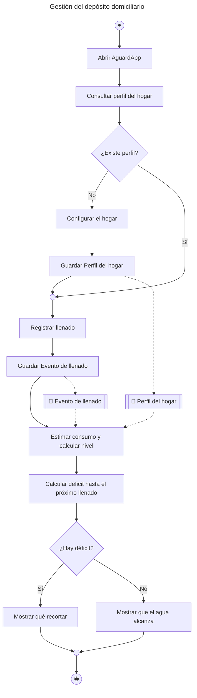

#### c) Diagrama de Secuencia

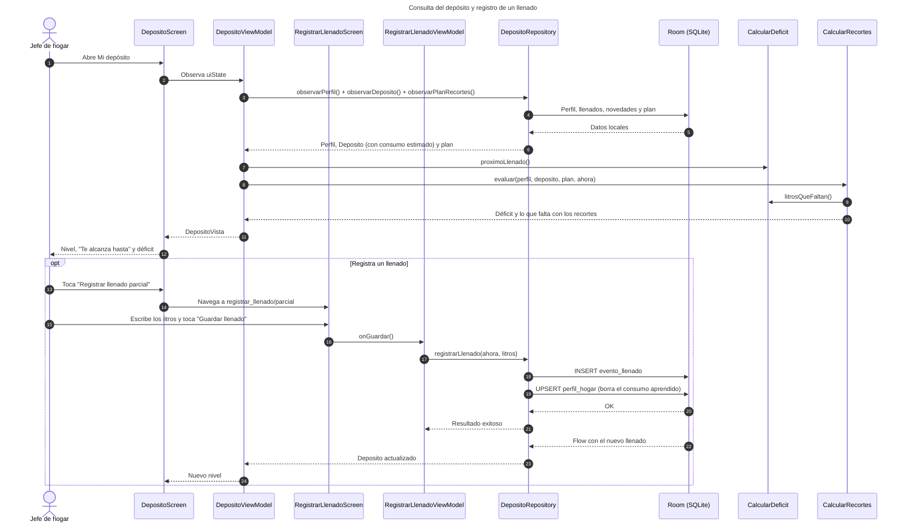

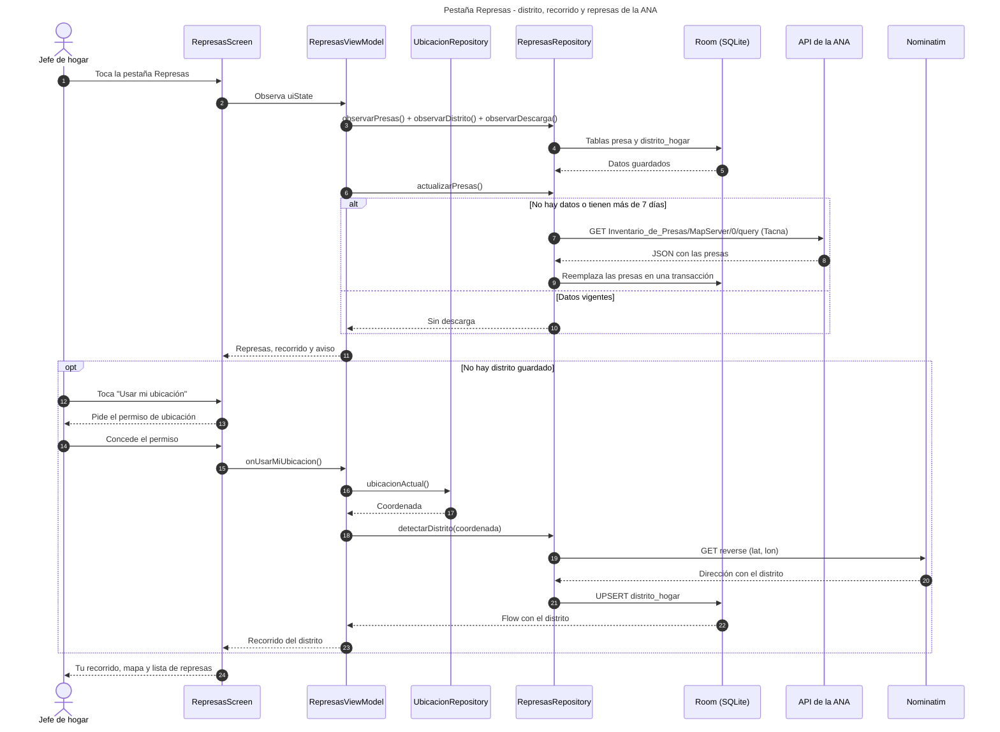

#### d) Diagrama de Clases

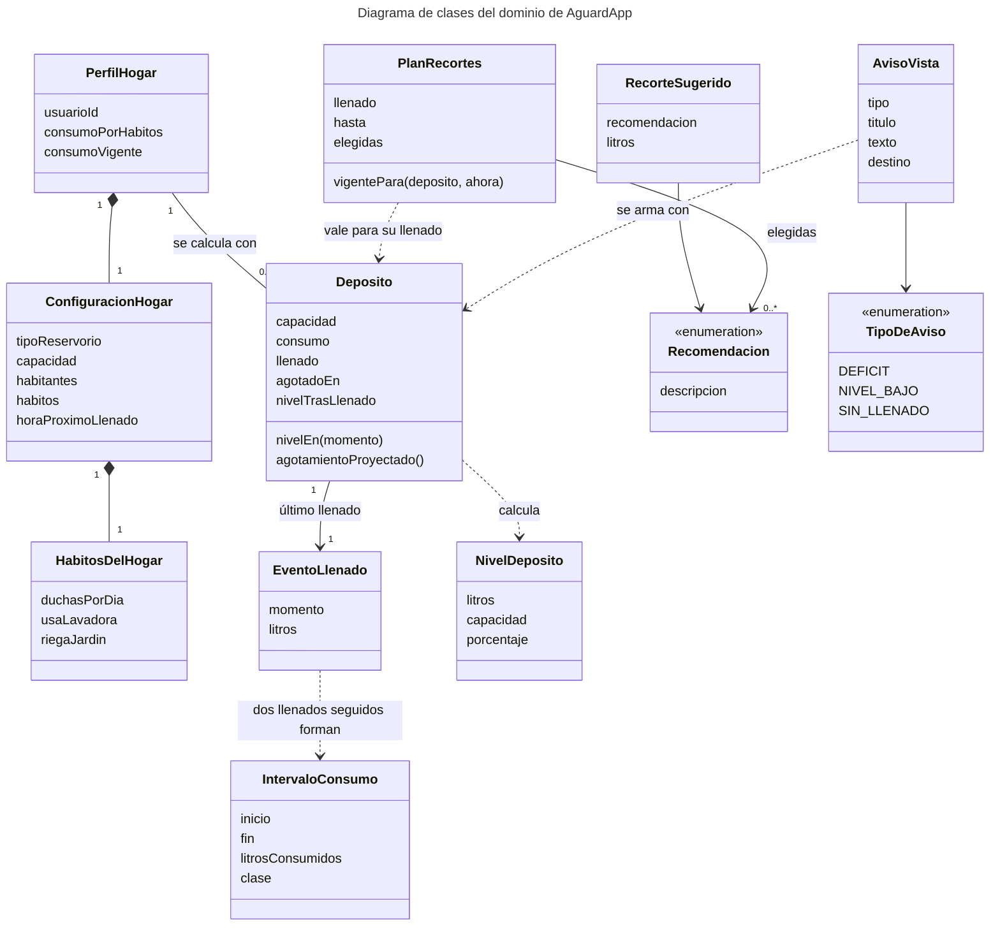

> `AvisoVista` y `TipoDeAviso` pertenecen a la capa de presentación (`AvisosViewModel`): los avisos se derivan del `Deposito` y no se guardan en la base de datos. Los litros de cada `RecorteSugerido` los calcula el caso de uso `CalcularRecortes` según los hábitos y habitantes del hogar (RN-09); `PlanRecortes` sí se guarda (tabla `plan_recortes`) y solo vale para el llenado en que se creó y hasta el próximo llenado.

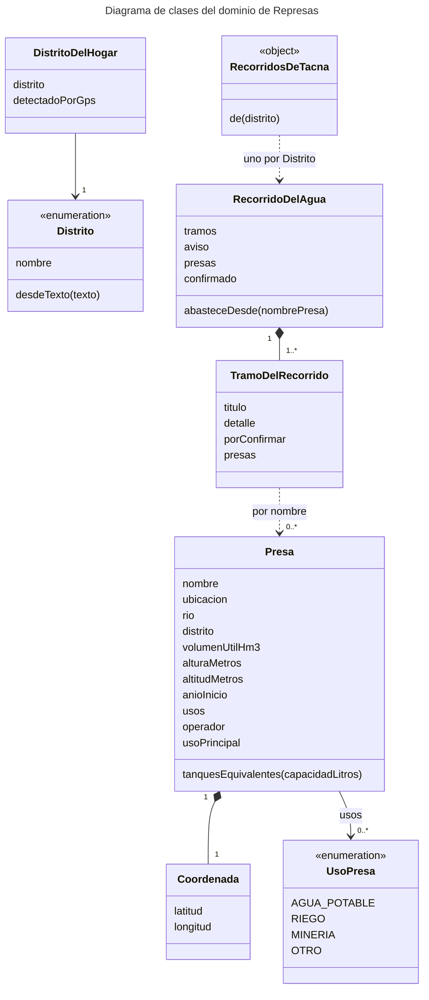

> `Presa` y `DistritoDelHogar` se guardan en Room (tablas `presa` y `distrito_hogar`). `RecorridoDelAgua` no se guarda: `RecorridosDeTacna` lo arma a partir del distrito con la tabla de RN-12, y sus tramos nombran las represas tal como aparecen en el inventario de la ANA.

## 6. Conclusiones

- La especificación definió las funcionalidades de AguardApp mediante 13 requerimientos funcionales, 8 no funcionales y 16 reglas de negocio, centrados en la gestión del depósito domiciliario de agua.
- Centrar el producto en el Depósito permitió entregar una solución completa y simple, que funciona sin conexión ni cuentas de usuario; las funciones nuevas se agregaron sin perder esa base.
- La pestaña Represas cubre los temas de la Unidad II: consume dos servicios REST (ANA y OpenStreetMap) con Retrofit, usa la ubicación del teléfono y guarda lo descargado en Room, de modo que también se consulta sin conexión.
- El modelado de procesos evidencia la mejora frente al proceso manual: el hogar sabe cuánta agua le queda, hasta cuándo le alcanza y cuántos litros le faltarán antes del próximo llenado.
- Los diagramas de paquetes, casos de uso, actividades, secuencia y clases reflejan la arquitectura MVVM + DDD implementada en el código.

## 7. Recomendaciones

- Validar las reglas de estimación del consumo (RN-03 a RN-07) con hogares piloto y ajustar sus parámetros.
- Agregar pruebas unitarias para la capa de dominio del Depósito, que es Kotlin puro y no depende de Android; la pestaña Represas ya cuenta con 21 pruebas unitarias.
- Confirmar con EPS Tacna el recorrido del agua de cada distrito (RN-12), en especial el del Cercado, Pocollay, Calana, Pachía y La Yarada-Los Palos.
- Mostrar el nivel actual de las represas si la ANA o el Proyecto Especial Tacna lo publican como servicio.
- Mantener la trazabilidad entre requerimientos, casos de uso y pruebas en las próximas versiones.
- Evaluar en versiones futuras los módulos que quedaron fuera del alcance (sector, notificaciones push a partir de los avisos actuales, sincronización) sin perder el funcionamiento sin conexión.

## 8. Bibliografía

- Congreso de la República del Perú. (2011). *Ley N.° 29733 – Ley de Protección de Datos Personales*. Lima, Perú.
- Sommerville, I. (2016). *Ingeniería de Software* (10.ª ed.). Pearson Educación.
- Pressman, R. S. (2014). *Ingeniería del Software: Un Enfoque Práctico* (8.ª ed.). McGraw-Hill.
- IEEE. (1998). *IEEE Std 830-1998 – Recommended Practice for Software Requirements Specifications*.
- Evans, E. (2003). *Domain-Driven Design: Tackling Complexity in the Heart of Software*. Addison-Wesley.

## 9. Webgrafía

- Documentación de Jetpack Compose: <https://developer.android.com/compose>
- Documentación de Room: <https://developer.android.com/training/data-storage/room>
- Guía de arquitectura de apps Android: <https://developer.android.com/topic/architecture>
- Documentación de Koin: <https://insert-koin.io/docs>
- Documentación de Retrofit: <https://square.github.io/retrofit/>
- Autoridad Nacional del Agua, inventario de presas (servicio ArcGIS REST): <https://geosnirh.ana.gob.pe/server/rest/services/ONRH/Inventario_de_Presas/MapServer>
- Política de uso de Nominatim (OpenStreetMap): <https://operations.osmfoundation.org/policies/nominatim/>
- Andina (14/01/2026). *Tacna: racionan dotación de agua a la población ante déficit de recurso hídrico y lluvias*: <https://andina.pe/agencia/noticia-tacna-racionan-dotacion-agua-a-poblacion-ante-deficit-recurso-hidrico-y-lluvias-1059257.aspx>
- Documentación de Mermaid: <https://mermaid.js.org/>
