# FD04 — Documento de Arquitectura de Software (SAD)

## Proyecto AguardApp

**Sistema:** AguardApp — sistema móvil para la gestión de la reserva domiciliaria de agua y la anticipación de cortes durante el racionamiento hídrico en Tacna.  
**Curso:** Soluciones Móviles I  
**Docente:** Mag. Alberto Johnatan Flor Rodríguez  
**Versión:** 2.3  
**Fecha:** 11/11/2026  
**Lugar:** Tacna — Perú, 2026

### Integrantes

- Jahuira Pilco, Dayan Elvis (2022075749)
- Llica Mamani, Jimmy Mijair (2023076789)
- Mamani Cori, Cristhian Carlos (2023077282)
- Sierra Ruiz, Iker Alberto (2023077090)

---

## Control de versiones

| Versión | Hecha por | Revisada por | Aprobada por | Fecha | Motivo |
|---|---|---|---|---|---|
| 1.0 | DJ - JL - CM - IS | AFR | AFR | 30/09/2026 | Versión original |
| 2.0 | DJ - JL - CM - IS | — | — | 02/10/2026 | Actualización a la arquitectura de AguardApp: Android nativo, MVVM + DDD, módulo Depósito y base de datos local |
| 2.1 | DJ - JL - CM - IS | — | — | 02/10/2026 | Se agrega la pantalla Avisos (RF-09) y se actualiza la base de datos a la versión 2 |
| 2.2 | DJ - JL - CM - IS | — | — | 14/10/2026 | Se alinea con el código: plan de recortes (tabla `plan_recortes`, base de datos versión 3 con `AutoMigration`), secuencias y clases corregidas, inyección con Koin y respaldo automático desactivado |
| 2.3 | DJ - JL - CM - IS | — | — | 11/11/2026 | Unidad II: se agrega el módulo Represas (RF-10 a RF-13) con Retrofit (API de la ANA y Nominatim), ubicación del teléfono y base de datos versión 4 (tablas `presa` y `distrito_hogar`); se actualizan la inyección con Koin (cuatro módulos y ViewModels inyectados), los componentes, el despliegue y la privacidad, porque la aplicación ahora usa internet y ubicación |

---

# 1. Introducción

## 1.1. Propósito — Modelo 4+1

Este documento presenta una visión global de la arquitectura del sistema AguardApp utilizando el modelo de vistas 4+1 de Kruchten. Describe las decisiones arquitectónicas significativas mediante cinco vistas complementarias: casos de uso, lógica, implementación o desarrollo, procesos y despliegue físico.

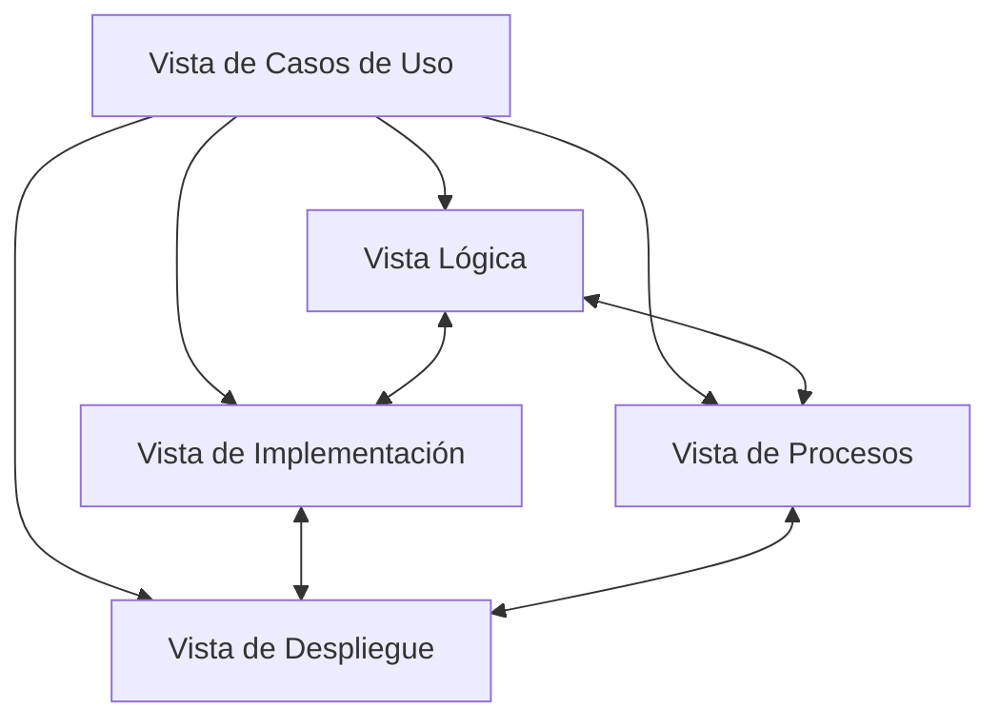

## 1.2. Alcance

El documento describe la arquitectura de la versión actual de AguardApp: una aplicación Android nativa de un solo módulo (`app`) con persistencia local en Room. Detalla las funcionalidades `bienvenida`, `deposito` y `represas`; esta última, agregada en la Unidad II, consume servicios REST públicos (la API de la ANA y Nominatim de OpenStreetMap) con Retrofit y usa la ubicación del teléfono. Las funcionalidades `mapa` (puntos de cisterna sobre Google Maps) y `sensor` (nivel del tanque desde ThingSpeak) se muestran en los diagramas de paquetes, componentes y despliegue, sin detalle de diseño. Cubre la organización en capas y paquetes, la interacción entre objetos, el modelo de datos, los componentes, los procesos y el despliegue. Sirve de guía para el desarrollo y el mantenimiento del sistema.

## 1.3. Definiciones, siglas y abreviaturas

| Término | Definición |
|---|---|
| SAD | Software Architecture Document (Documento de Arquitectura de Software). |
| Modelo 4+1 | Modelo de Kruchten con cinco vistas arquitectónicas complementarias. |
| MVVM | Model-View-ViewModel, patrón de la capa de presentación. |
| DDD | Domain-Driven Design: el código se organiza alrededor del dominio (modelos, repositorios y casos de uso). |
| Jetpack Compose | Kit de interfaz declarativa de Android. |
| Room | Biblioteca de persistencia local sobre SQLite. |
| Koin | Biblioteca de inyección de dependencias para Kotlin. |
| REST | Estilo de servicios web en el que cada recurso tiene una URL y se consulta con métodos HTTP (GET, POST…); aquí las respuestas llegan en JSON. |
| Retrofit / OkHttp | Retrofit convierte una interfaz de Kotlin en un cliente REST; OkHttp es el cliente HTTP que usa por debajo (tiempos de espera, cabeceras). |
| ANA | Autoridad Nacional del Agua. Publica su inventario de presas como servicio ArcGIS REST, sin clave. |
| Nominatim | Buscador de direcciones de OpenStreetMap: convierte coordenadas en una dirección. |
| hm³ | Hectómetro cúbico: un millón de metros cúbicos, es decir, mil millones de litros. |
| DTO | Data Transfer Object: clase que refleja el JSON de un servicio externo y no sale de la capa de datos. |
| UiState | Clase de datos con todo lo que una pantalla necesita mostrar. |
| QA | Quality Attribute (atributo de calidad del software). |

## 1.4. Organización del documento

El documento se organiza en cuatro secciones: introducción; objetivos y restricciones arquitectónicas; representación de la arquitectura mediante las vistas del modelo 4+1; y atributos de calidad del software.

---

# 2. Objetivos y restricciones arquitectónicas

## 2.1. Priorización de requerimientos

### 2.1.1. Requerimientos funcionales

| ID | Descripción | Prioridad |
|---|---|---|
| RF-01 | Mostrar la bienvenida y pedir el consentimiento la primera vez | Alta |
| RF-02 | Configurar el hogar (depósito, habitantes, hábitos y hora del próximo llenado) | Alta |
| RF-03 | Registrar un llenado completo o parcial | Alta |
| RF-04 | Consultar el depósito: nivel, hasta cuándo alcanza y consumo | Alta |
| RF-05 | Calcular el déficit hasta el próximo llenado | Alta |
| RF-06 | Recomendar recortes de consumo | Media |
| RF-07 | Declarar que se quedó sin agua y ajustar el consumo | Media |
| RF-08 | Operar sin conexión | Alta |
| RF-09 | Consultar los avisos del depósito (déficit, nivel bajo, sin llenado) | Media |
| RF-10 | Consultar el recorrido del agua del distrito del hogar | Media |
| RF-11 | Indicar el distrito del hogar (ubicación del teléfono o lista) | Media |
| RF-12 | Consultar las represas de Tacna con datos de la ANA (mapa, filtros y lista) | Media |
| RF-13 | Ver el detalle de una represa y compararla con el tanque | Baja |

### 2.1.2. Requerimientos no funcionales — atributos de calidad

| ID | Atributo | Descripción | Prioridad |
|---|---|---|---|
| RNF-01 | Disponibilidad | El depósito funciona 100 % sin conexión, con Room como única fuente de verdad. Represas muestra la copia local del inventario de la ANA y solo necesita internet la primera vez y para renovarla. | Alta |
| RNF-02 | Privacidad y seguridad | Los datos del hogar no salen del teléfono. Se piden los permisos de internet y de ubicación; las coordenadas solo se envían a Nominatim al detectar el distrito, y solo se guarda el distrito. Identidad con UUID local. | Alta |
| RNF-03 | Usabilidad | Interfaz simple, una sola fuente, colores sólidos y errores claros debajo de cada campo. | Alta |
| RNF-04 | Compatibilidad | Android 7.0 (API 24) o superior; probado contra la API 36. | Media |
| RNF-05 | Mantenibilidad | MVVM + DDD; dominio en Kotlin puro, independiente de Android; un Screen y un ViewModel por pantalla. | Alta |
| RNF-06 | Uso responsable de servicios externos | Cada consulta se identifica con un User-Agent propio y espera como máximo 20 s; la ANA se consulta como máximo una vez por semana y Nominatim solo al detectar el distrito. | Media |

## 2.2. Restricciones

- La aplicación debe funcionar sin conexión, con la base de datos local como única fuente de verdad: el inventario de la ANA y el distrito del hogar se guardan en Room, y las pantallas los leen desde allí.
- El dominio (`domain/`) no puede depender de Android, Room, Retrofit ni Koin: es Kotlin puro.
- Solo se usan tecnologías gratuitas y de código abierto; no hay backend propio. Solo se consumen servicios públicos y gratuitos (ANA, OpenStreetMap, Google Maps y ThingSpeak).
- Los servicios externos se consumen solo desde `data/remote` con Retrofit; sus DTO no salen de la capa de datos y el resto de la aplicación trabaja con modelos del dominio.
- La persistencia se realiza con Room; el esquema se exporta en `app/schemas/`.
- Las pantallas no contienen lógica de negocio: solo pintan el `UiState` y llaman funciones del ViewModel.

---

# 3. Representación de la arquitectura del sistema

## 3.1. Vista de casos de uso

El actor principal es el jefe de hogar, que usa la aplicación en su propio teléfono. La ANA y OpenStreetMap son actores secundarios: sistemas externos que la aplicación consulta por REST.

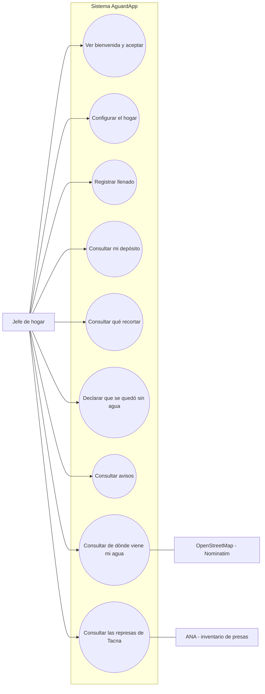

## 3.2. Vista lógica

### 3.2.1. Diagrama de subsistemas / paquetes

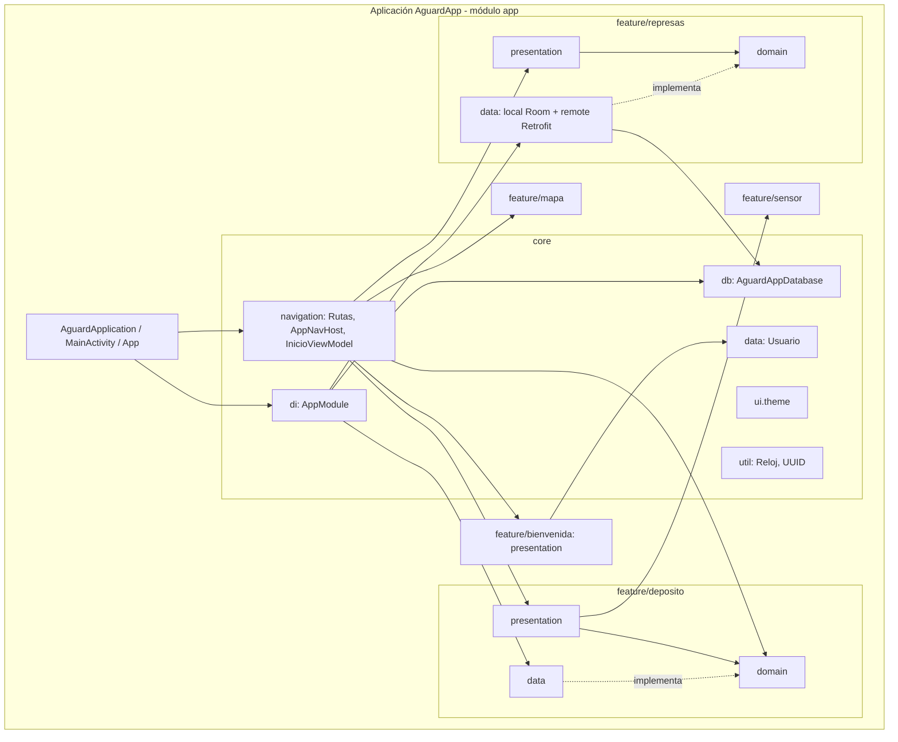

`feature/represas` reutiliza el modelo `Coordenada` de `feature/mapa` y el perfil del hogar de `feature/deposito` (para comparar las represas con el tanque).

### 3.2.2. Diagramas de secuencia — vista de diseño

#### Módulo 1: Inicio y bienvenida

##### 1.1. Inicio de la aplicación y elección de la primera pantalla

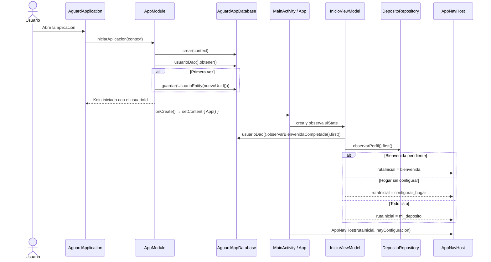

##### 1.2. Aceptar y empezar


#### Módulo 2: Depósito

##### 2.1. Configuración del hogar

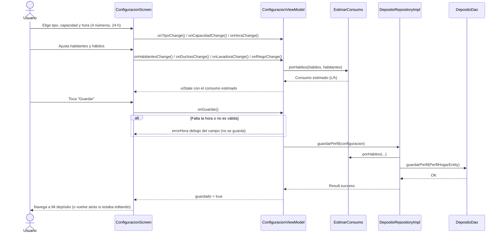

##### 2.2. Registro de un llenado (completo o parcial)

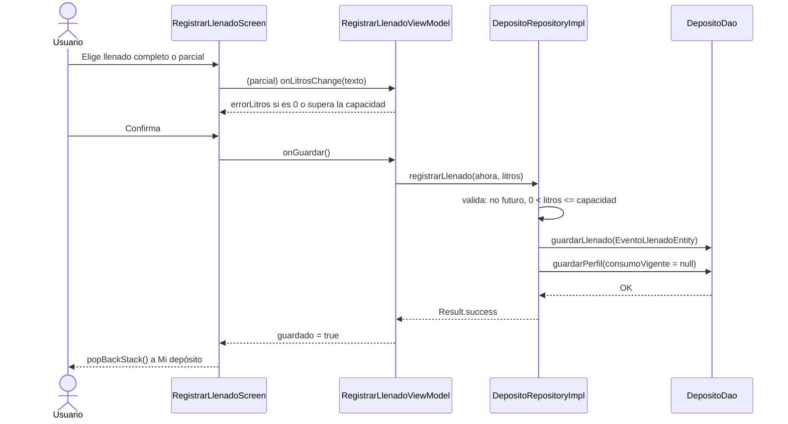

##### 2.3. Monitoreo reactivo del depósito

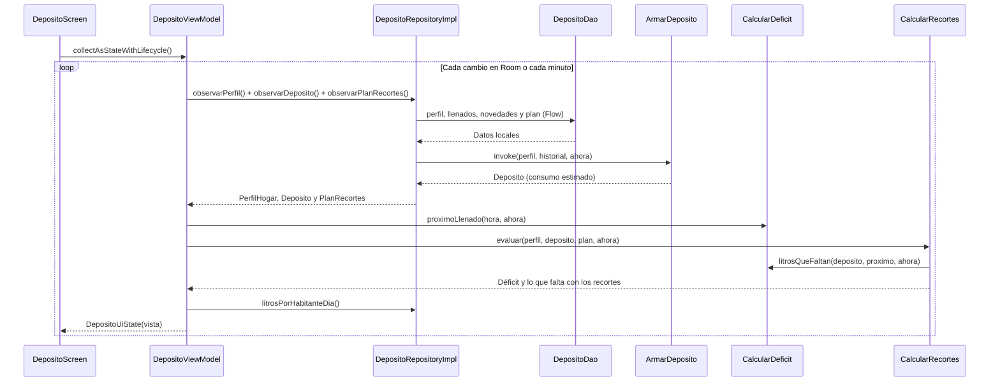

##### 2.4. Declaración de "me quedé sin agua"

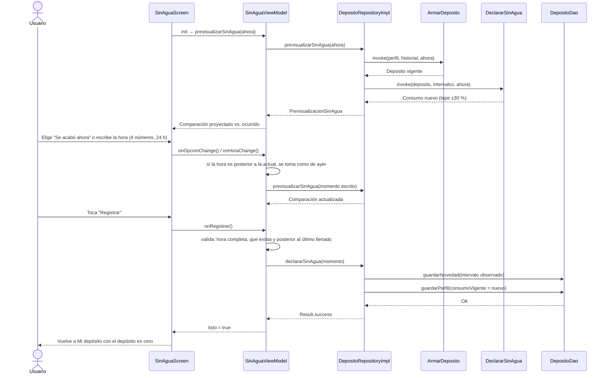

##### 2.5. Qué recortar

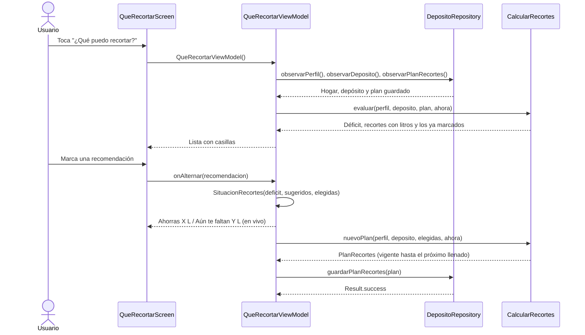

##### 2.6. Avisos

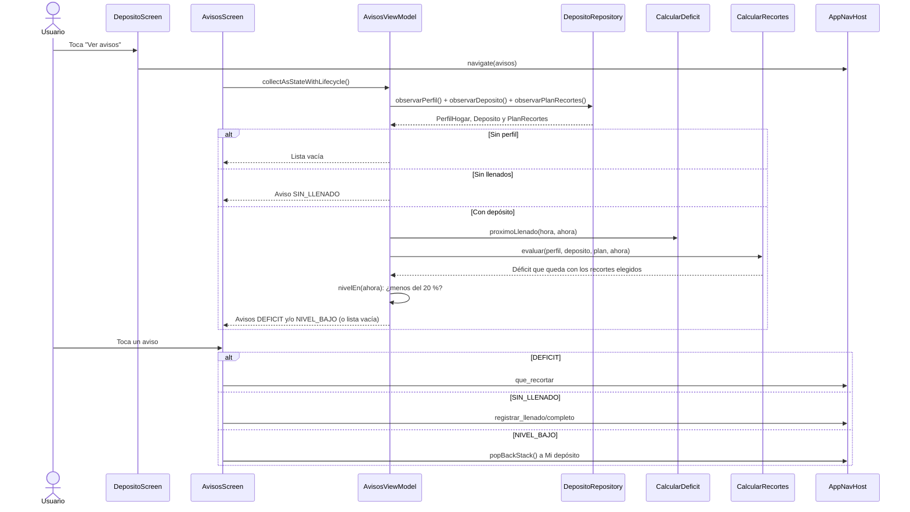

#### Módulo 3: Represas

##### 3.1. Apertura de la pestaña y descarga del inventario de la ANA

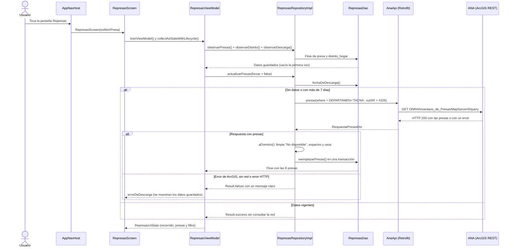

##### 3.2. Detección del distrito del hogar

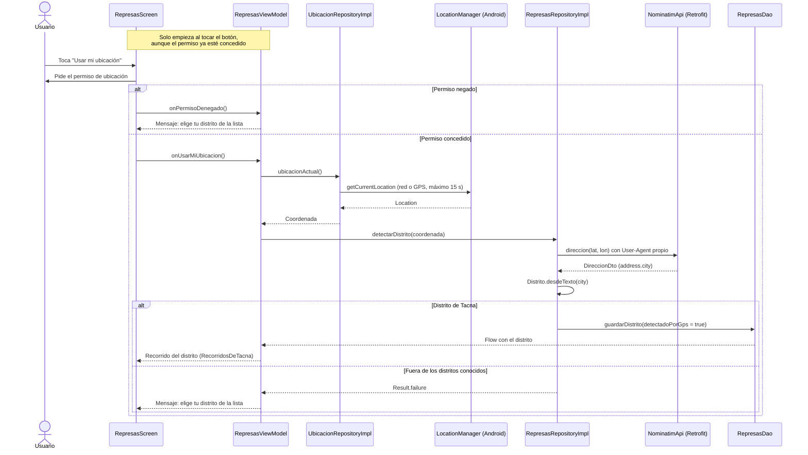

Si el usuario elige "Elegir de la lista", `onElegirDistrito(distrito)` lo guarda con `detectadoPorGps = false`, sin usar la ubicación ni la red.

##### 3.3. Detalle de una represa

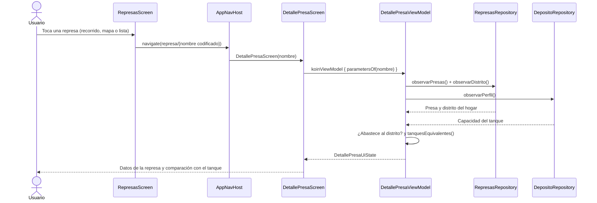

### 3.2.3. Diagrama de colaboración

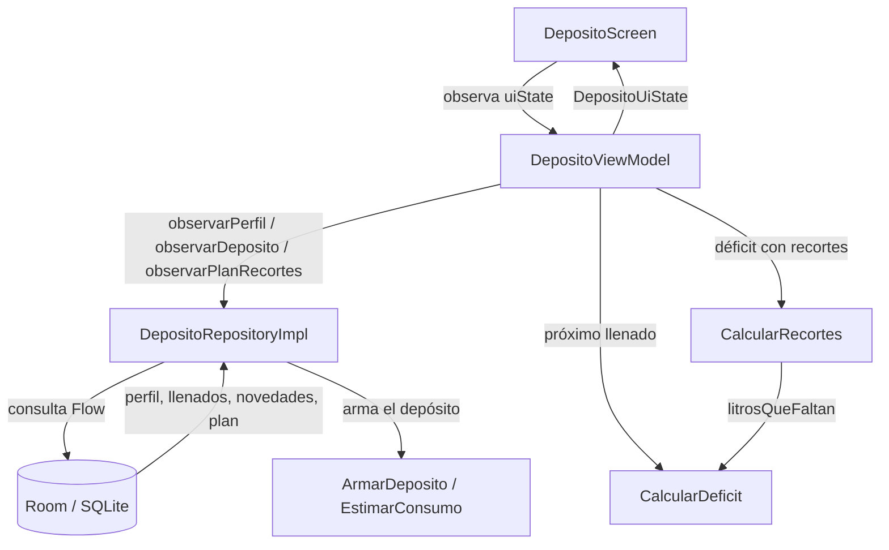

Colaboración del módulo Represas:

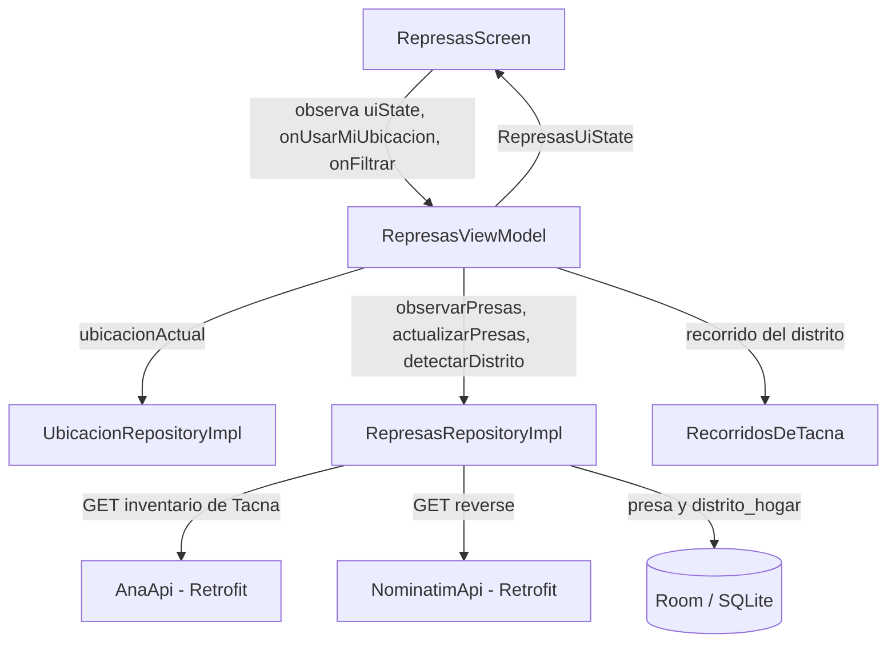

### 3.2.4. Diagrama de objetos

Ejemplo de un hogar con un tanque de 1 100 L, 4 personas, 2 duchas por día y lavadora, que llenó a las 5:10 a.m. Sin historial, el consumo sale de los hábitos: (4 × (60 + 2 × 30) + 100) / 12 = 48,3 L/h. A las 2:00 p.m. quedan 1 100 − 48,3 × 8,83 ≈ 673 L, y el tanque se agota a las 3:56 a.m. del día siguiente; como el agua vuelve a las 5:00 a.m., el déficit es de 48,3 × 15 − 673 ≈ 52 L.

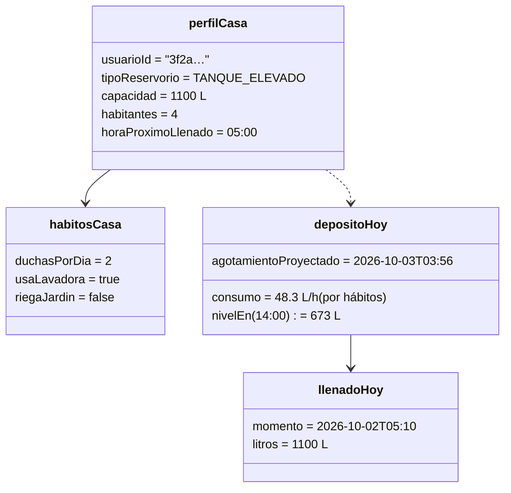

Ejemplo del módulo Represas para el mismo hogar, ubicado en Ciudad Nueva. Paucarani es una de las represas de su recorrido, y con un tanque de 1 100 L equivale a 8.5 × 10⁹ / 1 100 ≈ 7.7 millones de tanques.

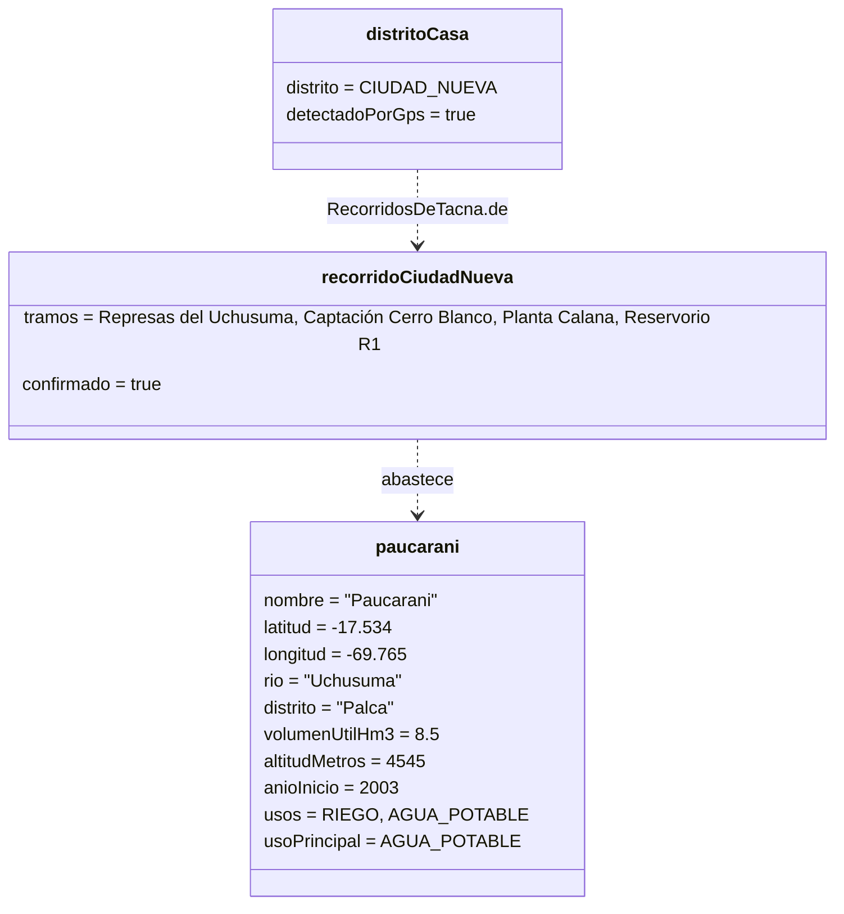

### 3.2.5. Diagrama de clases

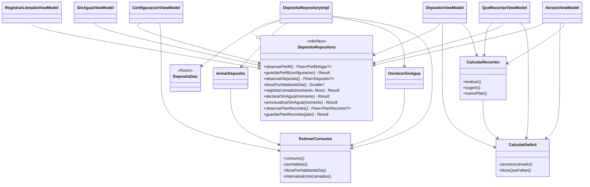

Clases del módulo Represas:

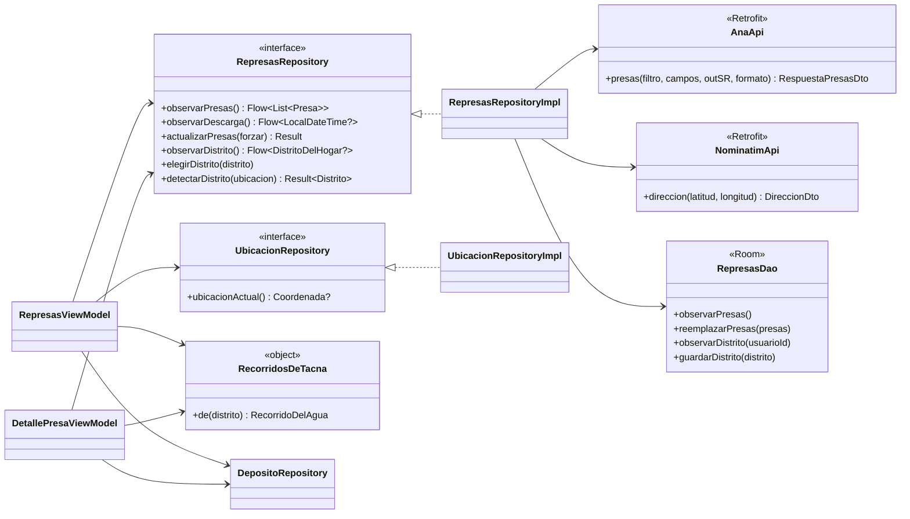

`RepresasDao` es una clase abstracta (no una interfaz) para que `reemplazarPresas` borre e inserte dentro de una transacción. Los DTO de la ANA y de Nominatim (`RespuestaPresasDto`, `DireccionDto`) se convierten en modelos del dominio en `RepresasMapper.kt`.

### 3.2.6. Diagrama de base de datos

Base de datos local `aguardapp.db` (Room, versión 4). De la versión 2 a la 3 se agregó la tabla `plan_recortes`, y de la 3 a la 4, las tablas `presa` y `distrito_hogar` del módulo Represas; ambos pasos usan una migración automática (`AutoMigration`), que conserva los datos existentes. Si falta la migración de alguna versión (por ejemplo, de la 1 a la 2), Room borra la base anterior y crea la nueva (`fallbackToDestructiveMigration`). Los esquemas de cada versión se exportan en `app/schemas/`.

Las relaciones del diagrama son lógicas: todas las tablas guardan el `usuarioId`, pero no se declaran claves foráneas. Las fechas y horas se guardan como texto ISO; `plan_recortes.recortes` guarda los nombres de las recomendaciones elegidas separados por comas, y los dos consumos de `perfil_hogar` admiten nulo. Los avisos no tienen tabla, porque se calculan a partir del depósito.

`presa` es una copia del inventario de la ANA, igual para todos los usuarios, por eso no guarda `usuarioId`. Se reemplaza completa en cada descarga (`reemplazarPresas`, dentro de una transacción) y `descargadaEn` indica cuándo se descargó; `usos` guarda los usos separados por comas, y los campos que la ANA no tiene quedan en nulo. `distrito_hogar` guarda solo el nombre del distrito, no las coordenadas. El recorrido del agua no tiene tabla: se arma en el dominio a partir del distrito.

```mermaid
erDiagram
    USUARIO ||--o| PERFIL_HOGAR : configura
    USUARIO ||--o{ EVENTO_LLENADO : registra
    USUARIO ||--o{ NOVEDAD_DEPOSITO : declara
    USUARIO ||--o| PLAN_RECORTES : planifica
    USUARIO ||--o| DISTRITO_HOGAR : "vive en"

    USUARIO {
      string id PK
      boolean bienvenidaCompletada
    }
    PERFIL_HOGAR {
      string usuarioId PK
      string tipoReservorio
      double capacidadLitros
      int habitantes
      int duchasPorDia
      boolean usaLavadora
      boolean riegaJardin
      string horaProximoLlenado
      double consumoPorHabitosLitrosHora
      double consumoVigenteLitrosHora
    }
    EVENTO_LLENADO {
      string id PK
      string usuarioId
      string momento
      double litros
    }
    NOVEDAD_DEPOSITO {
      string id PK
      string usuarioId
      string momento
      string inicioObservado
      double litrosObservados
    }
    PLAN_RECORTES {
      string usuarioId PK
      string llenado
      string hasta
      string recortes
    }
    DISTRITO_HOGAR {
      string usuarioId PK
      string distrito
      boolean detectadoPorGps
    }
    PRESA {
      string nombre PK
      double latitud
      double longitud
      string rio
      string distrito
      double volumenUtilHm3
      double alturaMetros
      double altitudMetros
      int anioInicio
      string usos
      string operador
      string descargadaEn
    }
```

## 3.3. Vista de implementación — desarrollo

### 3.3.1. Diagrama de arquitectura de software / paquetes

```mermaid
flowchart LR
    subgraph P[Presentación - MVVM]
      UI[Screens Jetpack Compose]
      VM[ViewModels + UiState]
    end
    subgraph DOM[Dominio - Kotlin puro]
      MOD[model]
      REPI[repository: interfaz]
      UC[usecase]
    end
    subgraph D[Datos]
      IMPL[RepositoryImpl: Deposito, Represas, Ubicacion]
      MAP[mapper]
      ROOM[local: Room DAO y entidades]
      REMOTE[remote: APIs Retrofit y DTO]
    end

    UI --> VM
    VM --> UC
    VM --> REPI
    IMPL -. implementa .-> REPI
    IMPL --> UC
    IMPL --> MAP
    IMPL --> ROOM
    IMPL --> REMOTE
    UC --> MOD
```

Estructura de carpetas del código:

```
app/src/main/java/com/example/aguardapp/
├── AguardApplication.kt · MainActivity.kt · App.kt
├── core/
│   ├── data/Usuario.kt            (entidad y DAO del usuario local)
│   ├── db/AguardAppDatabase.kt    (Room)
│   ├── di/AppModule.kt            (Koin: moduloApp, moduloRed, moduloRepresas, moduloViewModels)
│   ├── navigation/                (Rutas, AppNavHost, BarraInferior, InicioViewModel)
│   ├── ui/theme/                  (colores, tema, tipografía, barra de estado)
│   └── util/Reloj.kt              (hora actual y UUID)
└── feature/
    ├── bienvenida/presentation/   (BienvenidaScreen, BienvenidaViewModel)
    ├── deposito/
    │   ├── domain/   model/ · repository/ · usecase/
    │   ├── data/     DepositoRepositoryImpl · local/ · mapper/
    │   └── presentation/  *Screen + *ViewModel · FormatoDeposito · componentes/ (Comunes, ControlesConfiguracion, Tanque)
    ├── mapa/                      (puntos de cisterna sobre Google Maps)
    ├── sensor/                    (nivel del tanque desde ThingSpeak)
    └── represas/
        ├── domain/   model/ (Presa, Distrito, RecorridoDelAgua) · repository/ (RepresasRepository, UbicacionRepository)
        ├── data/     RepresasRepositoryImpl · UbicacionRepositoryImpl · local/ · remote/ (AnaApi, NominatimApi) · mapper/
        └── presentation/  RepresasScreen · DetallePresaScreen · MapaDeRepresas · *ViewModel · FormatoRepresas

app/src/test/java/.../feature/represas/   (pruebas unitarias del repositorio, del dominio y de los formatos)
app/src/test/resources/                   (respuestas reales de la ANA y de Nominatim para las pruebas)
```

Los casos de uso se agrupan por tema: `CalcularDeposito.kt` contiene `ArmarDeposito`, `DeclararSinAgua` e `HistorialDeposito`; `EstimarConsumo.kt` contiene también `ParametrosConsumo`, con todas las constantes del cálculo; y `CalcularRecortes.kt` contiene `SituacionRecortes` y `RecorteSugerido`.

### 3.3.2. Diagrama de arquitectura del sistema / componentes

```mermaid
flowchart LR
    subgraph DEVICE[Teléfono Android]
      subgraph APK[AguardApp]
        UI[Jetpack Compose + Navigation]
        VM[ViewModels]
        KOIN[Koin]
        DOMAIN[Dominio]
        REPO[Repositorios]
        HTTP[Retrofit + OkHttp]
        MAPS[Google Maps Compose]
      end
      LOCAL[(SQLite: aguardapp.db)]
      GPS[Ubicación de Android]
    end
    ANA[(API de la ANA - ArcGIS REST)]
    OSM[(Nominatim - OpenStreetMap)]
    TS[(ThingSpeak)]
    GM[(Google Maps)]

    UI --> VM
    VM --> DOMAIN
    VM --> REPO
    KOIN -. inyecta .-> VM
    KOIN -. inyecta .-> REPO
    REPO <--> LOCAL
    REPO --> GPS
    REPO --> HTTP
    HTTP -- HTTPS --> ANA
    HTTP -- HTTPS --> OSM
    HTTP -- HTTPS --> TS
    UI --> MAPS
    MAPS -- HTTPS --> GM
```

> Represas descarga el inventario de la ANA y consulta Nominatim; el Mapa carga los mapas de Google y el sensor lee ThingSpeak. Los datos del hogar no se envían a ningún servicio.

**Inyección de dependencias:** `iniciarAplicacion` crea la base de datos y el usuario local, y luego inicia Koin con cuatro módulos definidos en `core/di/AppModule.kt`:

| Módulo | Qué registra |
|---|---|
| `moduloApp` | El `Reloj`, el `UsuarioDao` y los repositorios del depósito y del mapa. |
| `moduloRed` | El Retrofit de ThingSpeak, su API y el repositorio del sensor. |
| `moduloRepresas` | Un `OkHttpClient` con tiempos de espera de 20 s y un interceptor que agrega la cabecera User-Agent; las APIs de la ANA y de Nominatim, cada una con su propio Retrofit; y los repositorios de represas y de ubicación. |
| `moduloViewModels` | Todos los ViewModels. |

Cada pantalla obtiene su ViewModel con `koinViewModel()`; los que necesitan un dato de la ruta lo reciben con `parametersOf`: el tipo de llenado en `RegistrarLlenadoViewModel` y el nombre de la represa en `DetallePresaViewModel`. Los casos de uso no tienen estado y cada ViewModel o repositorio los crea directamente.

## 3.4. Vista de procesos

### 3.4.1. Diagrama de actividad del sistema

```mermaid
flowchart TD
    A([Inicio]) --> B[Iniciar Room y Koin; crear el usuario local si no existe]
    B --> C{¿Bienvenida completada?}
    C -- No --> D[Mostrar bienvenida]
    D --> E
    C -- Sí --> E{¿Hogar configurado?}
    E -- No --> F[Configurar hogar]
    F --> G
    E -- Sí --> G[Mostrar Mi depósito]
    G --> H[Leer perfil, llenados, novedades y plan de recortes desde Room]
    H --> I[Estimar consumo y calcular nivel, agotamiento y déficit]
    I --> J[Actualizar la interfaz]
    J --> K{¿Acción del usuario?}
    K -- Registrar llenado --> L[Guardar llenado]
    K -- Sin agua --> M[Guardar novedad y nuevo consumo]
    K -- Qué recortar --> N[Mostrar recomendaciones y guardar el plan marcado]
    K -- Ver avisos --> O[Mostrar avisos: déficit, nivel bajo o sin llenado]
    K -- Editar hogar --> F
    K -- Ninguna, pasa un minuto --> H
    L --> H
    M --> H
    N --> H
    O --> G
```

Las operaciones con la base de datos se ejecutan en corrutinas fuera del hilo principal; las pantallas observan `StateFlow` y se recomponen solo cuando cambia su estado.

### 3.4.2. Diagrama de actividad de la pestaña Represas

```mermaid
flowchart TD
    A([Abrir la pestaña Represas]) --> B[Mostrar las presas y el distrito guardados en Room]
    B --> C{"¿Presas guardadas con<br/>menos de 7 días?"}
    C -- No --> D[Descargar el inventario de la ANA]
    D --> E{"¿Descarga correcta?"}
    E -- Sí --> F[Reemplazar las presas en Room]
    E -- No --> G[Avisar el error y seguir con lo guardado]
    C -- Sí --> H{"¿Hay distrito guardado?"}
    F --> H
    G --> H
    H -- Sí --> K[Mostrar el recorrido del distrito]
    H -- No --> L[Pedir el distrito]
    L -- Usar mi ubicación --> I{"¿Hay permiso de<br/>ubicación o lo concede?"}
    I -- Sí --> J[Leer la ubicación y consultar Nominatim]
    I -- No --> L
    L -- Elegir de la lista --> M[Guardar el distrito elegido]
    J --> N{"¿Es un distrito de Tacna?"}
    N -- Sí --> O[Guardar el distrito detectado]
    N -- No --> L
    O --> K
    M --> K
    K --> P[Mostrar mapa, filtros y lista de represas]
    P --> Q([Tocar una represa para ver su detalle])
```

En el código, la descarga de la ANA y la detección del distrito corren en corrutinas separadas del `viewModelScope`; la pantalla se actualiza con cada resultado, porque ambos se guardan en Room y llegan por `Flow`.

## 3.5. Vista de despliegue — vista física

### 3.5.1. Diagrama de despliegue

```mermaid
flowchart LR
    APP["Teléfono Android 7.0+<br/>proceso com.example.aguardapp<br/>(AguardApp APK)"]
    DB[("Teléfono: almacenamiento<br/>interno aguardapp.db")]
    GPS["Teléfono: servicio de<br/>ubicación de Android"]
    ANA[["Internet: geosnirh.ana.gob.pe<br/>(inventario de presas)"]]
    OSM[["Internet: nominatim.openstreetmap.org"]]
    GM[["Internet: Google Maps"]]
    TS[["Internet: api.thingspeak.com"]]
    APP <--> DB
    APP --> GPS
    APP -- "HTTPS / JSON" --> ANA
    APP -- "HTTPS / JSON" --> OSM
    APP -- HTTPS --> GM
    APP -- "HTTPS / JSON" --> TS
```

La aplicación se distribuye como un único APK. No requiere servidor propio ni cuenta de usuario. Usa internet solo para descargar datos públicos; el depósito y lo ya descargado de Represas funcionan sin conexión. La API key de Google Maps y los datos del canal de ThingSpeak se leen de `local.properties` al compilar; la ANA y Nominatim no piden clave.

---

# 4. Atributos de calidad del software

## 4.1. Escenario de funcionalidad

Los atributos de calidad (QA) son propiedades medibles que indican en qué grado el sistema satisface las necesidades de sus interesados. AguardApp entrega de forma completa las funciones del módulo Depósito: configurar el hogar, registrar llenados, consultar el nivel y el déficit, ver qué recortar, declarar que se quedó sin agua y consultar los avisos del depósito. En la Unidad II se agregó la pestaña Represas: el recorrido del agua según el distrito del hogar, las represas de Tacna con datos de la ANA y el detalle de cada una.

## 4.2. Escenario de usabilidad

Un usuario sin experiencia configura su hogar y registra un llenado en menos de un minuto: los controles son botones grandes, la capacidad, los habitantes y las duchas se ajustan con controles que no permiten salir del rango, la hora se escribe con 4 números (el ":" se agrega solo) y, si falta un dato al tocar Guardar, el formulario no se guarda y muestra el error exacto debajo del campo. El diseño usa colores sólidos y una sola fuente para facilitar la lectura.

## 4.3. Escenario de confiabilidad

Sin conexión, el depósito funciona igual porque no depende de la red, y Represas muestra la última copia del inventario de la ANA con su fecha. Si la ANA responde con un error (incluso con HTTP 200, como hace ArcGIS), si no hay red o si el JSON no se puede leer, los datos guardados no se borran: la descarga nueva solo reemplaza a la anterior, dentro de una transacción, cuando trae represas válidas. Las validaciones del dominio y del repositorio impiden datos incoherentes (llenados en el futuro, litros mayores que la capacidad, agotamientos anteriores al último llenado), y el tope de ±30 % evita que un error del usuario desordene la estimación del consumo.

## 4.4. Escenario de rendimiento

Las pantallas leen siempre de la base local; los cálculos (nivel, agotamiento, déficit) son operaciones simples en memoria. La pantalla Mi depósito se refresca cada minuto sin bloquear la interfaz. Represas muestra lo guardado de inmediato y descarga en segundo plano, como máximo una vez por semana, con un tiempo de espera de 20 s por consulta; la lectura de la ubicación espera como máximo 15 s.

## 4.5. Escenario de mantenibilidad

El dominio es Kotlin puro y no depende de Android, por lo que puede probarse con pruebas unitarias simples. Cada pantalla tiene solo dos archivos (Screen y ViewModel), y la inyección de dependencias está en un único archivo de Koin, con un módulo por área, lo que facilita agregar nuevas funcionalidades.

Represas tiene 21 pruebas unitarias. Las del repositorio pasan por Retrofit y Gson de verdad, con respuestas reales de la ANA y de Nominatim guardadas en `src/test/resources`, sin depender de la red: es posible porque el repositorio recibe sus APIs y su DAO por constructor, y la prueba los reemplaza por un cliente que responde desde esos archivos y por un DAO en memoria.

## 4.6. Otros escenarios

**Privacidad:** el `AndroidManifest.xml` declara los permisos `INTERNET`, `ACCESS_COARSE_LOCATION` y `ACCESS_FINE_LOCATION`. La ubicación se pide en tiempo de ejecución, al abrir el Mapa o al tocar "Usar mi ubicación" en Represas; el distrito solo se detecta al tocar ese botón, aunque el permiso ya se haya concedido en el Mapa, de modo que las coordenadas nunca salen del teléfono sin una acción explícita del usuario. Para detectar el distrito, las coordenadas se envían una vez a Nominatim y solo se guarda el nombre del distrito; quien no quiera compartir su ubicación puede elegirlo de una lista. Los datos del hogar (perfil, llenados, consumo y recortes) no se envían a ningún servicio, en línea con la privacidad por diseño de la Ley N.° 29733. El respaldo automático de Android está desactivado (`allowBackup="false"`, y `backup_rules.xml` y `data_extraction_rules.xml` excluyen todos los datos), de modo que la base local no se copia a la nube ni a otro teléfono. El consentimiento de la bienvenida empieza sin marcar: el usuario debe aceptarlo de forma explícita.
