# FD04 — Documento de Arquitectura de Software (SAD)

## Proyecto AguardApp

**Sistema:** AguardApp — sistema móvil para la gestión de la reserva domiciliaria de agua y la anticipación de cortes durante el racionamiento hídrico en Tacna.  
**Curso:** Soluciones Móviles I  
**Docente:** Mag. Alberto Johnatan Flor Rodríguez  
**Versión:** 2.3  
**Fecha:** 11/11/2026  
**Lugar:** Tacna — Perú, 2026

### Integrantes

- Jahuira Pilco, Dayan Elvis (2022075749)
- Llica Mamani, Jimmy Mijair (2023076789)
- Mamani Cori, Cristhian Carlos (2023077282)
- Sierra Ruiz, Iker Alberto (2023077090)

---

## Control de versiones

| Versión | Hecha por | Revisada por | Aprobada por | Fecha | Motivo |
|---|---|---|---|---|---|
| 1.0 | DJ - JL - CM - IS | AFR | AFR | 30/09/2026 | Versión original |
| 2.0 | DJ - JL - CM - IS | — | — | 02/10/2026 | Actualización a la arquitectura de AguardApp: Android nativo, MVVM + DDD, módulo Depósito y base de datos local |
| 2.1 | DJ - JL - CM - IS | — | — | 02/10/2026 | Se agrega la pantalla Avisos (RF-09) y se actualiza la base de datos a la versión 2 |
| 2.2 | DJ - JL - CM - IS | — | — | 14/10/2026 | Se alinea con el código: plan de recortes (tabla `plan_recortes`, base de datos versión 3 con `AutoMigration`), secuencias y clases corregidas, inyección con Koin y respaldo automático desactivado |
| 2.3 | DJ - JL - CM - IS | — | — | 11/11/2026 | Se agregan las funcionalidades `mapa` (Google Maps) y `sensor` (Retrofit + ThingSpeak, con un ESP32 simulado en Wokwi), la barra inferior, los ViewModels inyectados con Koin (`koinViewModel()`) y los servicios externos en los diagramas de componentes y despliegue |

---

# 1. Introducción

## 1.1. Propósito — Modelo 4+1

Este documento presenta una visión global de la arquitectura del sistema AguardApp utilizando el modelo de vistas 4+1 de Kruchten. Describe las decisiones arquitectónicas significativas mediante cinco vistas complementarias: casos de uso, lógica, implementación o desarrollo, procesos y despliegue físico.

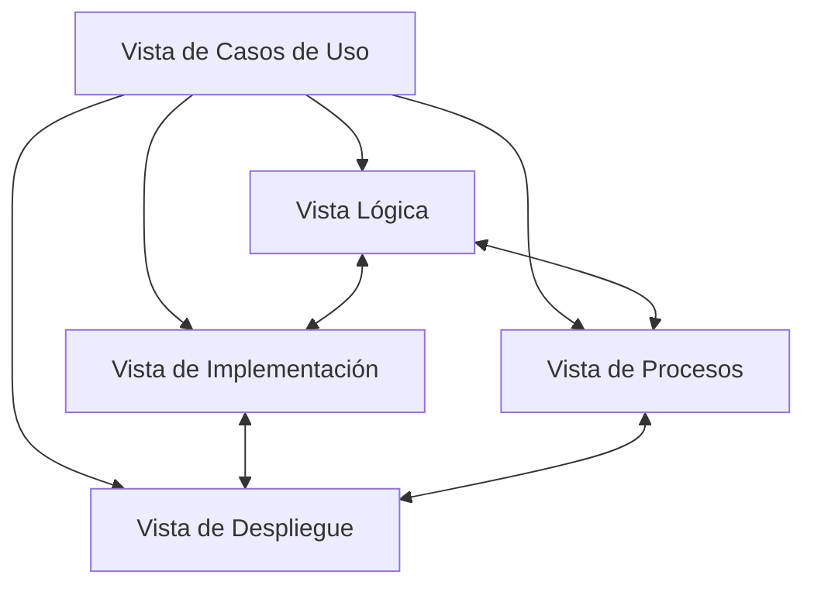

## 1.2. Alcance

El documento describe la arquitectura de AguardApp, una aplicación Android nativa de un solo módulo (`app`). Depósito usa Room y Ahorro guarda sus retos por fecha con SharedPreferences. Google Maps permite mostrar los puntos de cisterna y ThingSpeak entrega las mediciones del sensor del tanque. El documento cubre la organización en capas y paquetes, la interacción entre objetos, el modelo de datos, los componentes, los procesos y el despliegue.

## 1.3. Definiciones, siglas y abreviaturas

| Término | Definición |
|---|---|
| SAD | Software Architecture Document (Documento de Arquitectura de Software). |
| Modelo 4+1 | Modelo de Kruchten con cinco vistas arquitectónicas complementarias. |
| MVVM | Model-View-ViewModel, patrón de la capa de presentación. |
| DDD | Domain-Driven Design: el código se organiza alrededor del dominio (modelos, repositorios y casos de uso). |
| Jetpack Compose | Kit de interfaz declarativa de Android. |
| Room | Biblioteca de persistencia local sobre SQLite. |
| Koin | Biblioteca de inyección de dependencias para Kotlin. |
| Retrofit | Cliente HTTP para Android que convierte una API REST en una interfaz de Kotlin. |
| IoT | Internet de las cosas: dispositivos físicos que envían datos por internet. |
| ESP32 | Microcontrolador con WiFi que lee el sensor ultrasónico del tanque. |
| ThingSpeak | Servicio en la nube que guarda las mediciones del sensor y las expone mediante una API REST. |
| UiState | Clase de datos con todo lo que una pantalla necesita mostrar. |
| QA | Quality Attribute (atributo de calidad del software). |

## 1.4. Organización del documento

El documento se organiza en cuatro secciones: introducción; objetivos y restricciones arquitectónicas; representación de la arquitectura mediante las vistas del modelo 4+1; y atributos de calidad del software.

---

# 2. Objetivos y restricciones arquitectónicas

## 2.1. Priorización de requerimientos

### 2.1.1. Requerimientos funcionales

| ID | Descripción | Prioridad |
|---|---|---|
| RF-01 | Mostrar la bienvenida y pedir el consentimiento la primera vez | Alta |
| RF-02 | Configurar el hogar (depósito, habitantes, hábitos y hora del próximo llenado) | Alta |
| RF-03 | Registrar un llenado completo o parcial | Alta |
| RF-04 | Consultar el depósito: nivel, hasta cuándo alcanza y consumo | Alta |
| RF-05 | Calcular el déficit hasta el próximo llenado | Alta |
| RF-06 | Recomendar recortes de consumo | Media |
| RF-07 | Declarar que se quedó sin agua y ajustar el consumo | Media |
| RF-08 | Operar sin conexión en la gestión del depósito | Alta |
| RF-09 | Consultar los avisos del depósito (déficit, nivel bajo, sin llenado) | Media |
| RF-10 | Consultar el mapa de cisternas | Media |
| RF-11 | Consultar el nivel del sensor del tanque | Media |
| RF-12 | Registrar retos y consultar el progreso de ahorro | Media |
| RF-14 | Consultar avisos de agua y saneamiento | Media |

### 2.1.2. Requerimientos no funcionales — atributos de calidad

| ID | Atributo | Descripción | Prioridad |
|---|---|---|---|
| RNF-01 | Disponibilidad | Gestión del depósito 100 % sin conexión, con Room como única fuente de verdad; mapa, sensor, ranking opcional y consulta EPS usan internet. | Alta |
| RNF-02 | Privacidad y seguridad | Ningún dato del hogar sale del teléfono; solo se piden los permisos de internet y de ubicación (opcional); identidad con UUID local. | Alta |
| RNF-03 | Usabilidad | Interfaz simple, una sola fuente, colores sólidos y errores claros debajo de cada campo. | Alta |
| RNF-04 | Compatibilidad | Android 7.0 (API 24) o superior; probado contra la API 36. | Media |
| RNF-05 | Mantenibilidad | MVVM + DDD; dominio en Kotlin puro, independiente de Android; un Screen y un ViewModel por pantalla. | Alta |

## 2.2. Restricciones

- La gestión del depósito debe funcionar sin conexión, con la base de datos local como única fuente de verdad.
- El dominio (`domain/`) no puede depender de Android, Room ni Koin: es Kotlin puro.
- Solo se usan tecnologías gratuitas; no hay backend propio. Los únicos servicios externos son Google Maps y ThingSpeak, usados dentro de su cuota gratuita y solo para leer datos.
- Las claves de los servicios externos están en el código: la de Google Maps en `AndroidManifest.xml`, el canal y la clave de lectura de ThingSpeak en `ThingSpeakApi.kt`, y la URL y la clave anon de Supabase en `SupabaseApi.kt`. No se usa `BuildConfig` ni archivos de propiedades.
- El esquema de Room se exporta en `app/schemas/`. El historial de Ahorro se guarda en las preferencias privadas del teléfono.
- Las pantallas no contienen lógica de negocio: solo pintan el `UiState` y llaman funciones del ViewModel.

---

# 3. Representación de la arquitectura del sistema

## 3.1. Vista de casos de uso

El actor principal es el jefe de hogar, que usa la aplicación en su propio teléfono. El sensor del tanque (un ESP32 que publica sus mediciones en ThingSpeak) participa como actor secundario en la consulta del nivel del sensor.

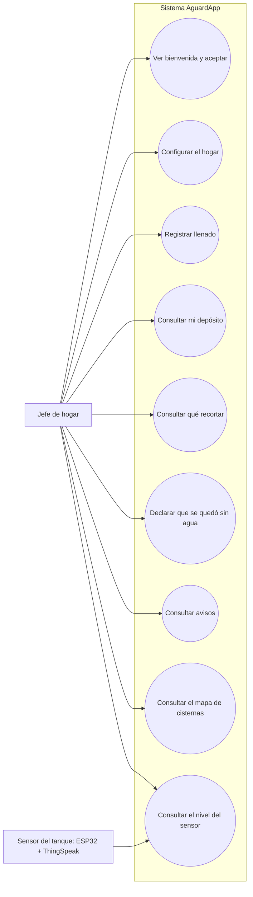

## 3.2. Vista lógica

### 3.2.1. Diagrama de subsistemas / paquetes

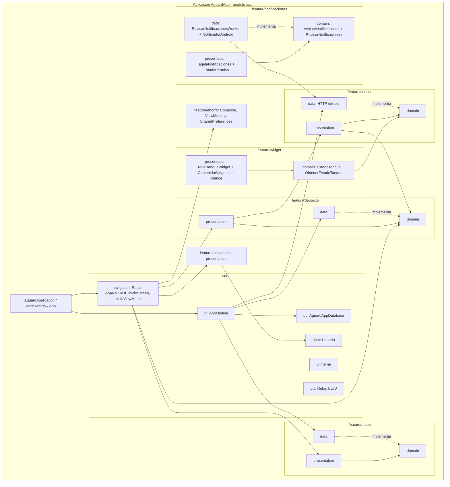

### 3.2.2. Diagramas de secuencia — vista de diseño

#### Módulo 1: Inicio y bienvenida

##### 1.1. Inicio de la aplicación y elección de la primera pantalla

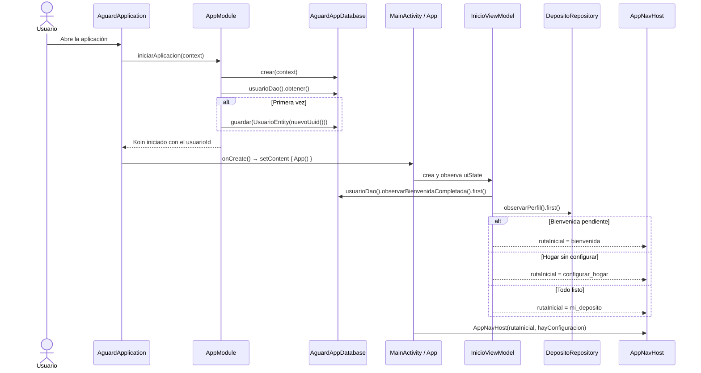

##### 1.2. Aceptar y empezar

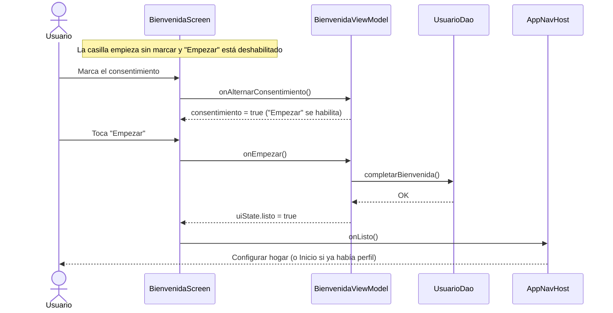

#### Módulo 2: Depósito

##### 2.1. Configuración del hogar

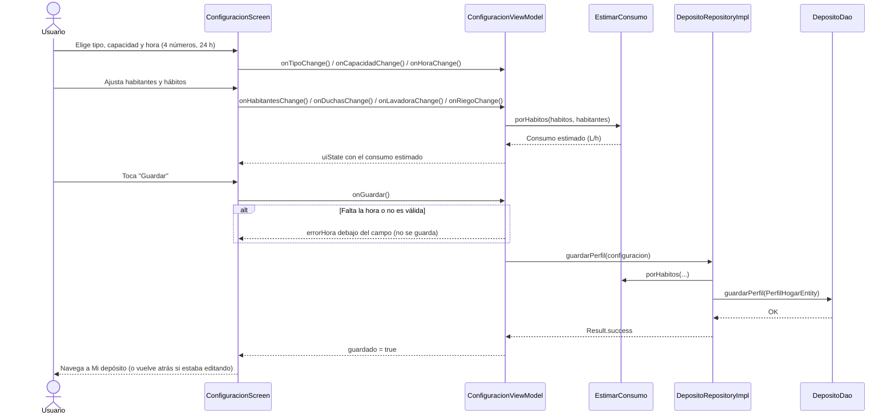

##### 2.2. Registro de un llenado (completo o parcial)

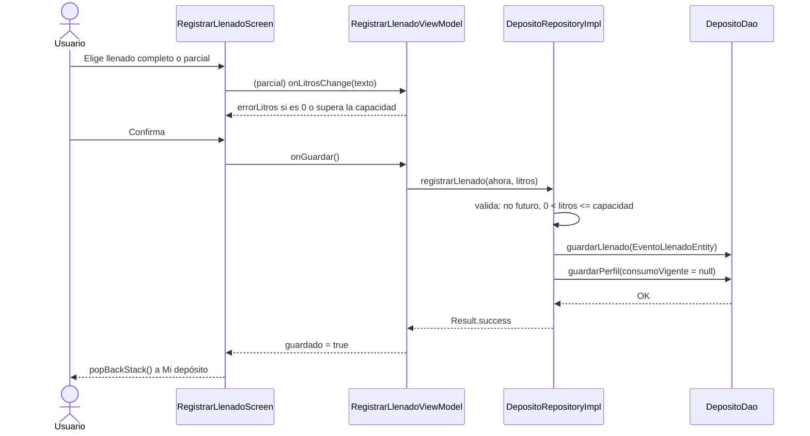

##### 2.3. Monitoreo reactivo del depósito

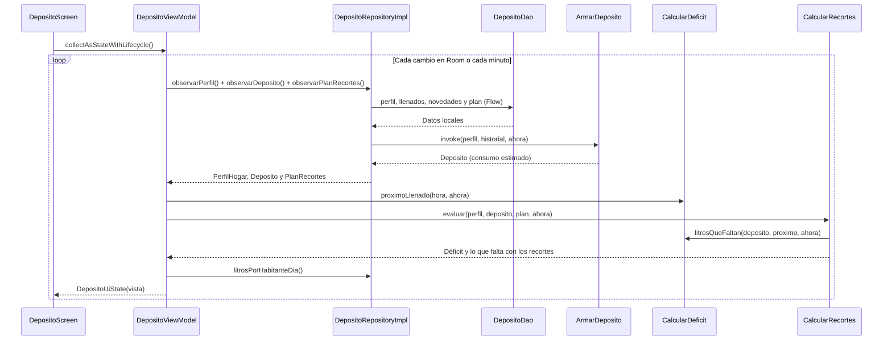

##### 2.4. Declaración de "me quedé sin agua"

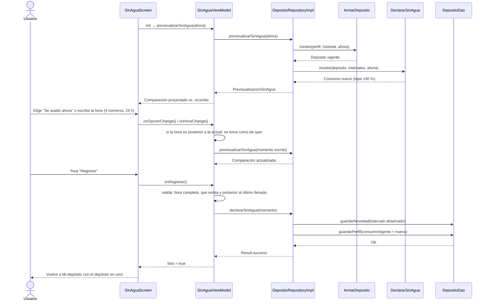

##### 2.5. Qué recortar

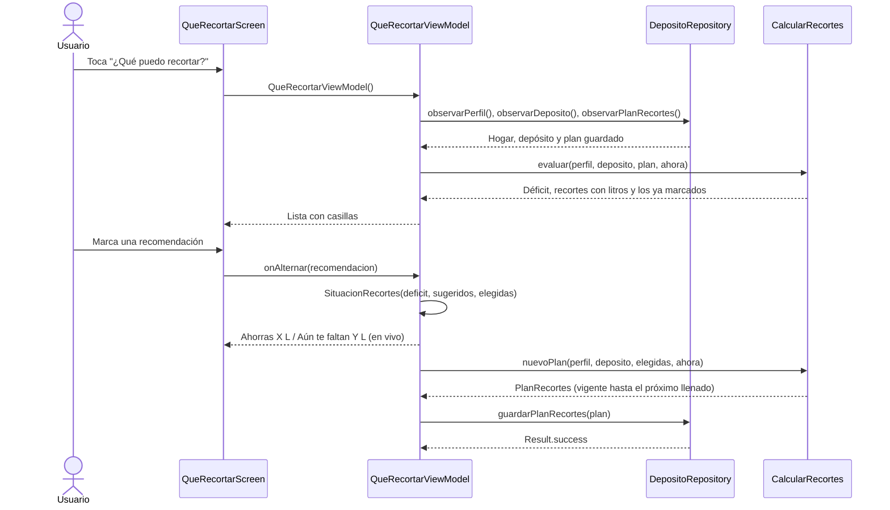

##### 2.6. Avisos

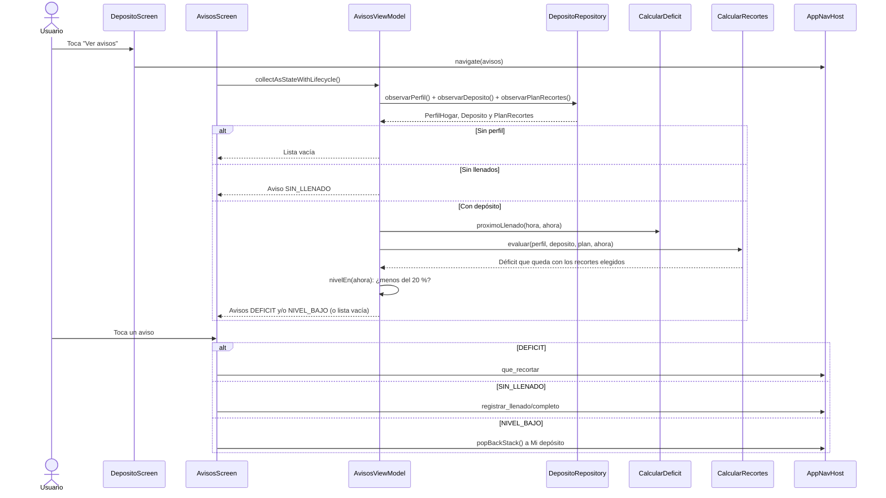

#### Módulo 3: Mapa de cisternas

##### 3.1. Consulta del mapa de cisternas

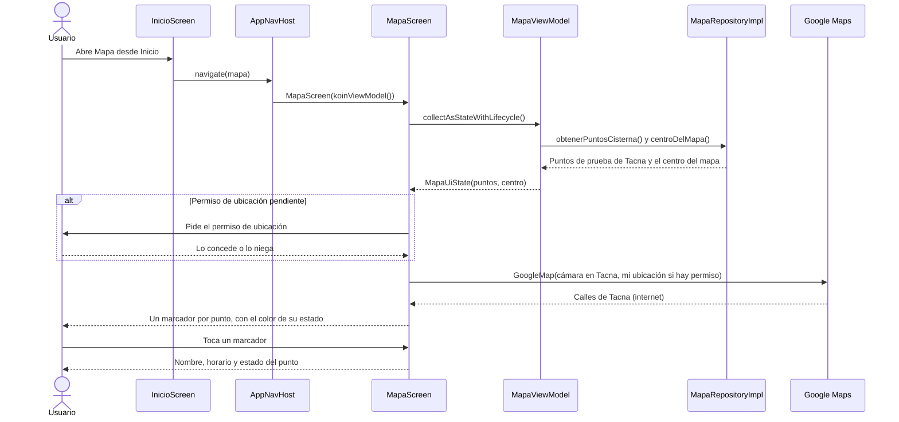

#### Módulo 4: Sensor del tanque

##### 4.1. Lectura del sensor y actualización del nivel

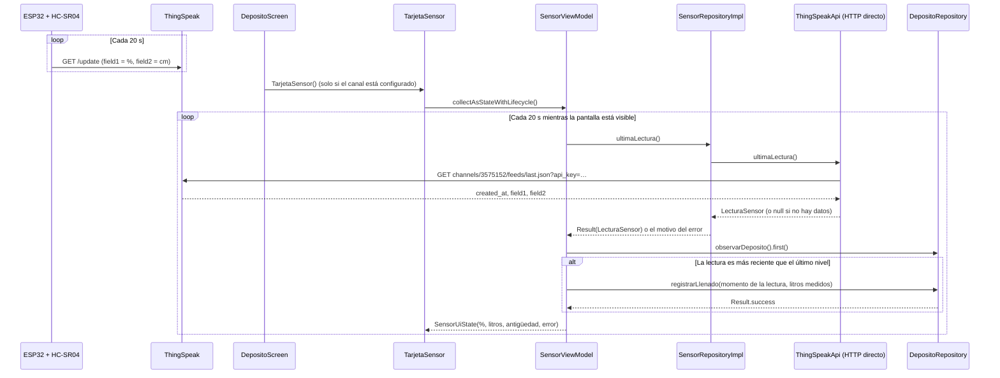

### 3.2.3. Diagrama de colaboración

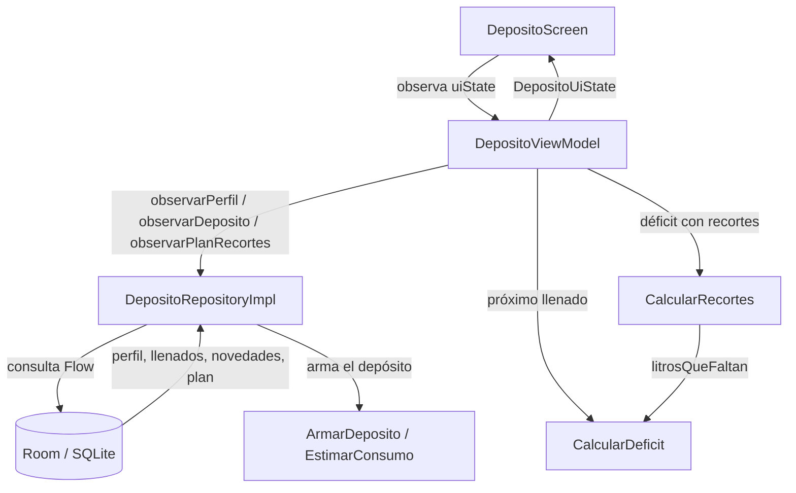

### 3.2.4. Diagrama de objetos

Ejemplo de un hogar con un tanque de 1 100 L, 4 personas, 2 duchas por día y lavadora, que llenó a las 5:10 a.m. Sin historial, el consumo sale de los hábitos: (4 × (60 + 2 × 30) + 100) / 12 = 48,3 L/h. A las 2:00 p.m. quedan 1 100 − 48,3 × 8,83 ≈ 673 L, y el tanque se agota a las 3:56 a.m. del día siguiente; como el agua vuelve a las 5:00 a.m., el déficit es de 48,3 × 15 − 673 ≈ 52 L.

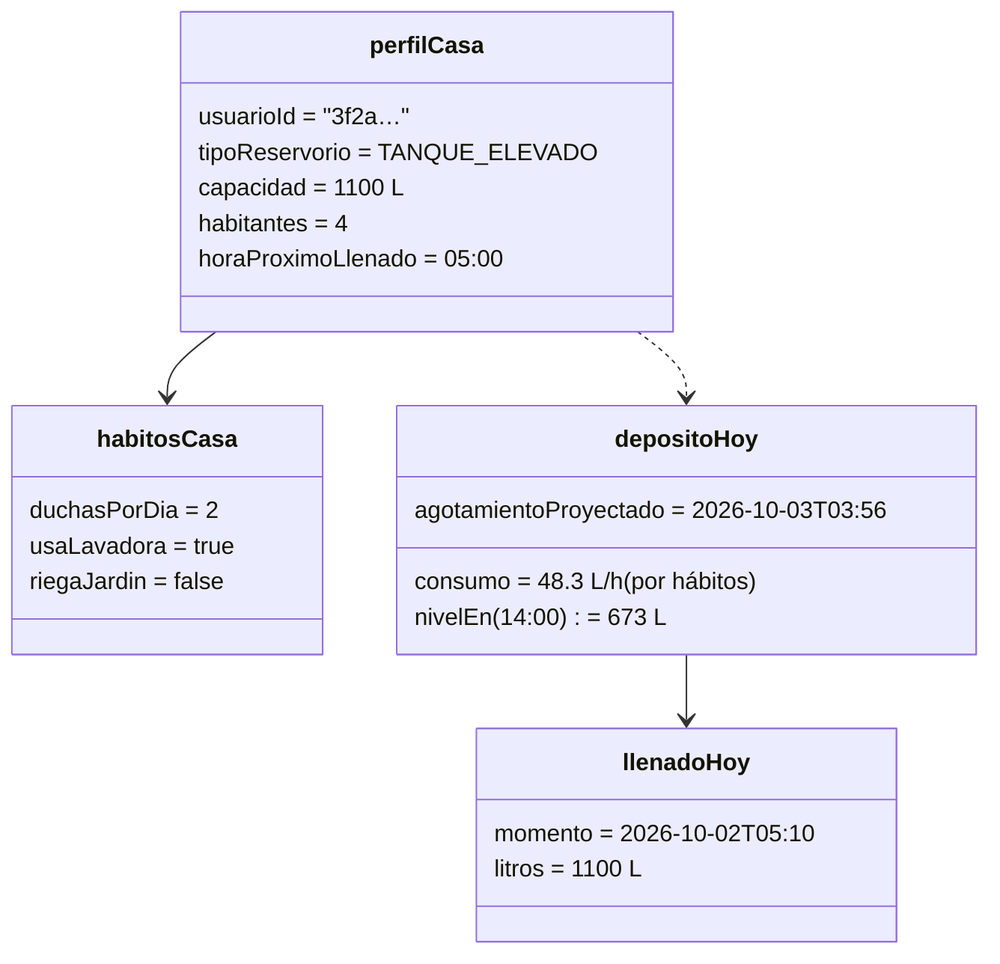

### 3.2.5. Diagrama de clases

```mermaid
classDiagram
    class DepositoRepository {
      <<interface>>
      +observarPerfil() Flow~PerfilHogar?~
      +guardarPerfil(configuracion) Result
      +observarDeposito() Flow~Deposito?~
      +litrosPorHabitanteDia() Double?
      +registrarLlenado(momento, litros) Result
      +declararSinAgua(momento) Result
      +previsualizarSinAgua(momento) Result
      +observarPlanRecortes() Flow~PlanRecortes?~
      +guardarPlanRecortes(plan) Result
    }
    class DepositoRepositoryImpl
    class DepositoDao {
      <<Room>>
    }
    class ArmarDeposito
    class DeclararSinAgua
    class EstimarConsumo {
      +consumo()
      +porHabitos()
      +litrosPorHabitanteDia()
      +intervalosEntreLlenados()
    }
    class CalcularDeficit {
      +proximoLlenado()
      +litrosQueFaltan()
    }
    class CalcularRecortes {
      +evaluar()
      +sugerir()
      +nuevoPlan()
    }
    class DepositoViewModel
    class ConfiguracionViewModel
    class RegistrarLlenadoViewModel
    class QueRecortarViewModel
    class SinAguaViewModel
    class AvisosViewModel
    class MapaRepository {
      <<interface>>
      +centroDelMapa() Coordenada
      +obtenerPuntosCisterna() List~PuntoCisterna~
    }
    class MapaRepositoryImpl
    class MapaViewModel
    class SensorRepository {
      <<interface>>
      +ultimaLectura() Result~LecturaSensor~
    }
    class SensorRepositoryImpl
    class ThingSpeakApi {
      +ultimaLectura() LecturaSensor?
      +historial(desde, hasta) List~LecturaSensor~
    }
    class SensorViewModel {
      +onUsarMedicion()
    }

    DepositoRepositoryImpl ..|> DepositoRepository
    DepositoRepositoryImpl --> DepositoDao
    DepositoRepositoryImpl --> ArmarDeposito
    DepositoRepositoryImpl --> DeclararSinAgua
    DepositoRepositoryImpl --> EstimarConsumo
    ArmarDeposito --> EstimarConsumo
    DeclararSinAgua --> EstimarConsumo
    DepositoViewModel --> DepositoRepository
    DepositoViewModel --> CalcularDeficit
    ConfiguracionViewModel --> DepositoRepository
    ConfiguracionViewModel --> EstimarConsumo
    RegistrarLlenadoViewModel --> DepositoRepository
    QueRecortarViewModel --> CalcularRecortes
    QueRecortarViewModel --> DepositoRepository
    QueRecortarViewModel --> CalcularDeficit
    DepositoViewModel --> CalcularRecortes
    CalcularRecortes --> CalcularDeficit
    SinAguaViewModel --> DepositoRepository
    AvisosViewModel --> DepositoRepository
    AvisosViewModel --> CalcularDeficit
    AvisosViewModel --> CalcularRecortes
    MapaRepositoryImpl ..|> MapaRepository
    MapaViewModel --> MapaRepository
    SensorRepositoryImpl ..|> SensorRepository
    SensorRepositoryImpl --> ThingSpeakApi
    SensorViewModel --> SensorRepository
    SensorViewModel --> DepositoRepository
```

### 3.2.6. Diagrama de base de datos

Base de datos local `aguardapp.db` (Room, versión 3). De la versión 2 a la 3 se agregó la tabla `plan_recortes` con una migración automática (`AutoMigration`), que conserva los datos existentes. Si falta la migración de alguna versión (por ejemplo, de la 1 a la 2), Room borra la base anterior y crea la nueva (`fallbackToDestructiveMigration`). Los esquemas de cada versión se exportan en `app/schemas/`.

Las relaciones del diagrama son lógicas: todas las tablas guardan el `usuarioId`, pero no se declaran claves foráneas. Las fechas y horas se guardan como texto ISO; `plan_recortes.recortes` guarda los nombres de las recomendaciones elegidas separados por comas, y los dos consumos de `perfil_hogar` admiten nulo. Los avisos no tienen tabla, porque se calculan a partir del depósito. El mapa y el sensor tampoco agregan tablas: los puntos de cisterna vienen del repositorio del mapa, y cada lectura nueva del sensor se guarda en `evento_llenado` con los litros medidos.

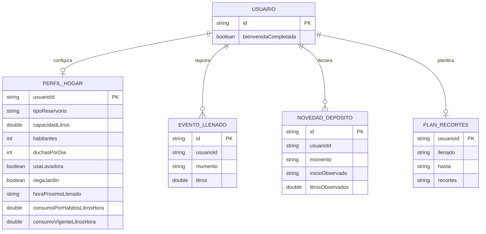

## 3.3. Vista de implementación — desarrollo

### 3.3.1. Diagrama de arquitectura de software / paquetes

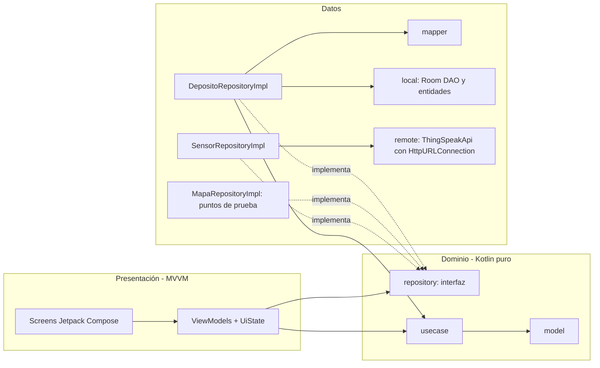

Estructura de carpetas del código:

```
app/src/main/java/com/example/aguardapp/
├── AguardApplication.kt · MainActivity.kt · App.kt
├── core/
│   ├── data/Usuario.kt            (entidad y DAO del usuario local)
│   ├── db/AguardAppDatabase.kt    (Room)
│   ├── di/AppModule.kt            (Koin: moduloApp, moduloRed y moduloViewModels)
│   ├── navigation/                (Rutas, AppNavHost, InicioScreen, InicioViewModel)
│   ├── ui/theme/                  (colores, tema, tipografía, barra de estado)
│   └── util/Reloj.kt              (hora actual y UUID)
└── feature/
    ├── bienvenida/presentation/   (BienvenidaScreen, BienvenidaViewModel)
    ├── deposito/
    │   ├── domain/   model/ · repository/ · usecase/
    │   ├── data/     DepositoRepositoryImpl · local/ · mapper/
    │   └── presentation/  *Screen + *ViewModel · FormatoDeposito · componentes/ (Comunes, ControlesConfiguracion, Tanque)
    ├── mapa/
    │   ├── domain/   model/ (PuntoCisterna, Coordenada, EstadoCisterna) · repository/
    │   ├── data/     MapaRepositoryImpl (puntos de prueba)
    │   └── presentation/  MapaScreen · MapaViewModel
    └── sensor/
        ├── domain/   model/ (LecturaSensor) · repository/
        ├── data/     SensorRepositoryImpl · remote/ThingSpeakApi
        └── presentation/  TarjetaSensor · SensorViewModel
```

Los casos de uso se agrupan por tema: `CalcularDeposito.kt` contiene `ArmarDeposito`, `DeclararSinAgua` e `HistorialDeposito`; `EstimarConsumo.kt` contiene también `ParametrosConsumo`, con todas las constantes del cálculo; y `CalcularRecortes.kt` contiene `SituacionRecortes` y `RecorteSugerido`.

### 3.3.2. Diagrama de arquitectura del sistema / componentes

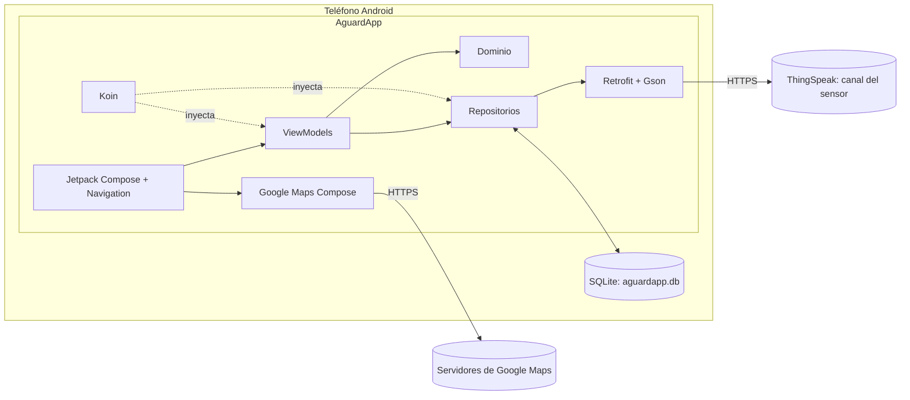

> Además de Google Maps y ThingSpeak, la aplicación incluye ranking opcional y un conector EPS en validación. EPS recibe las credenciales para el acceso HTTP, sin cifrado en tránsito; la contraseña no se guarda y el PDF se procesa localmente. La gestión del depósito permanece local.

**Inyección de dependencias:** Koin (`core/di/AppModule.kt`) se organiza en tres módulos. `moduloApp` registra el `Reloj`, el `UsuarioDao`, el `DepositoRepository` y el `MapaRepository`; `moduloRed` registra el `SensorRepository` con una `ThingSpeakApi`, que hace un GET directo a la URL del canal (con la clave de lectura incluida), y el cliente Retrofit de la ANA; y `moduloViewModels` registra todos los ViewModels, que cada pantalla obtiene con `koinViewModel()`. El tipo de llenado (completo o parcial) llega a `RegistrarLlenadoViewModel` con `parametersOf`. Antes de iniciar Koin, `iniciarAplicacion` crea la base de datos y el usuario local. Los casos de uso no tienen estado y cada ViewModel o el repositorio los crea directamente.

## 3.4. Vista de procesos

### 3.4.1. Diagrama de actividad del sistema

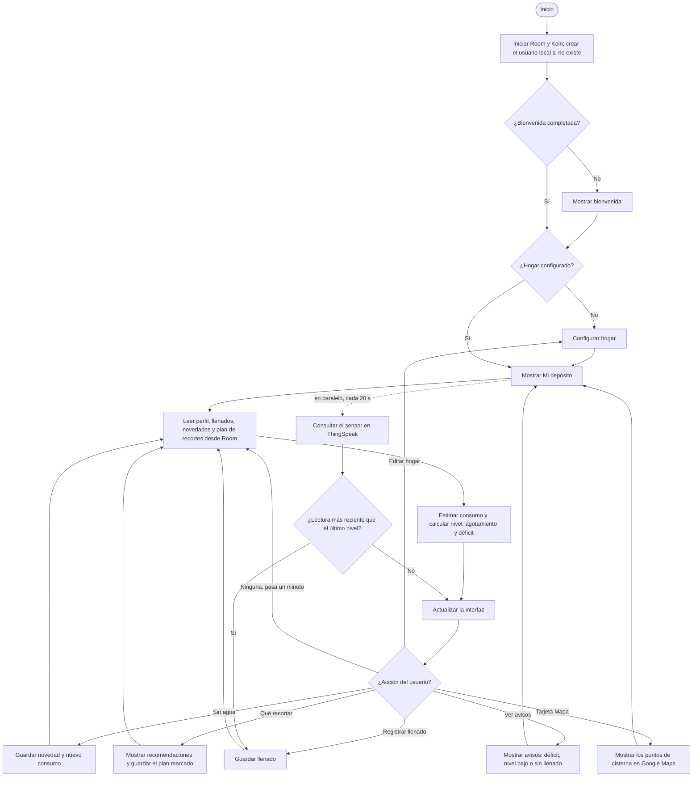

Las operaciones con la base de datos y con la red se ejecutan en corrutinas fuera del hilo principal; las pantallas observan `StateFlow` y se recomponen solo cuando cambia su estado. La consulta del sensor es un `Flow` que se repite cada 20 s y solo está activo mientras Mi depósito es visible (`SharingStarted.WhileSubscribed`): al salir de la pantalla se detiene y no consume datos en segundo plano.

## 3.5. Vista de despliegue — vista física

### 3.5.1. Diagrama de despliegue

```mermaid
flowchart TB
    subgraph PHONE[Dispositivo Android 7.0+]
      direction LR
      subgraph PROC[Proceso de la app com.example.aguardapp]
        APP[AguardApp APK]
      end
      DB[(Almacenamiento interno: aguardapp.db)]
      APP <--> DB
    end
    subgraph TANK[Tanque del hogar - prototipo simulado en Wokwi]
      ESP[ESP32 + sensor ultrasónico HC-SR04]
    end
    subgraph CLOUD[Internet]
      direction LR
      GM[(Google Maps Platform)]
      TS[(ThingSpeak: canal del sensor)]
    end
    APP -- HTTPS: mapa --> GM
    APP -- HTTPS: último dato --> TS
    ESP -- WiFi, HTTP cada 20 s --> TS
```

La aplicación se distribuye como un único APK y no requiere servidor propio ni cuenta de usuario. La gestión del depósito funciona sin internet; el mapa necesita conexión para cargar las calles y el sensor para leer su último dato. El prototipo del sensor es un ESP32 con un sensor ultrasónico HC-SR04, simulado en Wokwi, que mide la distancia hasta el agua, calcula el porcentaje de llenado y lo publica en un canal de ThingSpeak (campo 1: porcentaje; campo 2: distancia en cm).

---

## 3.6. Notificaciones de agua y saneamiento

El módulo Avisos EPS de Inicio navega a `CortesScreen`. `CortesViewModel` guarda el sector elegido y consulta `GET /avisos` mediante Retrofit con ámbito de provincia de Tacna, filtros y paginación. Android y `GET /sectores` comparten un catálogo de siete sectores. `GET /distritos` conserva los 28 distritos del departamento. SQLite añade las columnas de categoría y descripción al consultar una base existente. El importador actualiza la misma base y se ejecuta como proceso independiente. Para Facebook, recibe la URL RSS de EPSTacna o las credenciales de Meta Graph en su entorno. Tesseract reconoce el texto de las fotos disponibles y el importador conserva una copia local del resultado para evitar repetir el OCR.

```mermaid
flowchart LR
    Pantalla[Notificaciones en Android] -->|Retrofit| API[FastAPI]
    API -->|Consulta| Base[(SQLite)]
    Fuentes[EPS Tacna, SUNASS, Facebook y Radio Uno] -->|Comunicados, Graph, CSV y feeds RSS| Importador[Importador Python]
    Importador -->|Reconoce fotos de Facebook| OCR[Tesseract]
    Importador -->|Importa y actualiza| Base
```

En desarrollo, `backend/iniciar.ps1` inicia el servidor local y conecta el teléfono por USB con `adb reverse`. El emulador de Android Studio usa la dirección `10.0.2.2`. La variante de distribución usa una URL HTTPS. El archivo SQLite se mantiene en el equipo que ejecuta la API.

El importador puede consumir un RSS de EPSTacna configurado en el servidor. Extrae fecha, texto, enlace original y URLs de imágenes para el OCR. El servidor sigue acumulando los avisos de cada consulta en SQLite.

# 4. Atributos de calidad del software

## 4.1. Escenario de funcionalidad

Los atributos de calidad (QA) son propiedades medibles que indican en qué grado el sistema satisface las necesidades de sus interesados. AguardApp entrega de forma completa las funciones del módulo Depósito: configurar el hogar, registrar llenados, consultar el nivel y el déficit, ver qué recortar, declarar que se quedó sin agua y consultar los avisos del depósito. Además, muestra los puntos de reparto de agua en cisterna sobre un mapa y toma el nivel real del tanque desde el sensor IoT.

## 4.2. Escenario de usabilidad

Un usuario sin experiencia configura su hogar y registra un llenado en menos de un minuto: los controles son botones grandes, la capacidad, los habitantes y las duchas se ajustan con controles que no permiten salir del rango, la hora se escribe con 4 números (el ":" se agrega solo) y, si falta un dato al tocar Guardar, el formulario no se guarda y muestra el error exacto debajo del campo. El diseño usa colores sólidos y una sola fuente para facilitar la lectura.

## 4.3. Escenario de confiabilidad

Sin conexión, la gestión del depósito funciona igual porque no depende de la red; el mapa no carga sus calles y la tarjeta del sensor muestra el motivo ("Sin conexión con el sensor"), sin afectar al resto de la aplicación. Las validaciones del dominio y del repositorio impiden datos incoherentes (llenados en el futuro, litros mayores que la capacidad, agotamientos anteriores al último llenado), el tope de ±30 % evita que un error del usuario desordene la estimación del consumo y un "me quedé sin agua" registrado menos de 1 hora después del llenado no se usa para estimarlo.

## 4.4. Escenario de rendimiento

Todas las consultas se resuelven en la base local; los cálculos (nivel, agotamiento, déficit) son operaciones simples en memoria. La pantalla Mi depósito se refresca cada minuto sin bloquear la interfaz. La consulta al sensor es una petición pequeña cada 20 s, solo mientras la pantalla está visible.

## 4.5. Escenario de mantenibilidad

El dominio es Kotlin puro y no depende de Android, por lo que puede probarse con pruebas unitarias simples. Cada pantalla tiene solo dos archivos (Screen y ViewModel), y la inyección de dependencias está en un único archivo de Koin con tres módulos (aplicación, red y ViewModels), lo que facilita agregar nuevas funcionalidades: el mapa y el sensor se sumaron como paquetes nuevos sin cambiar el dominio del depósito.

## 4.6. Otros escenarios

**Privacidad:** la aplicación solo declara en el `AndroidManifest.xml` los permisos de internet (para el mapa y el sensor) y de ubicación (para mostrar al usuario en el mapa; se pide al abrirlo y puede negarse). El depósito permanece local. La consulta EPS envía las credenciales únicamente a su portal HTTP (sin cifrado en tránsito) y el ranking requiere consentimiento para los datos anónimos; el documento EPS se procesa dentro del teléfono. Las claves de Google Maps, ThingSpeak (solo lectura) y Supabase (clave anon) están en el código del repositorio privado. El respaldo automático de Android está desactivado (`allowBackup="false"`, y `backup_rules.xml` y `data_extraction_rules.xml` excluyen todos los datos), de modo que la base local no se copia a la nube ni a otro teléfono. El consentimiento de la bienvenida empieza sin marcar: el usuario debe aceptarlo de forma explícita.


## Actualización arquitectónica — 18/11/2026: conector EPS

`feature/eps` añade dominio (`ConsultaEps`, `CuentaEps`, `ReciboEps`, `ErrorEps`, extracción estricta), datos (`ClientePortalEps`, transporte jsoup, `AlmacenSesionEps`, `LectorPdfEps`, `ConsultaEpsPortal`) y presentación (`EpsViewModel`, `TarjetaEps`). Koin registra la implementación en `ModuloRecibos.kt`; `RecibosEpsScreen` se abre desde Inicio y contiene la tarjeta EPS y la lectura por foto. No hay cambios de esquema Room ni de Supabase.

El conector usa el formulario observado y el HTML autenticado. Además de enlaces directos, interpreta las dos funciones AJAX de recibo CargarRecibo/MostrarRecibo sin ejecutar JavaScript arbitrario, y sigue el iframe al documento. No consume una API documentada ni inventa endpoints de PDF. El acceso inicial usa HTTP; admite HTTP/HTTPS únicamente en el host exacto `oficinavirtual.epstacna.com.pe` y sus puertos estándar, incluyendo todas las redirecciones. `network_security_config.xml` bloquea tráfico HTTP por defecto y lo permite únicamente para ese host, sin subdominios. No desactiva la validación TLS. El usuario, la clave y las cookies viajan sin cifrado por HTTP; la interfaz lo advierte. Guarda cookies/usuario con AES/GCM y una clave de Android Keystore en `noBackupFilesDir`; no persiste contraseñas. Un `Mutex` serializa vinculación, actualización y eliminación de sesión. El trabajo de red/PDF se ejecuta en `Dispatchers.IO`. El documento temporal se elimina en `finally`.

`ReciboGuardado` añade campos opcionales `leidoDeEps`, `totalPagar` y `actualizadoEn`, persistidos en las preferencias de Liga con valores por defecto para datos antiguos. El recibo mantiene su fuente foto/EPS; solo las fuentes obtenidas y vigentes cuentan como verificadas. `ReciboViewModel` observa las preferencias para reflejar las actualizaciones externas. La eliminación de la sesión local no elimina el recibo ni invoca una revocación remota.

```mermaid
flowchart TB
    subgraph Android
      UI[TarjetaEps] --> VM[EpsViewModel]
      VM --> I[ConsultaEps]
      I --> R[ConsultaEpsPortal]
      R --> H[ClientePortalEps / TransporteJsoupEps]
      R --> A[AlmacenSesionEps]
      A --> K[Android Keystore + archivo AES GCM]
      R --> P[LectorPdfEps / PDFBox / PdfRenderer / ML Kit]
      P --> ALC[AlinearCamposEps: etiquetas y cifras por posición]
      ALC --> D[extraerReciboEps]
      VM --> L[RecibosLocales / ReciboGuardado]
      L --> T[TarjetaRecibo / ResumenDelHogar]
    end
    H -->|HTTP; cookies del mismo host| EPS[Oficina virtual EPS Tacna]
```

**Dependencias:** jsoup 1.24.1 y PDFBox Android 2.0.27.0. Se mantienen ML Kit y las APIs nativas de Android. **Validación:** se verificaron el HTML autenticado y la descarga del PDF real desde el teléfono. El conector rechaza destinos externos, ambigüedad y formatos desconocidos. HTTPS conserva la validación de certificados; el acceso HTTP solicitado permanece limitado al host de EPS.

**Lectura de campos EPS:** PDFBox Android intenta obtener texto digital. Para PDFs de imagen, ML Kit procesa páginas de hasta 3200 píxeles por lado (escala máxima 3); `AlinearCamposEps` asocia las cifras con etiquetas en su fila o recuadro. Si el volumen pequeño no se reconoce, se amplía solo la casilla a la derecha de «Volumen Fac m» y se acepta únicamente una cifra inequívoca. No se calculan consumos por diferencia de lecturas. Las credenciales y el texto completo del PDF no se registran en logs. El diagnóstico temporal usado en la validación se retiró del código y de la aplicación.

**Validación final del conector EPS (18/11/2026):** 89 pruebas unitarias aprobadas (30 de EPS), APK Debug compilado y actualización completa verificada en el Samsung con una cuenta y un recibo reales, incluyendo el guardado desde EpsViewModel. La verificación cubre ese formato de recibo; no garantiza disponibilidad del portal ni otros diseños. Se retiraron la actividad temporal y los puntos de diagnóstico. No se incorporaron datos personales, cookies, contraseñas ni documentos reales al repositorio.


## Inicio y Recibos EPS — 20/11/2026

Inicio reúne Mi depósito, Mapa, Represas, Ahorro, Liga del Agua y Recibos EPS. El nivel del depósito viene del mismo estado que usa Mi depósito y el acceso a llenado permite elegir completo o parcial. Cada pantalla tiene un acceso de regreso. La interfaz adopta la paleta azul.

Recibos EPS tiene ruta propia y agrupa vinculación, actualización y lectura por foto. `RecibosLocales` conserva las claves del último recibo y Liga del Agua consume ese dato para su resumen, sin presentar la vinculación de EPS dentro de Liga.

**Sesión de EPS vencida (21/11/2026).** Si EPS rechaza la sesión al actualizar, Recibos EPS abre el formulario con el usuario anterior. Al volver a vincular, reintenta actualizar el recibo una vez. La clave se introduce de nuevo y el recibo anterior sigue disponible durante el proceso. Aguarda recuerda localmente el usuario después de vincular la cuenta con éxito y lo rellena al abrir el formulario, incluso tras cerrar la app. Desvincular explícitamente borra el usuario recordado. La clave se vuelve a ingresar.

**Historial de recibos EPS (21/11/2026).** Recibos EPS conserva un historial local por mes facturado, tanto al actualizar desde el portal como al añadir una foto. El recibo de la versión anterior aparece como primer registro. Una nueva lectura del mismo mes actualiza su entrada. Si ya existe un recibo oficial, una foto solo puede completar los días faltantes. Liga sigue leyendo el periodo más reciente. La pantalla compara los dos periodos guardados más recientes, con el consumo y el total a pagar separados. Solo compara litros por día cuando ambos recibos tienen días facturados. La foto permite confirmar el importe y los días como campos opcionales. EPS obtiene los días de un valor explícito o de fechas identificadas como periodo de consumo.

`TarjetaEvolucion` presenta el historial local en orden cronológico. El dominio completa los huecos del calendario y calcula el promedio con los consumos registrados anteriores al último recibo. La tarjeta mantiene el periodo seleccionado al alternar consumo y cargo. Desde la tarjeta del último recibo se puede definir, editar o quitar una meta mensual en m³ tomando como referencia el promedio histórico. La meta se guarda en el teléfono, aparece como línea discontinua y se compara con el consumo de cada recibo. La tarjeta principal reúne el total a pagar y el progreso de la meta. **Descargar PDF** obtiene el último documento original de EPS y abre el selector de Android para elegir nombre y ubicación. **Ver PDF** abre ese mismo documento dentro de la app, con navegación por página y zoom. Si la sesión caduca, la acción se reanuda al vincular la cuenta. El historial presenta filas desplegables con el consumo, el total y el detalle disponible por periodo. El gráfico abarca todo el historial y muestra el valor de consumo o el cargo del mes sobre cada barra. Se puede elegir una foto de la galería o tomarla con la cámara del sistema. Ambas opciones usan la revisión del recibo y la captura temporal se elimina tras procesarla o cancelarla.

Recibos EPS ofrece **Actualizar último recibo** (PDF) e **Importar historial completo** (todos los periodos entregados por Historial de facturación, incluido el más reciente). La importación reutiliza la sesión, conserva consumo, cargo del mes, deuda y total a pagar como campos distintos y actualiza el historial local sin duplicados. La tabla no muestra días facturados, por lo que se conservan los que ya se hayan obtenido de un recibo. Si la sesión vence se reanuda la acción elegida tras volver a vincular.
