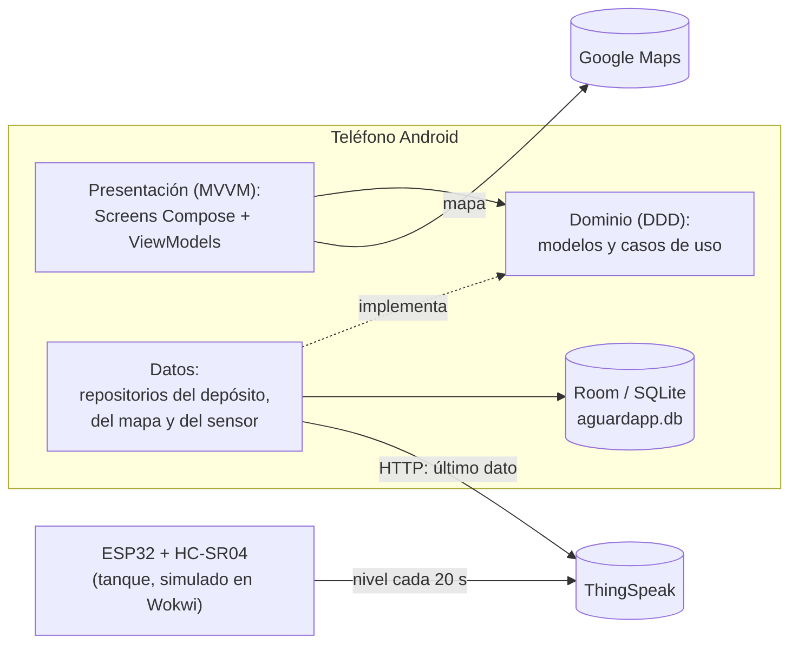
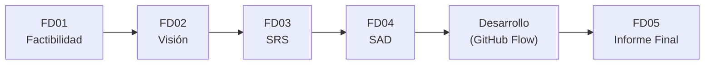
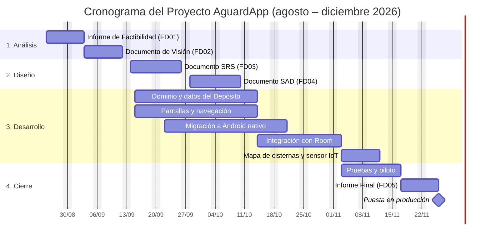
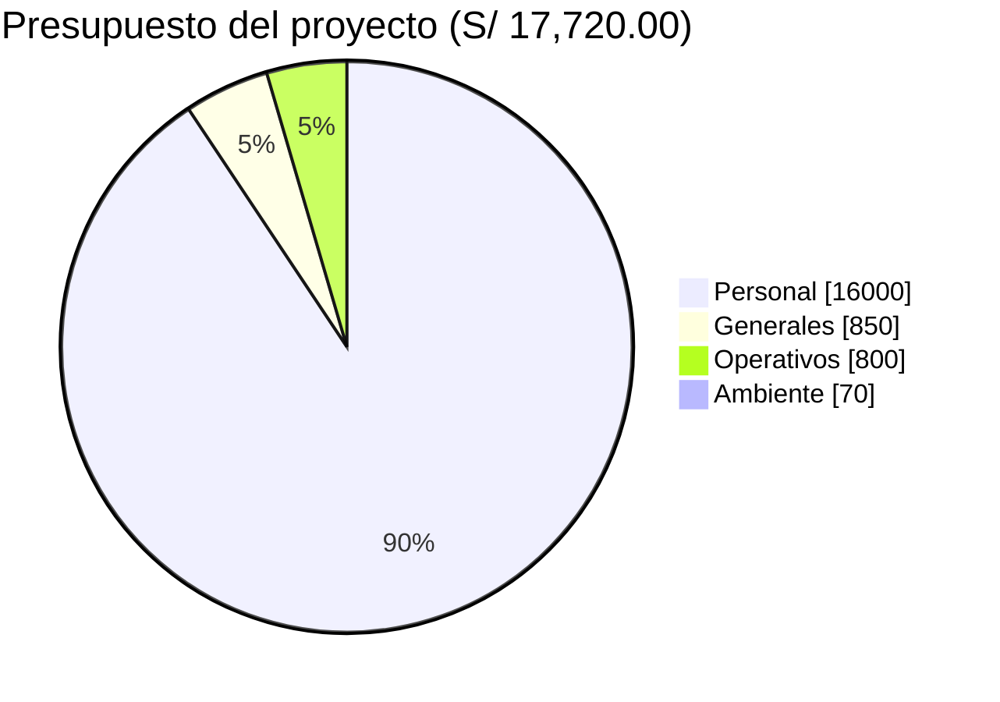

# AguardApp — Informe Final

> **Universidad Privada de Tacna** · Facultad de Ingeniería · Escuela Profesional de Ingeniería de Sistemas
> **Curso:** Soluciones Móviles I · **Docente:** Mag. Alberto Johnatan Flor Rodríguez
> **Proyecto:** AguardApp
> **Versión:** 2.3 · Tacna – Perú, 2026

**Integrantes**

| Integrante | Código |
|---|---|
| Jahuira Pilco, Dayan Elvis | 2022075749 |
| Llica Mamani, Jimmy Mijair | 2023076789 |
| Mamani Cori, Cristhian Carlos | 2023077282 |
| Sierra Ruiz, Iker Alberto | 2023077090 |

## Control de versiones

| Versión | Hecha por | Revisada por | Aprobada por | Fecha | Motivo |
|---|---|---|---|---|---|
| 1.0 | DJ - JL - CM - IS | AFR | AFR | 30/09/2026 | Versión Original |
| 2.0 | DJ - JL - CM - IS | — | — | 02/10/2026 | Actualización al sistema AguardApp: aplicación Android nativa, módulo Depósito y base de datos local |
| 2.1 | DJ - JL - CM - IS | — | — | 02/10/2026 | Se agrega la pantalla Avisos a las funcionalidades implementadas |
| 2.2 | DJ - JL - CM - IS | — | — | 14/10/2026 | Se alinea con el código: plan de recortes, base de datos versión 3, Koin y privacidad (respaldo desactivado y consentimiento explícito) |
| 2.3 | DJ - JL - CM - IS | — | — | 11/11/2026 | Se agregan el mapa de cisternas y el sensor IoT del tanque (ESP32 + ThingSpeak) a las funcionalidades implementadas, las tecnologías, la arquitectura y el cronograma |

## Índice

1. [Antecedentes](#1-antecedentes)
2. [Planteamiento del Problema](#2-planteamiento-del-problema)
3. [Objetivos](#3-objetivos)
4. [Marco Teórico](#4-marco-teórico)
5. [Desarrollo de la Solución](#5-desarrollo-de-la-solución)
6. [Cronograma](#6-cronograma)
7. [Presupuesto](#7-presupuesto)
8. [Conclusión](#8-conclusión)
- [Recomendaciones](#recomendaciones)
- [Bibliografía](#bibliografía)
- [Anexos](#anexos)

---

## 1. Antecedentes

El presente documento constituye el Informe Final del proyecto AguardApp, desarrollado por el equipo de desarrollo AguardApp.

El proyecto nació como **AguaTacna**, una aplicación Kotlin Multiplatform (Android e iOS) con varios módulos: reserva, sector y mapas, recibos, retos, asistente hídrico y sincronización con la nube. Durante el desarrollo, el equipo decidió concentrar el esfuerzo en el problema central —saber cuánta agua le queda al hogar y hasta cuándo le alcanza— y migró la solución a **AguardApp**, una aplicación **Android nativa** centrada en el módulo **Depósito**, que trabaja por completo con una base de datos local. Sobre esa base se incorporaron después dos funciones de apoyo: el **mapa de cisternas** y la lectura del nivel del tanque desde un **sensor IoT**.

Este informe consolida el trabajo realizado e integra los documentos elaborados en cada etapa: el Informe de Factibilidad (FD01), el Documento de Visión (FD02), la Especificación de Requerimientos de Software (FD03) y el Documento de Arquitectura de Software (FD04), que se adjuntan como anexos.

## 2. Planteamiento del Problema

### 2.1. Problema

La ciudad de Tacna, ubicada en una de las regiones más áridas del Perú, se abastece de agua potable bajo un esquema de racionamiento, con servicio solo durante algunas horas al día. Los hogares guardan agua en tanques, cisternas o bidones, pero no saben cuánta les queda ni hasta qué hora les alcanzará. Esto ocasiona desabastecimiento imprevisto, compra de agua de emergencia a sobreprecio y un consumo que no se ajusta a tiempo.

### 2.2. Justificación

El desarrollo de AguardApp se justifica por la necesidad de que cada hogar conozca el estado de su depósito y anticipe cuándo se quedará sin agua. Desde la perspectiva social, reduce la incertidumbre y el estrés de las familias. Desde la perspectiva económica, disminuye los gastos por compra de agua de emergencia. Desde la perspectiva ambiental, promueve el ahorro con recomendaciones concretas cuando el agua no alcanza. Y desde la perspectiva técnica, demuestra que una aplicación simple, gratuita y sin conexión, construida con buenas prácticas (MVVM + DDD), resuelve el problema principal sin depender de servicios externos.

### 2.3. Alcance

**Dentro del alcance del proyecto se considera:**

- Bienvenida con consentimiento para guardar los datos en el teléfono.
- Configuración del hogar: tipo y capacidad del depósito, habitantes, hábitos y hora habitual de llegada del agua.
- Registro de llenados completos o parciales.
- Cálculo del nivel actual, de la hora de agotamiento y del déficit de litros hasta el próximo llenado.
- Recomendaciones de recorte de consumo según los hábitos del hogar, con un plan que se guarda hasta el próximo llenado.
- Declaración de "me quedé sin agua", con la que la aplicación aprende el consumo real.
- Avisos dentro de la aplicación cuando el agua no alcanza hasta el próximo llenado, cuando el nivel baja del 20 % o cuando aún no se registró ningún llenado.
- Mapa de los puntos de reparto de agua en cisterna de Tacna, con su horario y estado.
- Lectura del nivel real del tanque desde un sensor IoT (ESP32 con sensor ultrasónico, prototipo simulado en Wokwi) que publica sus mediciones en ThingSpeak.
- Pestaña Ahorro con registro local de retos diarios, racha semanal, calendario e insignias.
- Gestión del depósito 100 % sin conexión con una base de datos local (Room / SQLite); mapa, sensor, ranking opcional y consulta EPS usan internet.

**Fuera del alcance del proyecto se considera:**

- La consulta del sector y de los cronogramas oficiales.
- Los reportes ciudadanos, la clasificación por sector y el asistente hídrico.
- La sincronización en la nube, el inicio de sesión con Google y las notificaciones push (los avisos solo se muestran dentro de la aplicación).
- La versión para iOS y los sistemas EPS distintos del conector de recibos descrito en la actualización del 18/11/2026.

El proyecto se ejecuta entre agosto y diciembre de 2026, con una inversión estimada de S/ 17,720.00 cubierta con recursos propios del equipo.

## 3. Objetivos

### 3.1. Objetivo general

Desarrollar una aplicación móvil que permita a los hogares de Tacna conocer y planificar el uso del agua de su depósito durante el racionamiento, anticipando cuándo se quedarán sin agua.

### 3.2. Objetivos específicos

- **Gestionar el depósito del hogar:** calcular el nivel actual y proyectar hasta cuándo alcanza el agua.
- **Anticipar la falta de agua:** calcular el déficit de litros hasta el próximo llenado, avisar al usuario y recomendar recortes de consumo.
- **Aprender el consumo real:** ajustar la estimación con el historial de llenados y las declaraciones de "me quedé sin agua".
- **Medir el nivel real del tanque:** tomar el nivel desde un sensor IoT cuando esté disponible, en lugar de solo estimarlo.
- **Orientar al hogar cuando falta agua:** mostrar en un mapa dónde y en qué horario reparten agua las cisternas.
- **Operar sin conexión y con privacidad:** gestionar el depósito sin internet y sin sacar datos del hogar del teléfono.

## 4. Marco Teórico

### Racionamiento del agua y gestión del recurso hídrico

El racionamiento del agua es una medida de distribución del servicio por horarios ante la escasez del recurso. En ciudades como Tacna, de clima desértico, el acceso al agua potable es intermitente, lo que exige a los hogares almacenar agua y planificar su consumo hasta el siguiente abastecimiento.

### Desarrollo móvil nativo (Kotlin y Jetpack Compose)

Kotlin es el lenguaje recomendado para Android, y Jetpack Compose es su kit de interfaz declarativa: la pantalla se describe en función de su estado y se vuelve a dibujar sola cuando el estado cambia. Esto simplifica el código de la interfaz y reduce errores.

### Arquitectura MVVM + DDD y diseño offline-first

El patrón MVVM separa la pantalla (View) de su lógica de presentación (ViewModel), que expone un estado observable (`StateFlow<UiState>`). El diseño guiado por el dominio (DDD) organiza el código alrededor de los conceptos del problema —depósito, llenado, consumo, déficit— en una capa de dominio independiente de Android. El diseño offline-first establece la base de datos local (Room) como única fuente de verdad, de modo que la aplicación funciona aun sin conexión.

### Estimación del consumo con datos del propio hogar

AguardApp estima el consumo con el historial real del hogar (los intervalos entre llenados y los momentos en que se quedó sin agua) y usa la mediana, un estadístico robusto frente a datos erróneos. Si aún no hay historial suficiente, estima a partir de los hábitos declarados.

### Internet de las cosas (IoT) y medición del nivel del tanque

El internet de las cosas conecta dispositivos físicos a internet para que envíen datos sin intervención humana. Un sensor ultrasónico instalado en la tapa del tanque mide el tiempo que tarda un pulso de sonido en ir y volver desde la superficie del agua; con esa distancia y la altura del tanque se calcula el porcentaje de llenado. Un microcontrolador ESP32, que tiene WiFi, publica esa medición en un servicio en la nube (ThingSpeak), del que la aplicación lee el último dato mediante una API REST.

### Privacidad por diseño

La Ley N.° 29733 exige proteger los datos personales. AguardApp guarda el depósito en el teléfono. Las funciones de mapa, sensor, ranking opcional y EPS requieren internet. El ranking requiere consentimiento; la consulta EPS envía las credenciales solo al portal HTTP (sin cifrado en tránsito), conserva la sesión cifrada y procesa el documento localmente. La ubicación para el mapa es opcional.

## 5. Desarrollo de la Solución

### 5.1. Análisis de Factibilidad (técnico, económica, operativa, social, legal, ambiental)

| Dimensión | Resultado | Sustento |
|---|---|---|
| Técnica | **Factible** | El equipo domina las tecnologías seleccionadas (todas gratuitas y de código abierto). La aplicación compila y funciona como un único APK, sin depender de un servidor propio. |
| Económica | **Viable** | La inversión estimada es de S/ 17,720.00, con un VAN de S/ 3,176.00, una TIR del 22.2 % y una relación beneficio/costo de 1.14, según el Informe de Factibilidad (FD01). Los servicios externos (Google Maps y ThingSpeak) se usan dentro de su cuota gratuita, por lo que no hay costos de operación adicionales. |
| Operativa | **Factible** | La aplicación es simple, funciona sin conexión y no requiere personal adicional; los hogares la usan con un teléfono de gama básica (Android 7.0 o superior). |
| Social | **Positiva** | Ayuda a las familias a anticipar la falta de agua y a consumir de forma responsable, contribuyendo a los ODS 6, 11 y 12. |
| Legal | **Factible** | Cumple la Ley N.° 29733: ningún dato del hogar sale del teléfono y solo se piden los permisos de internet y de ubicación (opcional). Utiliza software libre conforme a sus licencias y servicios externos según sus condiciones de uso. |
| Ambiental | **Positiva** | Incentiva el ahorro y evita el desperdicio del agua, un recurso escaso en Tacna, sin generar residuos físicos. |

### 5.2. Tecnología de Desarrollo

La solución se construye con un conjunto de tecnologías gratuitas, en su mayoría de código abierto:

| Capa | Tecnología | Justificación |
|---|---|---|
| Lenguaje y plataforma | Kotlin · Android (API 24 a 36) | Lenguaje oficial de Android; compatible con teléfonos de gama básica. |
| Interfaz | Jetpack Compose + Material 3 | Interfaz declarativa, con el tema propio de la app (colores sólidos y una sola fuente). |
| Navegación | Navigation Compose | Rutas declaradas en un solo NavHost. |
| Persistencia local | Room (SQLite) y SharedPreferences | Room guarda los datos del depósito y SharedPreferences registra los retos de Ahorro por fecha. |
| Inyección de dependencias | Koin (koin-androidx-compose) | Tres módulos (aplicación, red y ViewModels); cada pantalla obtiene su ViewModel con `koinViewModel()`. |
| Estado y asincronía | Corrutinas, Flow y Lifecycle (ViewModel) | Las pantallas observan un `StateFlow` y Room avisa de cada cambio con `Flow`. |
| Fechas y horas | kotlinx-datetime | Cálculo del nivel, del agotamiento y del próximo llenado. |
| Mapas | Google Maps Compose (maps-compose) | Mapa de los puntos de cisterna con marcadores por estado y la ubicación del usuario. |
| Segundo plano y notificaciones | WorkManager (work-runtime-ktx) y NotificationCompat | Revisión periódica cada 30 min que publica notificaciones aunque la app esté cerrada, en tres canales (Mi tanque, Avisos de agua, Ahorro). |
| Widget | Jetpack Glance (glance-appwidget) | Widget 2x1 de pantalla de inicio con el nivel del tanque. |
| Red | HttpURLConnection + org.json; Retrofit + Gson | El último dato del sensor se lee con un GET directo a ThingSpeak; Retrofit se usa para la ANA y Supabase. |
| IoT | ESP32 + sensor ultrasónico HC-SR04 (simulado en Wokwi) y ThingSpeak | El ESP32 mide el nivel del tanque y lo publica cada 20 s en un canal de ThingSpeak. |

La arquitectura general de la solución se muestra a continuación:

**Figura 1.** Arquitectura general de la solución AguardApp.

Las pantallas implementadas y sus rutas de navegación son:

| Ruta | Pantalla | Función |
|---|---|---|
| `bienvenida` | Bienvenida | Presenta la app y pide el consentimiento (solo la primera vez). |
| `configurar_hogar` | Configurar hogar | Formulario del hogar con validaciones y hora del próximo llenado escrita en formato 24 h. |
| `mi_deposito` | Mi depósito | Nivel, "Te alcanza hasta", próximo llenado, déficit, consumo y, si el sensor está configurado, la tarjeta "Sensor del tanque" con el nivel medido. |
| `registrar_llenado/{tipo}` | Registrar llenado | Llenado completo (confirmar) o parcial (con litros). |
| `que_recortar` | Qué recortar | Recomendaciones con litros según el hogar; lo marcado se guarda hasta el próximo llenado y se refleja en Mi depósito y Avisos. |
| `me_quede_sin_agua` | Me quedé sin agua | "Se acabó ahora" o "Se acabó antes, a las HH:mm" (hora escrita; si es posterior a la actual, se toma como de ayer). |
| `avisos` | Avisos | Alertas de déficit (descontando los recortes elegidos), nivel bajo (menos del 20 %) o sin llenado; cada aviso lleva a la pantalla que lo resuelve. |
| `mapa` | Puntos de cisterna | Mapa de Google con los puntos de reparto de Tacna, su horario y su estado; se abre desde Inicio. |

### 5.3. Metodología de implementación (Documento de VISIÓN, SRS, SAD)

El desarrollo siguió el flujo de trabajo GitHub Flow (rama por funcionalidad, revisión por pares y una rama principal protegida) y una arquitectura MVVM + DDD. La ingeniería de requisitos y el diseño se documentaron en tres entregables, adjuntos como anexos:

- **Documento de Visión (FD02):** define el posicionamiento, los interesados, las características y las restricciones del producto.
- **Documento SRS (FD03):** especifica los requerimientos funcionales y no funcionales, las reglas de negocio, los procesos y los modelos (casos de uso, clases y secuencia).
- **Documento SAD (FD04):** describe la arquitectura mediante el modelo de vistas 4+1 (lógica, implementación, procesos y despliegue).

Durante la implementación se tomaron estas decisiones:

1. **Migración a Android nativo:** el código de AguaTacna (Kotlin Multiplatform) se trasladó a un único módulo Android (`app`), reemplazando las piezas multiplataforma por sus equivalentes de Android.
2. **Reducción del alcance:** se eliminaron los módulos de sector, recibo, retos y asistente, junto con sus librerías (mapas, OCR, cámara y permisos).
3. **Solo datos locales:** se eliminaron la sincronización con Supabase, el inicio de sesión con Google y las notificaciones; la aplicación ya no necesita internet ni permisos.
4. **Simplificación de la arquitectura:** cada pantalla quedó con un Screen y un ViewModel; los modelos y casos de uso del dominio se agruparon por tema; la inyección de dependencias se concentró en un único módulo.
5. **Diseño:** colores sólidos sin degradados ni sombras, y una sola fuente tipográfica en toda la app.
6. **Avisos dentro de la aplicación:** en lugar de notificaciones push, que requieren permisos, se agregó una pantalla de avisos que se calcula a partir del depósito y no necesita tablas nuevas.
7. **Base de datos versión 3:** se agregó la tabla `plan_recortes` para guardar los recortes elegidos hasta el próximo llenado. El paso de la versión 2 a la 3 usa una migración automática de Room (`AutoMigration`) que conserva los datos; solo si falta una migración, Room recrea la base. Los esquemas de cada versión se exportan en `app/schemas/`.
8. **Privacidad reforzada:** el respaldo automático de Android está desactivado (`allowBackup="false"` y reglas que excluyen todos los datos), de modo que la base local no se copia a la nube ni a otro teléfono; además, la casilla de consentimiento de la bienvenida empieza sin marcar.
9. **Mapa de cisternas:** se agregó la funcionalidad `mapa`, con Google Maps y una barra inferior para pasar de Mi depósito al mapa. Mientras EPS Tacna no publique los puntos oficiales, se usan puntos de prueba; la clave de Google Maps está en el `AndroidManifest.xml`.
10. **Sensor IoT del tanque:** se construyó un prototipo con un ESP32 y un sensor ultrasónico HC-SR04, simulado en Wokwi, que publica el nivel en ThingSpeak cada 20 s. La aplicación lo lee con un GET directo a la URL del canal (funcionalidad `sensor`) y registra cada lectura nueva como el nivel actual del depósito, sin agregar tablas.
11. **Inyección completa con Koin:** todos los ViewModels se registran en Koin y cada pantalla los obtiene con `koinViewModel()`.
12. **Estimación más robusta:** un "me quedé sin agua" registrado menos de 1 hora después del llenado ya no se usa para estimar el consumo, porque se considera un error al registrar.
13. **Widget del tanque:** widget 2x1 hecho con Jetpack Glance que muestra el nivel del sensor y si el tanque está conectado. Se actualiza cada hora para ahorrar batería y reutiliza el dibujo del tanque de Mi depósito.
14. **Notificaciones fuera de la app:** módulo `notificaciones` con dominio, datos y presentación. WorkManager revisa cada 30 minutos el nivel del tanque, los avisos de agua y la racha de ahorro, y notifica cuando vuelve el agua, cuando el tanque se llena o baja al 20 %, cuando sale un aviso nuevo y para continuar la racha. El permiso de notificaciones se pide en tiempo de ejecución con explicación y acceso a ajustes si se bloquea.

Al cierre de esta versión se cuenta con una aplicación funcional que permite configurar el hogar, registrar llenados, consultar el depósito y el déficit, ver qué recortar, declarar que se quedó sin agua y consultar los avisos del depósito, todo sin conexión; además, muestra el mapa de cisternas y toma el nivel real del tanque desde el sensor IoT cuando hay internet.

### 5.4. Notificaciones de agua y saneamiento

El módulo Avisos EPS de Inicio abre la bandeja de avisos de la provincia de Tacna. El usuario puede elegir sector EPS, tipo de aviso y periodo, buscar una calle o asociación y consultar la guía de distritos y subsectores. Las coincidencias geográficas por nombre se muestran como referencias. Cada tarjeta enlaza a la publicación original y distingue los horarios de inicio, reposición y restablecimiento cuando están disponibles.

La API con FastAPI y SQLite incorpora comunicados públicos de EPS Tacna, avisos y noticias de SUNASS y el RSS de Radio Uno. El importador también puede consultar EPSTacna mediante un RSS configurado o mediante Meta Graph con un token autorizado. Tesseract extrae automáticamente el texto de las imágenes disponibles. Dos comunicados históricos de EPS Tacna están disponibles para la demostración. [Guía de la API](../backend/README.md)

## 6. Cronograma

Cronograma del Proyecto AguardApp (agosto – diciembre 2026). Comienzo: mar 25/08/26 · Fin: jue 26/11/26.

| # | Tarea | Duración | Comienzo | Fin | Predecesoras | Recursos |
|---|---|---|---|---|---|---|
| 1 | **1. Análisis** | **15 días** | **mar 25/08/26** | **vie 11/09/26** | | |
| 2 | Informe de Factibilidad (FD01) | 7 días | mar 25/08/26 | mié 02/09/26 | | Equipo Análisis |
| 3 | Documento de Visión (FD02) | 7 días | jue 03/09/26 | vie 11/09/26 | 2 | Equipo Análisis |
| 4 | **2. Diseño** | **20 días** | **lun 14/09/26** | **vie 09/10/26** | | |
| 5 | Documento SRS (FD03) | 10 días | lun 14/09/26 | vie 25/09/26 | 3 | Equipo Diseño |
| 6 | Documento SAD (FD04) | 10 días | lun 28/09/26 | vie 09/10/26 | 5 | Equipo Diseño |
| 7 | **3. Desarrollo** | **42 días** | **mar 15/09/26** | **mié 11/11/26** | | |
| 8 | Dominio y datos del Depósito | 21 días | mar 15/09/26 | mar 13/10/26 | | Equipo Desarrollo |
| 9 | Pantallas y navegación | 21 días | mar 15/09/26 | mar 13/10/26 | | Equipo Desarrollo |
| 10 | Migración a Android nativo y simplificación | 21 días | mar 22/09/26 | mar 20/10/26 | | Equipo Desarrollo |
| 11 | Integración con la base local (Room) | 14 días | mié 14/10/26 | lun 02/11/26 | 8 | Equipo Desarrollo |
| 12 | Mapa de cisternas y sensor IoT | 7 días | mar 03/11/26 | mié 11/11/26 | 11 | Equipo Desarrollo |
| 13 | **4. Cierre** | **24 días** | **mar 03/11/26** | **jue 26/11/26** | | |
| 14 | Pruebas y piloto | 10 días | mar 03/11/26 | lun 16/11/26 | 11 | Equipo QA |
| 15 | Informe Final (FD05) | 7 días | mar 17/11/26 | mié 25/11/26 | 14 | Equipo Dirección |
| 16 | Puesta en producción | 0 días | jue 26/11/26 | jue 26/11/26 | 15 | Equipo TI |

## 7. Presupuesto

El presupuesto del proyecto, detallado en el Informe de Factibilidad, se resume a continuación. El costo principal corresponde al recurso humano, dado que las herramientas empleadas son gratuitas y los servicios en la nube (Google Maps y ThingSpeak) se usan dentro de su cuota gratuita.

| Categoría | Total (S/) |
|---|---:|
| Costos de personal (4 desarrolladores x 4 meses) | 16,000.00 |
| Costos generales (útiles, impresiones, equipo de pruebas) | 850.00 |
| Costos operativos durante el desarrollo (internet, energía) | 800.00 |
| Costos del ambiente (dominio) | 70.00 |
| **Inversión total del proyecto** | **17,720.00** |

## 8. Conclusión

- AguardApp responde a una necesidad real de la ciudad de Tacna: saber cuánta agua le queda al hogar y hasta cuándo le alcanza durante el racionamiento.
- El proyecto es viable y factible en las dimensiones técnica, económica, operativa, social, legal y ambiental, con indicadores financieros que respaldan la inversión (VAN positivo, TIR del 22.2 % y B/C de 1.14).
- Concentrar el producto en el módulo Depósito, con una aplicación Android nativa y datos locales, simplificó la arquitectura y eliminó la dependencia de servidores propios y cuentas.
- La arquitectura MVVM + DDD, documentada en los entregables FD03 y FD04, separa el dominio de Android y deja cada pantalla con un Screen y un ViewModel, lo que facilitó sumar el mapa de cisternas y el sensor IoT como paquetes nuevos sin cambiar el dominio del depósito.
- El prototipo IoT (ESP32 + sensor ultrasónico + ThingSpeak) demuestra que el nivel del tanque puede medirse en lugar de solo estimarse, y que la aplicación lo integra con una simple lectura de una API REST.
- La privacidad por diseño —ningún dato del hogar sale del teléfono— alinea la solución con la Ley N.° 29733.

## Recomendaciones

- Realizar un piloto con 20 a 30 hogares para validar la estimación del consumo y ajustar sus parámetros.
- Agregar pruebas unitarias para la capa de dominio (estimación del consumo, déficit y recortes), que es Kotlin puro.
- Evaluar en próximas versiones la reincorporación de funciones fuera del alcance actual (notificaciones push a partir de los avisos actuales, sector y cronograma oficial, sincronización opcional), sin perder el funcionamiento sin conexión.
- Mantener las pruebas en dispositivos físicos de gama básica.
- Reemplazar los puntos de cisterna de prueba por los oficiales de EPS Tacna y probar el sensor con un ESP32 y un sensor ultrasónico reales instalados en un tanque.

## Bibliografía

- Congreso de la República del Perú. (2011). *Ley N.° 29733 – Ley de Protección de Datos Personales*. Lima, Perú.
- Kruchten, P. (1995). Architectural Blueprints — The 4+1 View Model of Software Architecture. *IEEE Software, 12*(6), 42–50.
- Evans, E. (2003). *Domain-Driven Design: Tackling Complexity in the Heart of Software*. Addison-Wesley.
- Sommerville, I. (2016). *Ingeniería de Software* (10.ª ed.). Pearson Educación.
- Pressman, R. S. (2014). *Ingeniería del Software: Un Enfoque Práctico* (8.ª ed.). McGraw-Hill.
- ISO/IEC. (2011). *ISO/IEC 25010:2011 – Systems and software engineering – SQuaRE*.

## Anexos

- **Anexo 01:** [Informe de Factibilidad (FD01)](FD01-Factibilidad.md)
- **Anexo 02:** [Documento de Visión (FD02)](FD02-Vision.md)
- **Anexo 03:** [Documento de Especificación de Requerimientos de Software (FD03)](FD03-SRS.md)
- **Anexo 04:** [Documento de Arquitectura de Software (FD04)](FD04-SAD.md)

## Actualización de desarrollo — 18/11/2026: consulta de recibo EPS

Se incorpora en Liga del Agua un flujo para vincular cuenta EPS, actualizar el recibo y desvincular la sesión. El conector implementado lee el formulario público, envía el acceso por HTTP al host exacto de la oficina virtual, cifra las cookies con Android Keystore y busca enlaces HTML al PDF. El PDF se procesa con PDFBox Android (texto digital) o PdfRenderer y ML Kit (OCR con alineación de campos) en el teléfono; se guardan consumo, mes y total a pagar, conservando el recibo anterior ante errores. La contraseña no se guarda y el documento temporal se elimina. El total puede incluir deuda; no se interpreta como consumo ni como cargo exclusivo del periodo.

La nueva biblioteca jsoup permite analizar formularios/enlaces y realizar las solicitudes HTTP/HTTPS al portal EPS. Se añaden pruebas unitarias con respuestas sintéticas para autenticación, sesión vencida, selección de periodo, extracción y bloqueo de redirecciones inseguras. Estas pruebas no equivalen a una certificación del servicio externo.

**Resultado:** se validaron en el Samsung conectado la cuenta real, la descarga del documento, la extracción de los tres campos y su guardado mediante EpsViewModel. No se almacenaron credenciales ni PDFs en el repositorio. Después del ajuste HTTP se inspeccionó el HTML autenticado y se obtuvo el PDF real desde el Samsung conectado. La descarga requirió seguir el menú AJAX y enviar las cabeceras de navegación. La app usa HTTP por solicitud del usuario, solo en la oficina virtual, y advierte que las credenciales viajan sin cifrado. No simula resultados ni vinculación exitosa. El flujo AJAX conocido está implementado sin ejecutar JavaScript arbitrario; CAPTCHA, formularios adicionales o variantes distintas requieren adaptar el conector. No se afirma que haya una API oficial de EPS disponible.

**Verificación de código (18/11/2026):** compilación Debug y 77 pruebas unitarias completadas (antes del ajuste HTTP) sin fallos, incluidas 18 del conector EPS. Se generó `app/build/outputs/apk/debug/app-debug.apk`. No se probó en dispositivo ni con cuenta real; ese resultado no confirma la disponibilidad del portal externo.

**Validación del ajuste HTTP (18/11/2026):** `:app:testDebugUnitTest` y `:app:assembleDebug` completaron correctamente: 78 pruebas, incluidas 19 de EPS, sin fallos. Se comprobó que la política Android bloquea HTTP por defecto y lo permite solo para el host exacto de la oficina virtual. La consulta autenticada del recibo real continúa pendiente.

**Validación final del conector EPS (18/11/2026):** 89 pruebas unitarias aprobadas (30 de EPS), APK Debug compilado y actualización completa verificada en el Samsung con una cuenta y un recibo reales, incluyendo el guardado desde EpsViewModel. La verificación cubre ese formato de recibo; no garantiza disponibilidad del portal ni otros diseños. Se retiraron la actividad temporal y los puntos de diagnóstico. No se incorporaron datos personales, cookies, contraseñas ni documentos reales al repositorio.

## Inicio y Recibos EPS — 20/11/2026

Inicio reúne Mi depósito, Mapa, Represas, Ahorro, Liga del Agua y Recibos EPS. El nivel del depósito viene del mismo estado que usa Mi depósito y el acceso a llenado permite elegir completo o parcial. Cada pantalla tiene un acceso de regreso. La interfaz adopta la paleta azul.

Recibos EPS tiene ruta propia y agrupa vinculación, actualización y lectura por foto. `RecibosLocales` conserva las claves del último recibo y Liga del Agua consume ese dato para su resumen, sin presentar la vinculación de EPS dentro de Liga.

**Sesión de EPS vencida (21/11/2026).** Si EPS rechaza la sesión al actualizar, Recibos EPS abre el formulario con el usuario anterior. Al volver a vincular, reintenta actualizar el recibo una vez. La clave se introduce de nuevo y el recibo anterior sigue disponible durante el proceso. Aguarda recuerda localmente el usuario después de vincular la cuenta con éxito y lo rellena al abrir el formulario, incluso tras cerrar la app. Desvincular explícitamente borra el usuario recordado. La clave se vuelve a ingresar.

**Historial de recibos EPS (21/11/2026).** Recibos EPS conserva un historial local por mes facturado, tanto al actualizar desde el portal como al añadir una foto. El recibo de la versión anterior aparece como primer registro. Una nueva lectura del mismo mes actualiza su entrada. Si ya existe un recibo oficial, una foto solo puede completar los días faltantes. Liga sigue leyendo el periodo más reciente. La pantalla compara los dos periodos guardados más recientes, con el consumo y el total a pagar separados. Solo compara litros por día cuando ambos recibos tienen días facturados. La foto permite confirmar el importe y los días como campos opcionales. EPS obtiene los días de un valor explícito o de fechas identificadas como periodo de consumo.

La tarjeta **Evolución del consumo** muestra un gráfico interactivo del consumo o del cargo del mes. Al seleccionar un periodo se ve su detalle, incluidos los datos ausentes. También se muestra cuánto varía el último consumo frente al promedio anterior. Desde la tarjeta del último recibo se puede definir, editar o quitar una meta mensual en m³ tomando como referencia el promedio histórico. La meta se guarda en el teléfono, aparece como línea discontinua y se compara con el consumo de cada recibo. La tarjeta principal reúne el total a pagar y el progreso de la meta. **Descargar PDF** obtiene el último documento original de EPS y abre el selector de Android para elegir nombre y ubicación. **Ver PDF** abre ese mismo documento dentro de la app, con navegación por página y zoom. Si la sesión caduca, la acción se reanuda al vincular la cuenta. El historial presenta filas desplegables con el consumo, el total y el detalle disponible por periodo. El gráfico abarca todo el historial y muestra el valor de consumo o el cargo del mes sobre cada barra. Se puede elegir una foto de la galería o tomarla con la cámara del sistema. Ambas opciones usan la revisión del recibo y la captura temporal se elimina tras procesarla o cancelarla.

Recibos EPS ofrece **Actualizar último recibo** (PDF) e **Importar historial completo** (todos los periodos entregados por Historial de facturación, incluido el más reciente). La importación reutiliza la sesión, conserva consumo, cargo del mes, deuda y total a pagar como campos distintos y actualiza el historial local sin duplicados. La tabla no muestra días facturados, por lo que se conservan los que ya se hayan obtenido de un recibo. Si la sesión vence se reanuda la acción elegida tras volver a vincular.
